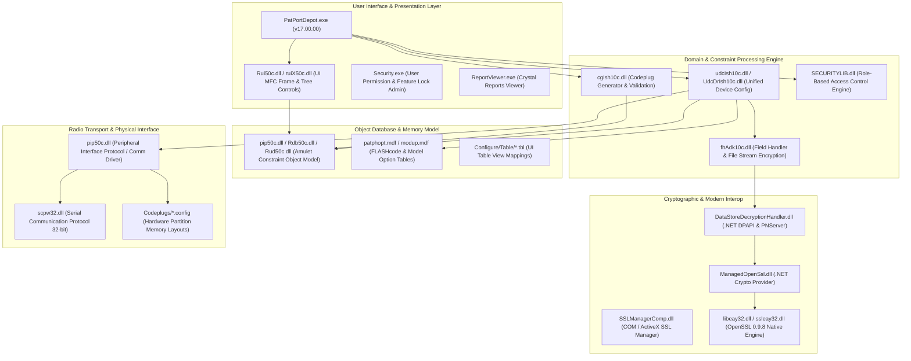

# Motorola ASTRO 25 Depot Software Suite: Exhaustive Reverse Engineering & Architecture Analysis

> [!IMPORTANT]
> This document contains an exhaustive static, binary, and structural reverse-engineering analysis of **all 265 files** within the Motorola ASTRO 25 Portable Depot installation suite (`C:\Program Files (x86)\Motorola\ASTRO 25 Products\ASTRO 25 Portable Depot`). It documents every DLL, executable, model definition (.mdf), configuration (.config), database table (.tbl), report template (.rpt), and cryptographic component.

## 1. Architectural Blueprint & Component Map

The ASTRO 25 Portable Depot software (ADK version `ADK7_2_SP04_SR13`, Application version `17.00.00`) is built upon an layered, object-oriented constraint-based architecture originally developed around the **Carnegie Mellon University Amulet C++ Object System** and Motorola's proprietary **Astro Development Kit (ADK)**.

## 2. Hardware Memory Map & Partition Configurations (`Codeplugs/*.config`)

The suite contains hardware partition memory definitions specifying exact base addresses, block counts, and block sizes in ASTRO 25 flash memory:

| Configuration File | Target Hardware Partition | Start Address | Num Blocks | Block Size | Total Size | Characteristics |
|---|---|---|---|---|---|---|
| `Codeplugs\security.config` | **Partition `0x81` (Security / UDC Key Storage)** | `0x1000A000` | 2 | `0x2000` (8 KB) | 16 KB | Read/Write, Optimize=True. Holds runtime license bitmasks (`0x1005`), serial number (`0x1004`), and factory FLASHcode (`0x1006`). |
| `Codeplugs\external.config` | **Partition `0x80` (Codeplug External Storage)** | `0x10020000` | 6 | `0x10000` (64 KB) | 384 KB | Read/Write, Optimize=True. Holds all conventional/trunking personalities, zone channel layouts, scan lists, and physical switch controls. |
| `Codeplugs\radio_pvt_data.config` | **Partition `0x82` (RF Calibration & Tuning)** | `0x10100000` | 8 | `0x10000` (64 KB) | 512 KB | Read/Write, Optimize=True, binary payload `./radio_pvt_data_pbt.out`. Holds critical analog/RF alignment data. Protected by cleanroom flasher firewall. |

## 3. Core DLL & Executable Deep Reverse Engineering

### `DataStoreDecryptionHandler.dll`

- **File Size:** 12,800 bytes
- **SHA-256:** `486a05e5b3f0ed4f9630aab59354e9cad6a789c3074f53ada44f179b6264c0a7`
- **Architecture / Subsystem:** Machine `0x14c`, Format `.NET / Managed CIL`
- **PE Sections:** `.text`, `.rsrc`, `.reloc`
- **Exports:** 0 exported symbols

- **Imported DLL Dependencies:** 1 libraries (`mscoree.dll`)
  

Click to view imported DLL breakdown

  | Imported Library | Function Count | Key Imported Functions |
  |---|---|---|
  | `mscoree.dll` | 1 | `_CorDllMain` |

  

### `Keyhh.exe`

- **File Size:** 24,576 bytes
- **SHA-256:** `74c8d449519c07973d9c2590f792994b19915a296b0ba0b0f252bce0df727a91`
- **Architecture / Subsystem:** Machine `0x14c`, Format `Native PE`
- **PE Sections:** `.text`, `.rdata`, `.data`, `.rsrc`
- **Exports:** 0 exported symbols

- **Imported DLL Dependencies:** 5 libraries (`ADVAPI32.dll, KERNEL32.dll, USER32.dll, comdlg32.dll, ole32.dll`)
  

Click to view imported DLL breakdown

  | Imported Library | Function Count | Key Imported Functions |
  |---|---|---|
  | `ADVAPI32.dll` | 7 | `RegCreateKeyExA`, `RegSetValueExA`, `RegCloseKey`, `RegQueryValueExA` *(+3 more)* |
  | `KERNEL32.dll` | 21 | `GetCommandLineA`, `MapViewOfFile`, `CreateFileMappingA`, `lstrcmpiA` *(+17 more)* |
  | `USER32.dll` | 26 | `CharNextA`, `LoadIconA`, `SendMessageA`, `SetWindowLongA` *(+22 more)* |
  | `comdlg32.dll` | 1 | `GetOpenFileNameA` |
  | `ole32.dll` | 2 | `CoCreateInstance`, `CoInitialize` |

  

### `ManagedOpenSsl.dll`

- **File Size:** 138,752 bytes
- **SHA-256:** `cdc252b9c998d67d55174c6a8ca819530bb942d21d2ae1546a8893e2ad3d166d`
- **Architecture / Subsystem:** Machine `0x14c`, Format `.NET / Managed CIL`
- **PE Sections:** `.text`, `.rsrc`, `.reloc`
- **Exports:** 0 exported symbols

- **Imported DLL Dependencies:** 1 libraries (`mscoree.dll`)
  

Click to view imported DLL breakdown

  | Imported Library | Function Count | Key Imported Functions |
  |---|---|---|
  | `mscoree.dll` | 1 | `_CorDllMain` |

  

### `OtapRWCDTimerExe.exe`

- **File Size:** 24,576 bytes
- **SHA-256:** `18eb39f0f5551b1ca1fd02dddc00439e54bf100aba66a8e6576fb5e6d47396ee`
- **Architecture / Subsystem:** Machine `0x14c`, Format `Native PE`
- **PE Sections:** `.text`, `.rdata`, `.data`, `.rsrc`
- **Exports:** 0 exported symbols

- **Imported DLL Dependencies:** 6 libraries (`KERNEL32.dll, MFC42.DLL, MSVCRT.dll, OtapRWCDTimer.dll, USER32.dll, ole32.dll`)
  

Click to view imported DLL breakdown

  | Imported Library | Function Count | Key Imported Functions |
  |---|---|---|
  | `KERNEL32.dll` | 3 | `GetModuleHandleA`, `GetStartupInfoA`, `Sleep` |
  | `MFC42.DLL` | 117 | `ord_1576`, `ord_4376`, `ord_2726`, `ord_5265` *(+113 more)* |
  | `MSVCRT.dll` | 19 | `_except_handler3`, `_controlfp`, `__CxxFrameHandler`, `free` *(+15 more)* |
  | `OtapRWCDTimer.dll` | 7 | `SetOtapRWCDTimerFlag`, `GetOtapRWCDTimerVal`, `GetOtapRWCDTimerFlag`, `GetOtapAbortFlag` *(+3 more)* |
  | `USER32.dll` | 4 | `EnableWindow`, `SendMessageA`, `KillTimer`, `SetTimer` |
  | `ole32.dll` | 2 | `CoInitialize`, `CoUninitialize` |

  

### `PatPort.exe`

- **File Size:** 24,887,296 bytes
- **SHA-256:** `ae26c95c9fcc89cedc609f5d7d7feaf5ad7640b9d42cb7644e71d6a051b90cc4`
- **Architecture / Subsystem:** Machine `0x14c`, Format `Native PE`
- **PE Sections:** `.text`, `.rdata`, `.data`, `.rsrc`
- **Exports:** 178 exported symbols
  

Click to view exported APIs and demangled symbols

  | Ordinal | Mangled Export Name | Demangled C++ Signature / API |
  |---|---|---|
  | `1` | `??0Am_Constraint@@QAE@ABV0@@Z` | `public: __thiscall Am_Constraint::Am_Constraint(class Am_Constraint const &)` |
  | `2` | `??0Am_Constraint@@QAE@XZ` | `public: __thiscall Am_Constraint::Am_Constraint(void)` |
  | `3` | `??0Am_Constraint_Context@@QAE@ABV0@@Z` | `public: __thiscall Am_Constraint_Context::Am_Constraint_Context(class Am_Constraint_Context const &)` |
  | `4` | `??0Am_Constraint_Context@@QAE@XZ` | `public: __thiscall Am_Constraint_Context::Am_Constraint_Context(void)` |
  | `5` | `??0Am_Demon_Queue@@QAE@PAVAm_Demon_Queue_Data@@@Z` | `public: __thiscall Am_Demon_Queue::Am_Demon_Queue(class Am_Demon_Queue_Data *)` |
  | `6` | `??0Am_Demon_Set@@QAE@PAVAm_Demon_Set_Data@@@Z` | `public: __thiscall Am_Demon_Set::Am_Demon_Set(class Am_Demon_Set_Data *)` |
  | `7` | `??0Am_Formula@@QAE@ABV0@@Z` | `public: __thiscall Am_Formula::Am_Formula(class Am_Formula const &)` |
  | `8` | `??0Am_Formula_Advanced@@QAE@ABV0@@Z` | `public: __thiscall Am_Formula_Advanced::Am_Formula_Advanced(class Am_Formula_Advanced const &)` |
  | `9` | `??0Am_Formula_Advanced@@QAE@XZ` | `public: __thiscall Am_Formula_Advanced::Am_Formula_Advanced(void)` |
  | `10` | `??0Am_Instance_Iterator@@QAE@ABV0@@Z` | `public: __thiscall Am_Instance_Iterator::Am_Instance_Iterator(class Am_Instance_Iterator const &)` |
  | `11` | `??0Am_Load_Save_Context@@QAE@PAVAm_Load_Save_Context_Data@@@Z` | `public: __thiscall Am_Load_Save_Context::Am_Load_Save_Context(class Am_Load_Save_Context_Data *)` |
  | `12` | `??0Am_Load_Save_Context@@QAE@XZ` | `public: __thiscall Am_Load_Save_Context::Am_Load_Save_Context(void)` |
  | `13` | `??0Am_MapIterator_CStr2Int@@QAE@PBVAm_Map_CStr2Int@@@Z` | `public: __thiscall Am_MapIterator_CStr2Int::Am_MapIterator_CStr2Int(class Am_Map_CStr2Int const *)` |
  | `14` | `??0Am_MapIterator_Int2Str@@QAE@PBVAm_Map_Int2Str@@@Z` | `public: __thiscall Am_MapIterator_Int2Str::Am_MapIterator_Int2Str(class Am_Map_Int2Str const *)` |
  | `15` | `??0Am_Map_CStr2Int@@QAE@ABV0@@Z` | `public: __thiscall Am_Map_CStr2Int::Am_Map_CStr2Int(class Am_Map_CStr2Int const &)` |
  | `16` | `??0Am_Map_Int2Str@@QAE@ABV0@@Z` | `public: __thiscall Am_Map_Int2Str::Am_Map_Int2Str(class Am_Map_Int2Str const &)` |
  | `17` | `??0Am_Method_Wrapper@@QAE@ABV0@@Z` | `public: __thiscall Am_Method_Wrapper::Am_Method_Wrapper(class Am_Method_Wrapper const &)` |
  | `18` | `??0Am_Object@@QAE@PAVAm_Object_Data@@@Z` | `public: __thiscall Am_Object::Am_Object(class Am_Object_Data *)` |
  | `19` | `??0Am_Object@@QAE@XZ` | `public: __thiscall Am_Object::Am_Object(void)` |
  | `20` | `??0Am_Object_Advanced@@QAE@ABV0@@Z` | `public: __thiscall Am_Object_Advanced::Am_Object_Advanced(class Am_Object_Advanced const &)` |
  | `21` | `??0Am_Part_Iterator@@QAE@ABV0@@Z` | `public: __thiscall Am_Part_Iterator::Am_Part_Iterator(class Am_Part_Iterator const &)` |
  | `22` | `??0Am_Registered_Type@@QAE@ABV0@@Z` | `public: __thiscall Am_Registered_Type::Am_Registered_Type(class Am_Registered_Type const &)` |
  | `23` | `??0Am_Registered_Type@@QAE@XZ` | `public: __thiscall Am_Registered_Type::Am_Registered_Type(void)` |
  | `24` | `??0Am_Slot@@QAE@PAVAm_Slot_Data@@@Z` | `public: __thiscall Am_Slot::Am_Slot(class Am_Slot_Data *)` |
  | `25` | `??0Am_Slot@@QAE@XZ` | `public: __thiscall Am_Slot::Am_Slot(void)` |
  | `26` | `??0Am_Slot_Iterator@@QAE@ABV0@@Z` | `public: __thiscall Am_Slot_Iterator::Am_Slot_Iterator(class Am_Slot_Iterator const &)` |
  | `27` | `??0Am_String@@QAE@PAVAm_String_Data@@@Z` | `public: __thiscall Am_String::Am_String(class Am_String_Data *)` |
  | `28` | `??0Am_String@@QAE@XZ` | `public: __thiscall Am_String::Am_String(void)` |
  | `29` | `??0Am_Symbol_Table@@QAE@ABV0@@Z` | `public: __thiscall Am_Symbol_Table::Am_Symbol_Table(class Am_Symbol_Table const &)` |
  | `30` | `??0Am_Symbol_Table@@QAE@H@Z` | `public: __thiscall Am_Symbol_Table::Am_Symbol_Table(int)` |
  | `31` | `??0Am_Value@@QAE@D@Z` | `public: __thiscall Am_Value::Am_Value(char)` |
  | `32` | `??0Am_Value@@QAE@H@Z` | `public: __thiscall Am_Value::Am_Value(int)` |
  | `33` | `??0Am_Value@@QAE@J@Z` | `public: __thiscall Am_Value::Am_Value(long)` |
  | `34` | `??0Am_Value@@QAE@M@Z` | `public: __thiscall Am_Value::Am_Value(float)` |
  | `35` | `??0Am_Value@@QAE@P6AXXZ@Z` | `public: __thiscall Am_Value::Am_Value(void (__cdecl*)(void))` |
  | `36` | `??0Am_Value@@QAE@PAE@Z` | `public: __thiscall Am_Value::Am_Value(unsigned char *)` |
  | `37` | `??0Am_Value@@QAE@XZ` | `public: __thiscall Am_Value::Am_Value(void)` |
  | `38` | `??0Am_Value@@QAE@_N@Z` | `public: __thiscall Am_Value::Am_Value(bool)` |
  | `39` | `??0Am_Value_List@@QAE@PAVAm_Value_List_Data@@@Z` | `public: __thiscall Am_Value_List::Am_Value_List(class Am_Value_List_Data *)` |
  | `40` | `??0Am_Wrapper@@QAE@ABV0@@Z` | `public: __thiscall Am_Wrapper::Am_Wrapper(class Am_Wrapper const &)` |
  | ... | ... | *(+ 138 additional exported symbols)* |

  

- **Imported DLL Dependencies:** 28 libraries (`ADVAPI32.dll, COMCTL32.dll, GDI32.dll, IBFS32.dll, KERNEL32.dll, MFC42.DLL, MSVCIRT.dll, MSVCRT.dll, OLEAUT32.dll, OtapRWCDTimer.dll, PIP50C.dll, PortManager10.dll, RDB50C.dll, RUD50C.dll, RUI50C.dll, SHELL32.dll, USER32.dll, VERSION.dll, WS2_32.dll, adkGen10c.dll, cgIsh10c.dll, fhAdk10c.dll, ole32.dll, ruiX50c.dll, udcDrIsh10c.dll, udcDrXAdk10c.dll, udcIsh10c.dll, udcXAdk10c.dll`)
  

Click to view imported DLL breakdown

  | Imported Library | Function Count | Key Imported Functions |
  |---|---|---|
  | `ADVAPI32.dll` | 18 | `CryptReleaseContext`, `CryptExportKey`, `CryptImportKey`, `CryptGetUserKey` *(+14 more)* |
  | `COMCTL32.dll` | 1 | `ImageList_ReplaceIcon` |
  | `GDI32.dll` | 5 | `CreatePatternBrush`, `GetObjectA`, `CreateCompatibleDC`, `BitBlt` *(+1 more)* |
  | `IBFS32.dll` | 23 | `TMCRC`, `TMRom`, `TMFirst`, `TMNext` *(+19 more)* |
  | `KERNEL32.dll` | 45 | `CreateEventA`, `SetThreadPriority`, `ResetEvent`, `WaitForSingleObject` *(+41 more)* |
  | `MFC42.DLL` | 569 | `ord_3719`, `ord_793`, `ord_6093`, `ord_3525` *(+565 more)* |
  | `MSVCIRT.dll` | 12 | `??6ostream@@QAEAAV0@PBD@Z`, `??_Dofstream@@QAEXXZ`, `?openprot@filebuf@@2HB`, `??6ostream@@QAEAAV0@P6AAAV0@AAV0@@Z@Z` *(+8 more)* |
  | `MSVCRT.dll` | 85 | `_setmbcp`, `wcslen`, `_controlfp`, `__set_app_type` *(+81 more)* |
  | `OLEAUT32.dll` | 18 | `GetErrorInfo`, `SysAllocStringLen`, `SysStringLen`, `SafeArrayDestroyData` *(+14 more)* |
  | `OtapRWCDTimer.dll` | 4 | `SetOtapRWCDTimerVal`, `StopOtapRWCDTimer`, `SetOtapRWLock`, `StartOtapRWCDTimer` |
  | `PIP50C.dll` | 150 | `?Add@Am_Value_List@@QAEAAV1@NE_N@Z`, `??4Am_Value@@QAEAAV0@J@Z`, `??4Am_Value@@QAEAAV0@PBD@Z`, `?Add@Am_Value_List@@QAEAAV1@_NE0@Z` *(+146 more)* |
  | `PortManager10.dll` | 3 | `??0CPortManager@@QAE@XZ`, `?ListDevices@CPortManager@@QAEKAAUDeviceList@@J@Z`, `??1CPortManager@@QAE@XZ` |
  | `RDB50C.dll` | 135 | `?rdkNullObject@@3VAm_Object@@A`, `?GetSlotID@CDbFieldAccess@@QBEIXZ`, `?adkFilterRecordCriteriaFunction_ID@adkFilterRecordCriteriaFunction@@2GA`, `??0adkFilterRecordCriteriaFunction@@QAE@PAVAm_Method_Wrapper@@P6A_NABVCDbRecRefIndex@@ABVCDbRecSet@@HABVAm_Value@@@Z@Z` *(+131 more)* |
  | `RUD50C.dll` | 223 | `??0CudRecTblDlg@@QAE@IIIPAVCWnd@@@Z`, `??0CudXchgInfo@@QAE@XZ`, `?DoDataExchange@CudRecTblDlg@@MAEXPAVCDataExchange@@@Z`, `?messageMap@CudRecTblDlg@@1UAFX_MSGMAP@@B` *(+219 more)* |
  | `RUI50C.dll` | 346 | `?AppDeleteTblMultipleRecords@CUiTblControlDlg@@UAEHPAVCUIntArray@@@Z`, `?AppMoveTblRecord@CUiTblControlDlg@@UAEHII@Z`, `?AppDeleteTblRecord@CUiTblControlDlg@@UAEHI@Z`, `?AppInsertTblRecAt@CUiTblControlDlg@@UAEHII@Z` *(+342 more)* |
  | `SHELL32.dll` | 6 | `SHBrowseForFolderA`, `SHGetPathFromIDListA`, `SHGetMalloc`, `ShellExecuteA` *(+2 more)* |
  | `USER32.dll` | 59 | `DestroyAcceleratorTable`, `CreateAcceleratorTableA`, `CopyAcceleratorTableA`, `GetSysColor` *(+55 more)* |
  | `VERSION.dll` | 2 | `GetFileVersionInfoSizeA`, `GetFileVersionInfoA` |
  | `WS2_32.dll` | 2 | `WSAStartup`, `WSACleanup` |
  | `adkGen10c.dll` | 5 | `?GetRuntimeClass@CAdkGenException@@UBEPAUCRuntimeClass@@XZ`, `??0CAdkGenException@@QAE@VCString@@I@Z`, `??1CAdkGenException@@UAE@XZ`, `?GetErrorMessage@CAdkGenException@@UAEHPADIPAI@Z` *(+1 more)* |
  | `cgIsh10c.dll` | 87 | `??1CcgIshListFieldLayout@@UAE@XZ`, `??1CcgIshBlkLayout@@UAE@XZ`, `??1CcgIshILSBlkLayout@@UAE@XZ`, `??1CcgIshDataLayout@@UAE@XZ` *(+83 more)* |
  | `fhAdk10c.dll` | 12 | `??0CFhAdkFileHeader@@QAE@IW4AdkType@AdkCommonEnums@@ABU_GUID@@VCString@@22P6AEABVCByteArray@@@ZW4EncryptType@AdkMotFhHeader@@@Z`, `?GetFileExtension@CFhAdkFileHandler@@SA?AVCString@@W4FileType@1@@Z`, `?fhAdkCalcChecksum@@YAEABVCByteArray@@@Z`, `??1CFhAdkFileHeader@@UAE@XZ` *(+8 more)* |
  | `ole32.dll` | 11 | `CoGetClassObject`, `CLSIDFromString`, `OleRun`, `CoCreateInstance` *(+7 more)* |
  | `ruiX50c.dll` | 10 | `?OnTypeChange@CUiFileDlg@@UAEXXZ`, `?OnFolderChange@CUiFileDlg@@UAEXXZ`, `?OnFileNameChange@CUiFileDlg@@UAEXXZ`, `?OnFileNameOK@CUiFileDlg@@UAEHXZ` *(+6 more)* |
  | `udcDrIsh10c.dll` | 33 | `?OnRdkReadDeviceDirect@CudcDrIshDoc@@IAEXXZ`, `?AppGetPortNames@CudcDrIshMainFrm@@MBEHAAVCStringArray@@@Z`, `?OnRdkReadDeviceDirect@CudcDrIshMainFrm@@QAEXXZ`, `?OnRdkReadDevice@CudcDrIshMainFrm@@QAEXXZ` *(+29 more)* |
  | `udcDrXAdk10c.dll` | 1 | `?udcDrXAdkGetPortFromUser@@YAHAAVCString@@AAH1AAVCStringArray@@@Z` |
  | `udcIsh10c.dll` | 87 | `?GetCpLayout@CudcIshDoc@@QBEPBVCcgIshCpLayout@@XZ`, `?OnSaveDocument@CudcIshDoc@@UAEHPBD@Z`, `?ResetRdkCallingAppInfo@CudcIshDoc@@QAEXXZ`, `?DeletePackCpDb@CudcIshDbToImage@@IAEXXZ` *(+83 more)* |
  | `udcXAdk10c.dll` | 11 | `?AppGetMaxModelNoLength@CudcXAdkFileDlg@@MAEIXZ`, `?GetInfoFromFile@CudcXAdkFileDlg@@MAE?AUstrUiFileDlgInfo@@VCString@@@Z`, `?GetDirPathFromRegistry@CudcXAdkFileDlg@@MBEHHAAVCString@@@Z`, `?AppGetMaxQuickInfoLength@CudcXAdkFileDlg@@MAEIXZ` *(+7 more)* |

  

### `PatPortDepot.exe`

- **File Size:** 25,079,808 bytes
- **SHA-256:** `3e8ce5c588080205945f8ad54d078a77052a5b2f4b90e4cf11f5a1fef1867669`
- **Architecture / Subsystem:** Machine `0x14c`, Format `Native PE`
- **PE Sections:** `.text`, `.rdata`, `.data`, `.rsrc`
- **Exports:** 178 exported symbols
  

Click to view exported APIs and demangled symbols

  | Ordinal | Mangled Export Name | Demangled C++ Signature / API |
  |---|---|---|
  | `1` | `??0Am_Constraint@@QAE@ABV0@@Z` | `public: __thiscall Am_Constraint::Am_Constraint(class Am_Constraint const &)` |
  | `2` | `??0Am_Constraint@@QAE@XZ` | `public: __thiscall Am_Constraint::Am_Constraint(void)` |
  | `3` | `??0Am_Constraint_Context@@QAE@ABV0@@Z` | `public: __thiscall Am_Constraint_Context::Am_Constraint_Context(class Am_Constraint_Context const &)` |
  | `4` | `??0Am_Constraint_Context@@QAE@XZ` | `public: __thiscall Am_Constraint_Context::Am_Constraint_Context(void)` |
  | `5` | `??0Am_Demon_Queue@@QAE@PAVAm_Demon_Queue_Data@@@Z` | `public: __thiscall Am_Demon_Queue::Am_Demon_Queue(class Am_Demon_Queue_Data *)` |
  | `6` | `??0Am_Demon_Set@@QAE@PAVAm_Demon_Set_Data@@@Z` | `public: __thiscall Am_Demon_Set::Am_Demon_Set(class Am_Demon_Set_Data *)` |
  | `7` | `??0Am_Formula@@QAE@ABV0@@Z` | `public: __thiscall Am_Formula::Am_Formula(class Am_Formula const &)` |
  | `8` | `??0Am_Formula_Advanced@@QAE@ABV0@@Z` | `public: __thiscall Am_Formula_Advanced::Am_Formula_Advanced(class Am_Formula_Advanced const &)` |
  | `9` | `??0Am_Formula_Advanced@@QAE@XZ` | `public: __thiscall Am_Formula_Advanced::Am_Formula_Advanced(void)` |
  | `10` | `??0Am_Instance_Iterator@@QAE@ABV0@@Z` | `public: __thiscall Am_Instance_Iterator::Am_Instance_Iterator(class Am_Instance_Iterator const &)` |
  | `11` | `??0Am_Load_Save_Context@@QAE@PAVAm_Load_Save_Context_Data@@@Z` | `public: __thiscall Am_Load_Save_Context::Am_Load_Save_Context(class Am_Load_Save_Context_Data *)` |
  | `12` | `??0Am_Load_Save_Context@@QAE@XZ` | `public: __thiscall Am_Load_Save_Context::Am_Load_Save_Context(void)` |
  | `13` | `??0Am_MapIterator_CStr2Int@@QAE@PBVAm_Map_CStr2Int@@@Z` | `public: __thiscall Am_MapIterator_CStr2Int::Am_MapIterator_CStr2Int(class Am_Map_CStr2Int const *)` |
  | `14` | `??0Am_MapIterator_Int2Str@@QAE@PBVAm_Map_Int2Str@@@Z` | `public: __thiscall Am_MapIterator_Int2Str::Am_MapIterator_Int2Str(class Am_Map_Int2Str const *)` |
  | `15` | `??0Am_Map_CStr2Int@@QAE@ABV0@@Z` | `public: __thiscall Am_Map_CStr2Int::Am_Map_CStr2Int(class Am_Map_CStr2Int const &)` |
  | `16` | `??0Am_Map_Int2Str@@QAE@ABV0@@Z` | `public: __thiscall Am_Map_Int2Str::Am_Map_Int2Str(class Am_Map_Int2Str const &)` |
  | `17` | `??0Am_Method_Wrapper@@QAE@ABV0@@Z` | `public: __thiscall Am_Method_Wrapper::Am_Method_Wrapper(class Am_Method_Wrapper const &)` |
  | `18` | `??0Am_Object@@QAE@PAVAm_Object_Data@@@Z` | `public: __thiscall Am_Object::Am_Object(class Am_Object_Data *)` |
  | `19` | `??0Am_Object@@QAE@XZ` | `public: __thiscall Am_Object::Am_Object(void)` |
  | `20` | `??0Am_Object_Advanced@@QAE@ABV0@@Z` | `public: __thiscall Am_Object_Advanced::Am_Object_Advanced(class Am_Object_Advanced const &)` |
  | `21` | `??0Am_Part_Iterator@@QAE@ABV0@@Z` | `public: __thiscall Am_Part_Iterator::Am_Part_Iterator(class Am_Part_Iterator const &)` |
  | `22` | `??0Am_Registered_Type@@QAE@ABV0@@Z` | `public: __thiscall Am_Registered_Type::Am_Registered_Type(class Am_Registered_Type const &)` |
  | `23` | `??0Am_Registered_Type@@QAE@XZ` | `public: __thiscall Am_Registered_Type::Am_Registered_Type(void)` |
  | `24` | `??0Am_Slot@@QAE@PAVAm_Slot_Data@@@Z` | `public: __thiscall Am_Slot::Am_Slot(class Am_Slot_Data *)` |
  | `25` | `??0Am_Slot@@QAE@XZ` | `public: __thiscall Am_Slot::Am_Slot(void)` |
  | `26` | `??0Am_Slot_Iterator@@QAE@ABV0@@Z` | `public: __thiscall Am_Slot_Iterator::Am_Slot_Iterator(class Am_Slot_Iterator const &)` |
  | `27` | `??0Am_String@@QAE@PAVAm_String_Data@@@Z` | `public: __thiscall Am_String::Am_String(class Am_String_Data *)` |
  | `28` | `??0Am_String@@QAE@XZ` | `public: __thiscall Am_String::Am_String(void)` |
  | `29` | `??0Am_Symbol_Table@@QAE@ABV0@@Z` | `public: __thiscall Am_Symbol_Table::Am_Symbol_Table(class Am_Symbol_Table const &)` |
  | `30` | `??0Am_Symbol_Table@@QAE@H@Z` | `public: __thiscall Am_Symbol_Table::Am_Symbol_Table(int)` |
  | `31` | `??0Am_Value@@QAE@D@Z` | `public: __thiscall Am_Value::Am_Value(char)` |
  | `32` | `??0Am_Value@@QAE@H@Z` | `public: __thiscall Am_Value::Am_Value(int)` |
  | `33` | `??0Am_Value@@QAE@J@Z` | `public: __thiscall Am_Value::Am_Value(long)` |
  | `34` | `??0Am_Value@@QAE@M@Z` | `public: __thiscall Am_Value::Am_Value(float)` |
  | `35` | `??0Am_Value@@QAE@P6AXXZ@Z` | `public: __thiscall Am_Value::Am_Value(void (__cdecl*)(void))` |
  | `36` | `??0Am_Value@@QAE@PAE@Z` | `public: __thiscall Am_Value::Am_Value(unsigned char *)` |
  | `37` | `??0Am_Value@@QAE@XZ` | `public: __thiscall Am_Value::Am_Value(void)` |
  | `38` | `??0Am_Value@@QAE@_N@Z` | `public: __thiscall Am_Value::Am_Value(bool)` |
  | `39` | `??0Am_Value_List@@QAE@PAVAm_Value_List_Data@@@Z` | `public: __thiscall Am_Value_List::Am_Value_List(class Am_Value_List_Data *)` |
  | `40` | `??0Am_Wrapper@@QAE@ABV0@@Z` | `public: __thiscall Am_Wrapper::Am_Wrapper(class Am_Wrapper const &)` |
  | ... | ... | *(+ 138 additional exported symbols)* |

  

- **Imported DLL Dependencies:** 28 libraries (`ADVAPI32.dll, COMCTL32.dll, GDI32.dll, IBFS32.dll, KERNEL32.dll, MFC42.DLL, MSVCIRT.dll, MSVCRT.dll, OLEAUT32.dll, OtapRWCDTimer.dll, PIP50C.dll, PortManager10.dll, RDB50C.dll, RUD50C.dll, RUI50C.dll, SHELL32.dll, USER32.dll, VERSION.dll, WS2_32.dll, adkGen10c.dll, cgIsh10c.dll, fhAdk10c.dll, ole32.dll, ruiX50c.dll, udcDrIsh10c.dll, udcDrXAdk10c.dll, udcIsh10c.dll, udcXAdk10c.dll`)
  

Click to view imported DLL breakdown

  | Imported Library | Function Count | Key Imported Functions |
  |---|---|---|
  | `ADVAPI32.dll` | 18 | `CryptReleaseContext`, `CryptExportKey`, `CryptImportKey`, `CryptGetUserKey` *(+14 more)* |
  | `COMCTL32.dll` | 1 | `ImageList_ReplaceIcon` |
  | `GDI32.dll` | 5 | `CreatePatternBrush`, `GetObjectA`, `CreateCompatibleDC`, `BitBlt` *(+1 more)* |
  | `IBFS32.dll` | 23 | `TMCRC`, `TMRom`, `TMFirst`, `TMNext` *(+19 more)* |
  | `KERNEL32.dll` | 45 | `CreateEventA`, `SetThreadPriority`, `ResetEvent`, `WaitForSingleObject` *(+41 more)* |
  | `MFC42.DLL` | 579 | `ord_5602`, `ord_5583`, `ord_290`, `ord_614` *(+575 more)* |
  | `MSVCIRT.dll` | 12 | `??6ostream@@QAEAAV0@PBD@Z`, `??_Dofstream@@QAEXXZ`, `?openprot@filebuf@@2HB`, `??6ostream@@QAEAAV0@P6AAAV0@AAV0@@Z@Z` *(+8 more)* |
  | `MSVCRT.dll` | 85 | `_setmbcp`, `wcslen`, `_controlfp`, `__set_app_type` *(+81 more)* |
  | `OLEAUT32.dll` | 18 | `GetErrorInfo`, `SysAllocStringLen`, `SysStringLen`, `SafeArrayDestroyData` *(+14 more)* |
  | `OtapRWCDTimer.dll` | 4 | `SetOtapRWCDTimerVal`, `StopOtapRWCDTimer`, `SetOtapRWLock`, `StartOtapRWCDTimer` |
  | `PIP50C.dll` | 150 | `?Add@Am_Value_List@@QAEAAV1@NE_N@Z`, `??4Am_Value@@QAEAAV0@J@Z`, `??4Am_Value@@QAEAAV0@PBD@Z`, `?Add@Am_Value_List@@QAEAAV1@_NE0@Z` *(+146 more)* |
  | `PortManager10.dll` | 3 | `??1CPortManager@@QAE@XZ`, `??0CPortManager@@QAE@XZ`, `?ListDevices@CPortManager@@QAEKAAUDeviceList@@J@Z` |
  | `RDB50C.dll` | 135 | `?rdkNullObject@@3VAm_Object@@A`, `?GetSlotID@CDbFieldAccess@@QBEIXZ`, `?adkFilterRecordCriteriaFunction_ID@adkFilterRecordCriteriaFunction@@2GA`, `??0adkFilterRecordCriteriaFunction@@QAE@PAVAm_Method_Wrapper@@P6A_NABVCDbRecRefIndex@@ABVCDbRecSet@@HABVAm_Value@@@Z@Z` *(+131 more)* |
  | `RUD50C.dll` | 223 | `??0CudRecTblDlg@@QAE@IIIPAVCWnd@@@Z`, `??0CudXchgInfo@@QAE@XZ`, `?DoDataExchange@CudRecTblDlg@@MAEXPAVCDataExchange@@@Z`, `?messageMap@CudRecTblDlg@@1UAFX_MSGMAP@@B` *(+219 more)* |
  | `RUI50C.dll` | 346 | `?AppDeleteTblMultipleRecords@CUiTblControlDlg@@UAEHPAVCUIntArray@@@Z`, `?AppMoveTblRecord@CUiTblControlDlg@@UAEHII@Z`, `?AppDeleteTblRecord@CUiTblControlDlg@@UAEHI@Z`, `?AppInsertTblRecAt@CUiTblControlDlg@@UAEHII@Z` *(+342 more)* |
  | `SHELL32.dll` | 6 | `SHBrowseForFolderA`, `SHGetPathFromIDListA`, `SHGetMalloc`, `ShellExecuteA` *(+2 more)* |
  | `USER32.dll` | 59 | `DestroyAcceleratorTable`, `CreateAcceleratorTableA`, `CopyAcceleratorTableA`, `GetSysColor` *(+55 more)* |
  | `VERSION.dll` | 2 | `GetFileVersionInfoSizeA`, `GetFileVersionInfoA` |
  | `WS2_32.dll` | 2 | `WSAStartup`, `WSACleanup` |
  | `adkGen10c.dll` | 5 | `?GetRuntimeClass@CAdkGenException@@UBEPAUCRuntimeClass@@XZ`, `??0CAdkGenException@@QAE@VCString@@I@Z`, `??1CAdkGenException@@UAE@XZ`, `?GetErrorMessage@CAdkGenException@@UAEHPADIPAI@Z` *(+1 more)* |
  | `cgIsh10c.dll` | 87 | `??1CcgIshListFieldLayout@@UAE@XZ`, `??1CcgIshBlkLayout@@UAE@XZ`, `??1CcgIshILSBlkLayout@@UAE@XZ`, `??1CcgIshDataLayout@@UAE@XZ` *(+83 more)* |
  | `fhAdk10c.dll` | 12 | `??0CFhAdkFileHeader@@QAE@IW4AdkType@AdkCommonEnums@@ABU_GUID@@VCString@@22P6AEABVCByteArray@@@ZW4EncryptType@AdkMotFhHeader@@@Z`, `?GetFileExtension@CFhAdkFileHandler@@SA?AVCString@@W4FileType@1@@Z`, `?fhAdkCalcChecksum@@YAEABVCByteArray@@@Z`, `??1CFhAdkFileHeader@@UAE@XZ` *(+8 more)* |
  | `ole32.dll` | 11 | `CoGetClassObject`, `CLSIDFromString`, `OleRun`, `CoCreateInstance` *(+7 more)* |
  | `ruiX50c.dll` | 10 | `?OnTypeChange@CUiFileDlg@@UAEXXZ`, `?OnFolderChange@CUiFileDlg@@UAEXXZ`, `?OnFileNameChange@CUiFileDlg@@UAEXXZ`, `?OnFileNameOK@CUiFileDlg@@UAEHXZ` *(+6 more)* |
  | `udcDrIsh10c.dll` | 33 | `?GetPortName@CudcDrIshMainFrm@@QBE?AVCString@@XZ`, `??0CudcDrIshCmdLine@@QAE@XZ`, `?AppGetPortNames@CudcDrIshMainFrm@@MBEHAAVCStringArray@@@Z`, `?OnRdkReadDeviceDirect@CudcDrIshMainFrm@@QAEXXZ` *(+29 more)* |
  | `udcDrXAdk10c.dll` | 1 | `?udcDrXAdkGetPortFromUser@@YAHAAVCString@@AAH1AAVCStringArray@@@Z` |
  | `udcIsh10c.dll` | 86 | `?OnSaveDocument@CudcIshDoc@@UAEHPBD@Z`, `?ResetRdkCallingAppInfo@CudcIshDoc@@QAEXXZ`, `?DeletePackCpDb@CudcIshDbToImage@@IAEXXZ`, `?InitRdkCallingAppInfo@CudcIshDoc@@QAEXW4Direction@1@W4FileType@CFhAdkFileHandler@@@Z` *(+82 more)* |
  | `udcXAdk10c.dll` | 11 | `?AppGetMaxModelNoLength@CudcXAdkFileDlg@@MAEIXZ`, `?GetInfoFromFile@CudcXAdkFileDlg@@MAE?AUstrUiFileDlgInfo@@VCString@@@Z`, `?GetDirPathFromRegistry@CudcXAdkFileDlg@@MBEHHAAVCString@@@Z`, `?AppGetMaxQuickInfoLength@CudcXAdkFileDlg@@MAEIXZ` *(+7 more)* |

  

### `Prn50c.dll`

- **File Size:** 192,512 bytes
- **SHA-256:** `fba8dd2b7d9117769d75cedb93251657e55292006a8f1216504a92a4c0014e42`
- **Architecture / Subsystem:** Machine `0x14c`, Format `Native PE`
- **PE Sections:** `.text`, `.rdata`, `.data`, `.rsrc`, `.reloc`
- **Exports:** 219 exported symbols
  

Click to view exported APIs and demangled symbols

  | Ordinal | Mangled Export Name | Demangled C++ Signature / API |
  |---|---|---|
  | `1` | `??0CPrListPrintJob@@QAE@PBDHPAV?$CArray@PAVCPrPageSetMergeInfo@@AAPAV1@@@@Z` | `public: __thiscall CPrListPrintJob::CPrListPrintJob(char const *,int,class CArray<class CPrPageSetMergeInfo *,class CPrPageSetMergeInfo * &> *)` |
  | `2` | `??0CPrLogicalCheckbox@@QAE@ABV0@@Z` | `public: __thiscall CPrLogicalCheckbox::CPrLogicalCheckbox(class CPrLogicalCheckbox const &)` |
  | `3` | `??0CPrLogicalCheckbox@@QAE@PBD0HHH@Z` | `public: __thiscall CPrLogicalCheckbox::CPrLogicalCheckbox(char const *,char const *,int,int,int)` |
  | `4` | `??0CPrLogicalGroup@@QAE@ABV0@@Z` | `public: __thiscall CPrLogicalGroup::CPrLogicalGroup(class CPrLogicalGroup const &)` |
  | `5` | `??0CPrLogicalGroup@@QAE@PBDHH@Z` | `public: __thiscall CPrLogicalGroup::CPrLogicalGroup(char const *,int,int)` |
  | `6` | `??0CPrLogicalLine@@QAE@ABV0@@Z` | `public: __thiscall CPrLogicalLine::CPrLogicalLine(class CPrLogicalLine const &)` |
  | `7` | `??0CPrLogicalLine@@QAE@PBD00HHPAUHFONT__@@@Z` | `public: __thiscall CPrLogicalLine::CPrLogicalLine(char const *,char const *,char const *,int,int,struct HFONT__ *)` |
  | `8` | `??0CPrLogicalList@@QAE@ABV0@@Z` | `public: __thiscall CPrLogicalList::CPrLogicalList(class CPrLogicalList const &)` |
  | `9` | `??0CPrLogicalList@@QAE@PBDAAVCStringList@@HH@Z` | `public: __thiscall CPrLogicalList::CPrLogicalList(char const *,class CStringList &,int,int)` |
  | `10` | `??0CPrLogicalPage@@QAE@ABV0@@Z` | `public: __thiscall CPrLogicalPage::CPrLogicalPage(class CPrLogicalPage const &)` |
  | `11` | `??0CPrLogicalPage@@QAE@XZ` | `public: __thiscall CPrLogicalPage::CPrLogicalPage(void)` |
  | `12` | `??0CPrLogicalPageSet@@QAE@W4PrintFormat@0@PBDH@Z` | `public: __thiscall CPrLogicalPageSet::CPrLogicalPageSet(enum CPrLogicalPageSet::PrintFormat,char const *,int)` |
  | `13` | `??0CPrLogicalTable@@QAE@ABV0@@Z` | `public: __thiscall CPrLogicalTable::CPrLogicalTable(class CPrLogicalTable const &)` |
  | `14` | `??0CPrLogicalTable@@QAE@HAAVCStringList@@PBDHH@Z` | `public: __thiscall CPrLogicalTable::CPrLogicalTable(int,class CStringList &,char const *,int,int)` |
  | `15` | `??0CPrPageSetMergeInfo@@QAE@XZ` | `public: __thiscall CPrPageSetMergeInfo::CPrPageSetMergeInfo(void)` |
  | `16` | `??0CPrPhysicalPage@@QAE@PAUCPrintInfo@@PBVCPrPrintInfo@@@Z` | `public: __thiscall CPrPhysicalPage::CPrPhysicalPage(struct CPrintInfo *,class CPrPrintInfo const *)` |
  | `17` | `??0CPrPhysicalPage@@QAE@PBV0@@Z` | `public: __thiscall CPrPhysicalPage::CPrPhysicalPage(class CPrPhysicalPage const *)` |
  | `18` | `??0CPrPrintInfo@@QAE@PBVCDocument@@@Z` | `public: __thiscall CPrPrintInfo::CPrPrintInfo(class CDocument const *)` |
  | `19` | `??0CPrPrintItem@@QAE@ABV0@@Z` | `public: __thiscall CPrPrintItem::CPrPrintItem(class CPrPrintItem const &)` |
  | `20` | `??0CPrPrintItem@@QAE@W4Pr_Item_Type@0@HHPAUHFONT__@@@Z` | `public: __thiscall CPrPrintItem::CPrPrintItem(enum CPrPrintItem::Pr_Item_Type,int,int,struct HFONT__ *)` |
  | `21` | `??0CPrPrintJob@@QAE@PBDHPAV?$CArray@PAVCPrPageSetMergeInfo@@AAPAV1@@@@Z` | `public: __thiscall CPrPrintJob::CPrPrintJob(char const *,int,class CArray<class CPrPageSetMergeInfo *,class CPrPageSetMergeInfo * &> *)` |
  | `22` | `??0CPrTablePrintJob@@QAE@PBDH@Z` | `public: __thiscall CPrTablePrintJob::CPrTablePrintJob(char const *,int)` |
  | `23` | `??0CPrTreePrintJob@@QAE@PBDH@Z` | `public: __thiscall CPrTreePrintJob::CPrTreePrintJob(char const *,int)` |
  | `24` | `??1CPrListPrintJob@@UAE@XZ` | `public: virtual __thiscall CPrListPrintJob::~CPrListPrintJob(void)` |
  | `25` | `??1CPrLogicalCheckbox@@UAE@XZ` | `public: virtual __thiscall CPrLogicalCheckbox::~CPrLogicalCheckbox(void)` |
  | `26` | `??1CPrLogicalGroup@@UAE@XZ` | `public: virtual __thiscall CPrLogicalGroup::~CPrLogicalGroup(void)` |
  | `27` | `??1CPrLogicalLine@@UAE@XZ` | `public: virtual __thiscall CPrLogicalLine::~CPrLogicalLine(void)` |
  | `28` | `??1CPrLogicalList@@UAE@XZ` | `public: virtual __thiscall CPrLogicalList::~CPrLogicalList(void)` |
  | `29` | `??1CPrLogicalPage@@UAE@XZ` | `public: virtual __thiscall CPrLogicalPage::~CPrLogicalPage(void)` |
  | `30` | `??1CPrLogicalPageSet@@UAE@XZ` | `public: virtual __thiscall CPrLogicalPageSet::~CPrLogicalPageSet(void)` |
  | `31` | `??1CPrLogicalTable@@UAE@XZ` | `public: virtual __thiscall CPrLogicalTable::~CPrLogicalTable(void)` |
  | `32` | `??1CPrPageSetMergeInfo@@UAE@XZ` | `public: virtual __thiscall CPrPageSetMergeInfo::~CPrPageSetMergeInfo(void)` |
  | `33` | `??1CPrPhysicalPage@@UAE@XZ` | `public: virtual __thiscall CPrPhysicalPage::~CPrPhysicalPage(void)` |
  | `34` | `??1CPrPrintInfo@@UAE@XZ` | `public: virtual __thiscall CPrPrintInfo::~CPrPrintInfo(void)` |
  | `35` | `??1CPrPrintItem@@UAE@XZ` | `public: virtual __thiscall CPrPrintItem::~CPrPrintItem(void)` |
  | `36` | `??1CPrPrintJob@@UAE@XZ` | `public: virtual __thiscall CPrPrintJob::~CPrPrintJob(void)` |
  | `37` | `??1CPrTablePrintJob@@UAE@XZ` | `public: virtual __thiscall CPrTablePrintJob::~CPrTablePrintJob(void)` |
  | `38` | `??1CPrTreePrintJob@@UAE@XZ` | `public: virtual __thiscall CPrTreePrintJob::~CPrTreePrintJob(void)` |
  | `39` | `??4CPrLogicalCheckbox@@QAE?AV0@ABV0@@Z` | `public: class CPrLogicalCheckbox __thiscall CPrLogicalCheckbox::operator=(class CPrLogicalCheckbox const &)` |
  | `40` | `??4CPrLogicalGroup@@QAE?AV0@ABV0@@Z` | `public: class CPrLogicalGroup __thiscall CPrLogicalGroup::operator=(class CPrLogicalGroup const &)` |
  | ... | ... | *(+ 179 additional exported symbols)* |

  

- **Imported DLL Dependencies:** 8 libraries (`ADVAPI32.dll, GDI32.dll, KERNEL32.dll, MFC42.DLL, MSVCRT.dll, OLEAUT32.dll, USER32.dll, ole32.dll`)
  

Click to view imported DLL breakdown

  | Imported Library | Function Count | Key Imported Functions |
  |---|---|---|
  | `ADVAPI32.dll` | 7 | `RegOpenKeyExA`, `RegSetValueExA`, `RegFlushKey`, `RegCloseKey` *(+3 more)* |
  | `GDI32.dll` | 6 | `LPtoDP`, `GetObjectA`, `GetDeviceCaps`, `CreateFontA` *(+2 more)* |
  | `KERNEL32.dll` | 12 | `FormatMessageA`, `CreateProcessA`, `GetLastError`, `GetExitCodeProcess` *(+8 more)* |
  | `MFC42.DLL` | 77 | `ord_6383`, `ord_6394`, `ord_3702`, `ord_501` *(+73 more)* |
  | `MSVCRT.dll` | 13 | `__CxxFrameHandler`, `_purecall`, `malloc`, `_CxxThrowException` *(+9 more)* |
  | `OLEAUT32.dll` | 7 | `GetErrorInfo`, `SysFreeString`, `SysAllocString`, `SysStringLen` *(+3 more)* |
  | `USER32.dll` | 3 | `SendMessageA`, `WaitForInputIdle`, `CopyRect` |
  | `ole32.dll` | 2 | `OleRun`, `CoCreateInstance` |

  

### `Rdb50c.dll`

- **File Size:** 180,224 bytes
- **SHA-256:** `3af488e647a6c86a5de6413e4ad94d7346367c584bc24da1254d58369d57bcc9`
- **Architecture / Subsystem:** Machine `0x14c`, Format `Native PE`
- **PE Sections:** `.text`, `.rdata`, `.data`, `.rsrc`, `.reloc`
- **Exports:** 453 exported symbols
  

Click to view exported APIs and demangled symbols

  | Ordinal | Mangled Export Name | Demangled C++ Signature / API |
  |---|---|---|
  | `1` | `??0Am_Constraint@@QAE@ABV0@@Z` | `public: __thiscall Am_Constraint::Am_Constraint(class Am_Constraint const &)` |
  | `2` | `??0Am_Constraint@@QAE@XZ` | `public: __thiscall Am_Constraint::Am_Constraint(void)` |
  | `3` | `??0Am_Constraint_Context@@QAE@ABV0@@Z` | `public: __thiscall Am_Constraint_Context::Am_Constraint_Context(class Am_Constraint_Context const &)` |
  | `4` | `??0Am_Constraint_Context@@QAE@XZ` | `public: __thiscall Am_Constraint_Context::Am_Constraint_Context(void)` |
  | `5` | `??0Am_Demon_Queue@@QAE@PAVAm_Demon_Queue_Data@@@Z` | `public: __thiscall Am_Demon_Queue::Am_Demon_Queue(class Am_Demon_Queue_Data *)` |
  | `6` | `??0Am_Demon_Queue_Data@@QAE@XZ` | `public: __thiscall Am_Demon_Queue_Data::Am_Demon_Queue_Data(void)` |
  | `7` | `??0Am_Demon_Set@@QAE@PAVAm_Demon_Set_Data@@@Z` | `public: __thiscall Am_Demon_Set::Am_Demon_Set(class Am_Demon_Set_Data *)` |
  | `8` | `??0Am_Demon_Set_Data@@QAE@PAV0@@Z` | `public: __thiscall Am_Demon_Set_Data::Am_Demon_Set_Data(class Am_Demon_Set_Data *)` |
  | `9` | `??0Am_Formula@@QAE@ABV0@@Z` | `public: __thiscall Am_Formula::Am_Formula(class Am_Formula const &)` |
  | `10` | `??0Am_Formula_Advanced@@QAE@ABV0@@Z` | `public: __thiscall Am_Formula_Advanced::Am_Formula_Advanced(class Am_Formula_Advanced const &)` |
  | `11` | `??0Am_Formula_Advanced@@QAE@XZ` | `public: __thiscall Am_Formula_Advanced::Am_Formula_Advanced(void)` |
  | `12` | `??0Am_Instance_Iterator@@QAE@ABV0@@Z` | `public: __thiscall Am_Instance_Iterator::Am_Instance_Iterator(class Am_Instance_Iterator const &)` |
  | `13` | `??0Am_Load_Save_Context@@QAE@PAVAm_Load_Save_Context_Data@@@Z` | `public: __thiscall Am_Load_Save_Context::Am_Load_Save_Context(class Am_Load_Save_Context_Data *)` |
  | `14` | `??0Am_Load_Save_Context@@QAE@XZ` | `public: __thiscall Am_Load_Save_Context::Am_Load_Save_Context(void)` |
  | `15` | `??0Am_MapIterator_CStr2Int@@QAE@PBVAm_Map_CStr2Int@@@Z` | `public: __thiscall Am_MapIterator_CStr2Int::Am_MapIterator_CStr2Int(class Am_Map_CStr2Int const *)` |
  | `16` | `??0Am_MapIterator_Int2Str@@QAE@PBVAm_Map_Int2Str@@@Z` | `public: __thiscall Am_MapIterator_Int2Str::Am_MapIterator_Int2Str(class Am_Map_Int2Str const *)` |
  | `17` | `??0Am_Map_CStr2Int@@QAE@ABV0@@Z` | `public: __thiscall Am_Map_CStr2Int::Am_Map_CStr2Int(class Am_Map_CStr2Int const &)` |
  | `18` | `??0Am_Map_Int2Str@@QAE@ABV0@@Z` | `public: __thiscall Am_Map_Int2Str::Am_Map_Int2Str(class Am_Map_Int2Str const &)` |
  | `19` | `??0Am_Method_Wrapper@@QAE@ABV0@@Z` | `public: __thiscall Am_Method_Wrapper::Am_Method_Wrapper(class Am_Method_Wrapper const &)` |
  | `20` | `??0Am_Object@@QAE@PAVAm_Object_Data@@@Z` | `public: __thiscall Am_Object::Am_Object(class Am_Object_Data *)` |
  | `21` | `??0Am_Object@@QAE@XZ` | `public: __thiscall Am_Object::Am_Object(void)` |
  | `22` | `??0Am_Object_Advanced@@QAE@ABV0@@Z` | `public: __thiscall Am_Object_Advanced::Am_Object_Advanced(class Am_Object_Advanced const &)` |
  | `23` | `??0Am_Object_Context@@QAE@_N@Z` | `public: __thiscall Am_Object_Context::Am_Object_Context(bool)` |
  | `24` | `??0Am_Object_Data@@QAE@ABV0@@Z` | `public: __thiscall Am_Object_Data::Am_Object_Data(class Am_Object_Data const &)` |
  | `25` | `??0Am_Part_Iterator@@QAE@ABV0@@Z` | `public: __thiscall Am_Part_Iterator::Am_Part_Iterator(class Am_Part_Iterator const &)` |
  | `26` | `??0Am_Registered_Type@@QAE@ABV0@@Z` | `public: __thiscall Am_Registered_Type::Am_Registered_Type(class Am_Registered_Type const &)` |
  | `27` | `??0Am_Registered_Type@@QAE@XZ` | `public: __thiscall Am_Registered_Type::Am_Registered_Type(void)` |
  | `28` | `??0Am_Slot@@QAE@PAVAm_Slot_Data@@@Z` | `public: __thiscall Am_Slot::Am_Slot(class Am_Slot_Data *)` |
  | `29` | `??0Am_Slot@@QAE@XZ` | `public: __thiscall Am_Slot::Am_Slot(void)` |
  | `30` | `??0Am_Slot_Data@@QAE@ABV0@@Z` | `public: __thiscall Am_Slot_Data::Am_Slot_Data(class Am_Slot_Data const &)` |
  | `31` | `??0Am_Slot_Iterator@@QAE@ABV0@@Z` | `public: __thiscall Am_Slot_Iterator::Am_Slot_Iterator(class Am_Slot_Iterator const &)` |
  | `32` | `??0Am_String@@QAE@PAVAm_String_Data@@@Z` | `public: __thiscall Am_String::Am_String(class Am_String_Data *)` |
  | `33` | `??0Am_String@@QAE@XZ` | `public: __thiscall Am_String::Am_String(void)` |
  | `34` | `??0Am_Symbol_Table@@QAE@ABV0@@Z` | `public: __thiscall Am_Symbol_Table::Am_Symbol_Table(class Am_Symbol_Table const &)` |
  | `35` | `??0Am_Symbol_Table@@QAE@H@Z` | `public: __thiscall Am_Symbol_Table::Am_Symbol_Table(int)` |
  | `36` | `??0Am_Value@@QAE@D@Z` | `public: __thiscall Am_Value::Am_Value(char)` |
  | `37` | `??0Am_Value@@QAE@H@Z` | `public: __thiscall Am_Value::Am_Value(int)` |
  | `38` | `??0Am_Value@@QAE@J@Z` | `public: __thiscall Am_Value::Am_Value(long)` |
  | `39` | `??0Am_Value@@QAE@M@Z` | `public: __thiscall Am_Value::Am_Value(float)` |
  | `40` | `??0Am_Value@@QAE@P6AXXZ@Z` | `public: __thiscall Am_Value::Am_Value(void (__cdecl*)(void))` |
  | ... | ... | *(+ 413 additional exported symbols)* |

  

- **Imported DLL Dependencies:** 5 libraries (`COMCTL32.dll, MFC42.DLL, MSVCRT.dll, PIP50C.dll, USER32.dll`)
  

Click to view imported DLL breakdown

  | Imported Library | Function Count | Key Imported Functions |
  |---|---|---|
  | `COMCTL32.dll` | 1 | `ImageList_AddMasked` |
  | `MFC42.DLL` | 214 | `ord_1665`, `ord_4837`, `ord_5163`, `ord_800` *(+210 more)* |
  | `MSVCRT.dll` | 17 | `_ltoa`, `_adjust_fdiv`, `malloc`, `free` *(+13 more)* |
  | `PIP50C.dll` | 188 | `?CreateVirtualRecord@Am_Object@@QAE?AV1@PBD@Z`, `??9Am_Value@@QBEHABV0@@Z`, `?Get_Owner@Am_Object@@QBE?AV1@XZ`, `??8Am_Value@@QBEHH@Z` *(+184 more)* |
  | `USER32.dll` | 11 | `EnableWindow`, `LoadBitmapA`, `SendMessageA`, `GetParent` *(+7 more)* |

  

### `ReportViewer.exe`

- **File Size:** 32,768 bytes
- **SHA-256:** `08c5ef8ed23d44919d9ba45032fd687519d5f0a3fee7d95cacb8286102e8ffe2`
- **Architecture / Subsystem:** Machine `0x14c`, Format `.NET / Managed CIL`
- **PE Sections:** `.text`, `.rsrc`, `.reloc`
- **Exports:** 0 exported symbols

- **Imported DLL Dependencies:** 1 libraries (`mscoree.dll`)
  

Click to view imported DLL breakdown

  | Imported Library | Function Count | Key Imported Functions |
  |---|---|---|
  | `mscoree.dll` | 1 | `_CorExeMain` |

  

### `Rud50c.dll`

- **File Size:** 647,168 bytes
- **SHA-256:** `01c254cec8128449bff1cf2139334bfb7cb01df155b8a6fa0d4f2fcd948056d0`
- **Architecture / Subsystem:** Machine `0x14c`, Format `Native PE`
- **PE Sections:** `.text`, `.rdata`, `.data`, `.rsrc`, `.reloc`
- **Exports:** 1142 exported symbols
  

Click to view exported APIs and demangled symbols

  | Ordinal | Mangled Export Name | Demangled C++ Signature / API |
  |---|---|---|
  | `1` | `??0Am_Constraint@@QAE@ABV0@@Z` | `public: __thiscall Am_Constraint::Am_Constraint(class Am_Constraint const &)` |
  | `2` | `??0Am_Constraint@@QAE@XZ` | `public: __thiscall Am_Constraint::Am_Constraint(void)` |
  | `3` | `??0Am_Constraint_Context@@QAE@ABV0@@Z` | `public: __thiscall Am_Constraint_Context::Am_Constraint_Context(class Am_Constraint_Context const &)` |
  | `4` | `??0Am_Constraint_Context@@QAE@XZ` | `public: __thiscall Am_Constraint_Context::Am_Constraint_Context(void)` |
  | `5` | `??0Am_Demon_Queue@@QAE@PAVAm_Demon_Queue_Data@@@Z` | `public: __thiscall Am_Demon_Queue::Am_Demon_Queue(class Am_Demon_Queue_Data *)` |
  | `6` | `??0Am_Demon_Set@@QAE@PAVAm_Demon_Set_Data@@@Z` | `public: __thiscall Am_Demon_Set::Am_Demon_Set(class Am_Demon_Set_Data *)` |
  | `7` | `??0Am_Formula@@QAE@ABV0@@Z` | `public: __thiscall Am_Formula::Am_Formula(class Am_Formula const &)` |
  | `8` | `??0Am_Formula_Advanced@@QAE@ABV0@@Z` | `public: __thiscall Am_Formula_Advanced::Am_Formula_Advanced(class Am_Formula_Advanced const &)` |
  | `9` | `??0Am_Formula_Advanced@@QAE@XZ` | `public: __thiscall Am_Formula_Advanced::Am_Formula_Advanced(void)` |
  | `10` | `??0Am_Instance_Iterator@@QAE@ABV0@@Z` | `public: __thiscall Am_Instance_Iterator::Am_Instance_Iterator(class Am_Instance_Iterator const &)` |
  | `11` | `??0Am_Load_Save_Context@@QAE@PAVAm_Load_Save_Context_Data@@@Z` | `public: __thiscall Am_Load_Save_Context::Am_Load_Save_Context(class Am_Load_Save_Context_Data *)` |
  | `12` | `??0Am_Load_Save_Context@@QAE@XZ` | `public: __thiscall Am_Load_Save_Context::Am_Load_Save_Context(void)` |
  | `13` | `??0Am_MapIterator_CStr2Int@@QAE@PBVAm_Map_CStr2Int@@@Z` | `public: __thiscall Am_MapIterator_CStr2Int::Am_MapIterator_CStr2Int(class Am_Map_CStr2Int const *)` |
  | `14` | `??0Am_MapIterator_Int2Str@@QAE@PBVAm_Map_Int2Str@@@Z` | `public: __thiscall Am_MapIterator_Int2Str::Am_MapIterator_Int2Str(class Am_Map_Int2Str const *)` |
  | `15` | `??0Am_Map_CStr2Int@@QAE@ABV0@@Z` | `public: __thiscall Am_Map_CStr2Int::Am_Map_CStr2Int(class Am_Map_CStr2Int const &)` |
  | `16` | `??0Am_Map_Int2Str@@QAE@ABV0@@Z` | `public: __thiscall Am_Map_Int2Str::Am_Map_Int2Str(class Am_Map_Int2Str const &)` |
  | `17` | `??0Am_Method_Wrapper@@QAE@ABV0@@Z` | `public: __thiscall Am_Method_Wrapper::Am_Method_Wrapper(class Am_Method_Wrapper const &)` |
  | `18` | `??0Am_Object@@QAE@PAVAm_Object_Data@@@Z` | `public: __thiscall Am_Object::Am_Object(class Am_Object_Data *)` |
  | `19` | `??0Am_Object@@QAE@XZ` | `public: __thiscall Am_Object::Am_Object(void)` |
  | `20` | `??0Am_Object_Advanced@@QAE@ABV0@@Z` | `public: __thiscall Am_Object_Advanced::Am_Object_Advanced(class Am_Object_Advanced const &)` |
  | `21` | `??0Am_Part_Iterator@@QAE@ABV0@@Z` | `public: __thiscall Am_Part_Iterator::Am_Part_Iterator(class Am_Part_Iterator const &)` |
  | `22` | `??0Am_Registered_Type@@QAE@ABV0@@Z` | `public: __thiscall Am_Registered_Type::Am_Registered_Type(class Am_Registered_Type const &)` |
  | `23` | `??0Am_Registered_Type@@QAE@XZ` | `public: __thiscall Am_Registered_Type::Am_Registered_Type(void)` |
  | `24` | `??0Am_Slot@@QAE@PAVAm_Slot_Data@@@Z` | `public: __thiscall Am_Slot::Am_Slot(class Am_Slot_Data *)` |
  | `25` | `??0Am_Slot@@QAE@XZ` | `public: __thiscall Am_Slot::Am_Slot(void)` |
  | `26` | `??0Am_Slot_Iterator@@QAE@ABV0@@Z` | `public: __thiscall Am_Slot_Iterator::Am_Slot_Iterator(class Am_Slot_Iterator const &)` |
  | `27` | `??0Am_String@@QAE@PAVAm_String_Data@@@Z` | `public: __thiscall Am_String::Am_String(class Am_String_Data *)` |
  | `28` | `??0Am_String@@QAE@XZ` | `public: __thiscall Am_String::Am_String(void)` |
  | `29` | `??0Am_Symbol_Table@@QAE@ABV0@@Z` | `public: __thiscall Am_Symbol_Table::Am_Symbol_Table(class Am_Symbol_Table const &)` |
  | `30` | `??0Am_Symbol_Table@@QAE@H@Z` | `public: __thiscall Am_Symbol_Table::Am_Symbol_Table(int)` |
  | `31` | `??0Am_Value@@QAE@D@Z` | `public: __thiscall Am_Value::Am_Value(char)` |
  | `32` | `??0Am_Value@@QAE@H@Z` | `public: __thiscall Am_Value::Am_Value(int)` |
  | `33` | `??0Am_Value@@QAE@J@Z` | `public: __thiscall Am_Value::Am_Value(long)` |
  | `34` | `??0Am_Value@@QAE@M@Z` | `public: __thiscall Am_Value::Am_Value(float)` |
  | `35` | `??0Am_Value@@QAE@P6AXXZ@Z` | `public: __thiscall Am_Value::Am_Value(void (__cdecl*)(void))` |
  | `36` | `??0Am_Value@@QAE@PAE@Z` | `public: __thiscall Am_Value::Am_Value(unsigned char *)` |
  | `37` | `??0Am_Value@@QAE@XZ` | `public: __thiscall Am_Value::Am_Value(void)` |
  | `38` | `??0Am_Value@@QAE@_N@Z` | `public: __thiscall Am_Value::Am_Value(bool)` |
  | `39` | `??0Am_Value_List@@QAE@PAVAm_Value_List_Data@@@Z` | `public: __thiscall Am_Value_List::Am_Value_List(class Am_Value_List_Data *)` |
  | `40` | `??0Am_Wrapper@@QAE@ABV0@@Z` | `public: __thiscall Am_Wrapper::Am_Wrapper(class Am_Wrapper const &)` |
  | ... | ... | *(+ 1102 additional exported symbols)* |

  

- **Imported DLL Dependencies:** 15 libraries (`COMCTL32.dll, GDI32.dll, KERNEL32.dll, MFC42.DLL, MSVCIRT.dll, MSVCRT.dll, PIP50C.dll, PRN50c.dll, RDB50C.dll, RUI50C.dll, SECURITYLIB.dll, USER32.dll, VERSION.dll, comdlg32.dll, ruiX50c.dll`)
  

Click to view imported DLL breakdown

  | Imported Library | Function Count | Key Imported Functions |
  |---|---|---|
  | `COMCTL32.dll` | 7 | `ImageList_BeginDrag`, `ImageList_EndDrag`, `ImageList_DragLeave`, `ImageList_DragShowNolock` *(+3 more)* |
  | `GDI32.dll` | 2 | `GetTextExtentPoint32A`, `GetTextMetricsA` |
  | `KERNEL32.dll` | 7 | `Sleep`, `GlobalAlloc`, `GetTempPathA`, `GlobalLock` *(+3 more)* |
  | `MFC42.DLL` | 372 | `ord_858`, `ord_800`, `ord_924`, `ord_540` *(+368 more)* |
  | `MSVCIRT.dll` | 10 | `?close@ifstream@@QAEXXZ`, `??1ifstream@@UAE@XZ`, `??_Difstream@@QAEXXZ`, `?openprot@filebuf@@2HB` *(+6 more)* |
  | `MSVCRT.dll` | 20 | `__dllonexit`, `_onexit`, `_except_handler3`, `?terminate@@YAXXZ` *(+16 more)* |
  | `PIP50C.dll` | 127 | `??4Am_Value@@QAEAAV0@PBD@Z`, `??4Am_Demon_Set@@QAEAAV0@ABV0@@Z`, `?Am_Root_Object@@3VAm_Object@@A`, `?Invoke@Am_Demon_Queue@@QAEXXZ` *(+123 more)* |
  | `PRN50c.dll` | 54 | `?AddPrintItem@CPrLogicalPage@@QAEPAVCPrPrintItem@@PAV2@@Z`, `??0CPrLogicalLine@@QAE@PBD00HHPAUHFONT__@@@Z`, `?SetCell@CPrLogicalTable@@QAEPAVCPrPrintItem@@HHPAV2@@Z`, `?AddLogicalPage@CPrLogicalPageSet@@QAEPAVCPrLogicalPage@@PAV2@@Z` *(+50 more)* |
  | `RDB50C.dll` | 125 | `?dbGetTopDownRecNums@@YAXAAVAm_Object@@AAVCUIntArray@@@Z`, `?GetValue@CDbListInfo@@QBEHAAVAm_Value@@@Z`, `?RemoveSelection@CDbListInfo@@QAEXXZ`, `?SetIndex@CDbListInfo@@QAEHH@Z` *(+121 more)* |
  | `RUI50C.dll` | 452 | `?SetCurSel@CUiCombo@@QAEHH@Z`, `?OnLoseFocus@CUiCombo@@IAEXXZ`, `?OnEditupdate@CUiCombo@@IAEXXZ`, `?IsDropList@CUiCombo@@QBEHXZ` *(+448 more)* |
  | `SECURITYLIB.dll` | 4 | `??1CSecurityObj@@QAE@XZ`, `?GetTreePath@CSecurityObj@@QAE?AVCString@@PAVCTreeCtrl@@PAU_TREEITEM@@H@Z`, `?IsFeatureFullyAccessible@CSecurityObj@@QAEHVCString@@@Z`, `??0CSecurityObj@@QAE@XZ` |
  | `USER32.dll` | 26 | `EnableMenuItem`, `LoadMenuA`, `GetSystemMetrics`, `GetCursorPos` *(+22 more)* |
  | `VERSION.dll` | 2 | `GetFileVersionInfoA`, `GetFileVersionInfoSizeA` |
  | `comdlg32.dll` | 1 | `CommDlgExtendedError` |
  | `ruiX50c.dll` | 3 | `??1strUiFileDlgInfo@@QAE@XZ`, `?DoPromptFileName@@YAHAAVCString@@IKHPAVCDocTemplate@@PAVCFileDialog@@V1@@Z`, `?GetFileDlgInfo@CUiFileDlg@@QBE?AUstrUiFileDlgInfo@@XZ` |

  

### `Rui50c.dll`

- **File Size:** 544,768 bytes
- **SHA-256:** `663ff1e791e6e2112e6f2ebfc4dc9362482b755abf39b358d54d69edbf5e98c2`
- **Architecture / Subsystem:** Machine `0x14c`, Format `Native PE`
- **PE Sections:** `.text`, `.rdata`, `.data`, `.rsrc`, `.reloc`
- **Exports:** 1827 exported symbols
  

Click to view exported APIs and demangled symbols

  | Ordinal | Mangled Export Name | Demangled C++ Signature / API |
  |---|---|---|
  | `1` | `??0CBubble@@QAE@XZ` | `public: __thiscall CBubble::CBubble(void)` |
  | `2` | `??0CCell@@QAE@AAV0@@Z` | `public: __thiscall CCell::CCell(class CCell &)` |
  | `3` | `??0CCell@@QAE@HH@Z` | `public: __thiscall CCell::CCell(int,int)` |
  | `4` | `??0CCell@@QAE@XZ` | `public: __thiscall CCell::CCell(void)` |
  | `5` | `??0CImpExpADKClientAPI@@QAE@ABV0@@Z` | `public: __thiscall CImpExpADKClientAPI::CImpExpADKClientAPI(class CImpExpADKClientAPI const &)` |
  | `6` | `??0CImpExpADKClientAPI@@QAE@XZ` | `public: __thiscall CImpExpADKClientAPI::CImpExpADKClientAPI(void)` |
  | `7` | `??0CImpExpSelectDlg@@QAE@PAVCWnd@@@Z` | `public: __thiscall CImpExpSelectDlg::CImpExpSelectDlg(class CWnd *)` |
  | `8` | `??0CRDKListCtrl@@QAE@XZ` | `public: __thiscall CRDKListCtrl::CRDKListCtrl(void)` |
  | `9` | `??0CUiButton@@QAE@PAVCUiSCtrlRep@@@Z` | `public: __thiscall CUiButton::CUiButton(class CUiSCtrlRep *)` |
  | `10` | `??0CUiCombo@@QAE@PAVCUiSCtrlRep@@@Z` | `public: __thiscall CUiCombo::CUiCombo(class CUiSCtrlRep *)` |
  | `11` | `??0CUiCtrlIDToCtrlRep@@QAE@XZ` | `public: __thiscall CUiCtrlIDToCtrlRep::CUiCtrlIDToCtrlRep(void)` |
  | `12` | `??0CUiCtrlRep@@QAE@IPAVCUiWinRep@@PAVCUiGrpCtrlRep@@ABV?$CList@II@@@Z` | `public: __thiscall CUiCtrlRep::CUiCtrlRep(unsigned int,class CUiWinRep *,class CUiGrpCtrlRep *,class CList<unsigned int,unsigned int> const &)` |
  | `13` | `??0CUiCtrlRep@@QAE@IPAVCUiWinRep@@PAVCUiGrpCtrlRep@@I@Z` | `public: __thiscall CUiCtrlRep::CUiCtrlRep(unsigned int,class CUiWinRep *,class CUiGrpCtrlRep *,unsigned int)` |
  | `14` | `??0CUiCustomPrintDlg@@QAE@W4PRINT_OPTION@0@PAVCWnd@@@Z` | `public: __thiscall CUiCustomPrintDlg::CUiCustomPrintDlg(enum CUiCustomPrintDlg::PRINT_OPTION,class CWnd *)` |
  | `15` | `??0CUiDlg@@QAE@IIHPAVCWnd@@@Z` | `public: __thiscall CUiDlg::CUiDlg(unsigned int,unsigned int,int,class CWnd *)` |
  | `16` | `??0CUiDlgRep@@QAE@IIIPAVCUiWinRep@@@Z` | `public: __thiscall CUiDlgRep::CUiDlgRep(unsigned int,unsigned int,unsigned int,class CUiWinRep *)` |
  | `17` | `??0CUiDoc@@IAE@XZ` | `protected: __thiscall CUiDoc::CUiDoc(void)` |
  | `18` | `??0CUiEdit@@QAE@PAVCUiSCtrlRep@@@Z` | `public: __thiscall CUiEdit::CUiEdit(class CUiSCtrlRep *)` |
  | `19` | `??0CUiEditMask@@QAE@XZ` | `public: __thiscall CUiEditMask::CUiEditMask(void)` |
  | `20` | `??0CUiEditableMChWnd@@IAE@XZ` | `protected: __thiscall CUiEditableMChWnd::CUiEditableMChWnd(void)` |
  | `21` | `??0CUiExpImpFileDlg@@QAE@HPBD00IPAVCWnd@@@Z` | `public: __thiscall CUiExpImpFileDlg::CUiExpImpFileDlg(int,char const *,char const *,char const *,unsigned int,class CWnd *)` |
  | `22` | `??0CUiFindMChWnd@@IAE@XZ` | `protected: __thiscall CUiFindMChWnd::CUiFindMChWnd(void)` |
  | `23` | `??0CUiGrpCtrlRep@@QAE@IW4GRPTYPE@0@IPAVCUiWinRep@@PAV0@ABV?$CList@II@@@Z` | `public: __thiscall CUiGrpCtrlRep::CUiGrpCtrlRep(unsigned int,enum CUiGrpCtrlRep::GRPTYPE,unsigned int,class CUiWinRep *,class CUiGrpCtrlRep *,class CList<unsigned int,unsigned int> const &)` |
  | `24` | `??0CUiGrpCtrlRep@@QAE@IW4GRPTYPE@0@IPAVCUiWinRep@@PAV0@I@Z` | `public: __thiscall CUiGrpCtrlRep::CUiGrpCtrlRep(unsigned int,enum CUiGrpCtrlRep::GRPTYPE,unsigned int,class CUiWinRep *,class CUiGrpCtrlRep *,unsigned int)` |
  | `25` | `??0CUiGrpCtrlRepFat@@QAE@IW4GRPTYPE@CUiGrpCtrlRep@@IPAVCUiWinRep@@PAV2@ABV?$CList@II@@3@Z` | `public: __thiscall CUiGrpCtrlRepFat::CUiGrpCtrlRepFat(unsigned int,enum CUiGrpCtrlRep::GRPTYPE,unsigned int,class CUiWinRep *,class CUiGrpCtrlRep *,class CList<unsigned int,unsigned int> const &,class CList<unsigned int,unsigned int> const &)` |
  | `26` | `??0CUiGrpCtrlRepFat@@QAE@IW4GRPTYPE@CUiGrpCtrlRep@@IPAVCUiWinRep@@PAV2@ABV?$CList@II@@I@Z` | `public: __thiscall CUiGrpCtrlRepFat::CUiGrpCtrlRepFat(unsigned int,enum CUiGrpCtrlRep::GRPTYPE,unsigned int,class CUiWinRep *,class CUiGrpCtrlRep *,class CList<unsigned int,unsigned int> const &,unsigned int)` |
  | `27` | `??0CUiGrpCtrlRepFat@@QAE@IW4GRPTYPE@CUiGrpCtrlRep@@IPAVCUiWinRep@@PAV2@IABV?$CList@II@@@Z` | `public: __thiscall CUiGrpCtrlRepFat::CUiGrpCtrlRepFat(unsigned int,enum CUiGrpCtrlRep::GRPTYPE,unsigned int,class CUiWinRep *,class CUiGrpCtrlRep *,unsigned int,class CList<unsigned int,unsigned int> const &)` |
  | `28` | `??0CUiGrpCtrlRepFat@@QAE@IW4GRPTYPE@CUiGrpCtrlRep@@IPAVCUiWinRep@@PAV2@II@Z` | `public: __thiscall CUiGrpCtrlRepFat::CUiGrpCtrlRepFat(unsigned int,enum CUiGrpCtrlRep::GRPTYPE,unsigned int,class CUiWinRep *,class CUiGrpCtrlRep *,unsigned int,unsigned int)` |
  | `29` | `??0CUiInvalidFieldsDlg@@QAE@PAVCWnd@@@Z` | `public: __thiscall CUiInvalidFieldsDlg::CUiInvalidFieldsDlg(class CWnd *)` |
  | `30` | `??0CUiInvalidFieldsVw@@QAE@XZ` | `public: __thiscall CUiInvalidFieldsVw::CUiInvalidFieldsVw(void)` |
  | `31` | `??0CUiLBox@@QAE@PAVCUiSCtrlRep@@@Z` | `public: __thiscall CUiLBox::CUiLBox(class CUiSCtrlRep *)` |
  | `32` | `??0CUiMChWnd@@IAE@XZ` | `protected: __thiscall CUiMChWnd::CUiMChWnd(void)` |
  | `33` | `??0CUiMFrmWnd@@IAE@XZ` | `protected: __thiscall CUiMFrmWnd::CUiMFrmWnd(void)` |
  | `34` | `??0CUiMRecMChWnd@@IAE@XZ` | `protected: __thiscall CUiMRecMChWnd::CUiMRecMChWnd(void)` |
  | `35` | `??0CUiMRecVw@@IAE@XZ` | `protected: __thiscall CUiMRecVw::CUiMRecVw(void)` |
  | `36` | `??0CUiMaskDecimal@@QAE@W4DecimalType@0@@Z` | `public: __thiscall CUiMaskDecimal::CUiMaskDecimal(enum CUiMaskDecimal::DecimalType)` |
  | `37` | `??0CUiMaskHex@@QAE@XZ` | `public: __thiscall CUiMaskHex::CUiMaskHex(void)` |
  | `38` | `??0CUiMaskNum@@QAE@AAV0@@Z` | `public: __thiscall CUiMaskNum::CUiMaskNum(class CUiMaskNum &)` |
  | `39` | `??0CUiMaskNum@@QAE@XZ` | `public: __thiscall CUiMaskNum::CUiMaskNum(void)` |
  | `40` | `??0CUiMaskOctal@@QAE@XZ` | `public: __thiscall CUiMaskOctal::CUiMaskOctal(void)` |
  | ... | ... | *(+ 1787 additional exported symbols)* |

  

- **Imported DLL Dependencies:** 12 libraries (`ADVAPI32.dll, COMCTL32.dll, GDI32.dll, KERNEL32.dll, MFC42.DLL, MSVCRT.dll, OLEAUT32.dll, SECURITYLIB.dll, USER32.dll, VERSION.dll, ole32.dll, ruiX50c.dll`)
  

Click to view imported DLL breakdown

  | Imported Library | Function Count | Key Imported Functions |
  |---|---|---|
  | `ADVAPI32.dll` | 2 | `RegOpenKeyExA`, `RegQueryValueExA` |
  | `COMCTL32.dll` | 5 | `ImageList_Draw`, `ImageList_GetImageInfo`, `ImageList_ReplaceIcon`, `ImageList_SetOverlayImage` *(+1 more)* |
  | `GDI32.dll` | 17 | `GetTextMetricsA`, `GetTextExtentPoint32A`, `SetGraphicsMode`, `UnrealizeObject` *(+13 more)* |
  | `KERNEL32.dll` | 22 | `GlobalMemoryStatus`, `WritePrivateProfileStringA`, `lstrlenA`, `GetPrivateProfileSectionNamesA` *(+18 more)* |
  | `MFC42.DLL` | 697 | `ord_3079`, `ord_4080`, `ord_4627`, `ord_4424` *(+693 more)* |
  | `MSVCRT.dll` | 38 | `malloc`, `_initterm`, `free`, `??1type_info@@UAE@XZ` *(+34 more)* |
  | `OLEAUT32.dll` | 8 | `SysFreeString`, `SysAllocString`, `VariantChangeType`, `SysAllocStringByteLen` *(+4 more)* |
  | `SECURITYLIB.dll` | 5 | `?IsUserAdmin@CSecurityObj@@QAEHXZ`, `??0CSecurityObj@@QAE@XZ`, `?IsFeatureAccessible@CSecurityObj@@QAEHVCString@@@Z`, `??1CSecurityObj@@QAE@XZ` *(+1 more)* |
  | `USER32.dll` | 95 | `ScreenToClient`, `GetKeyState`, `GetSystemMenu`, `OffsetRect` *(+91 more)* |
  | `VERSION.dll` | 2 | `GetFileVersionInfoSizeA`, `GetFileVersionInfoA` |
  | `ole32.dll` | 2 | `CoCreateInstance`, `CoInitialize` |
  | `ruiX50c.dll` | 5 | `??1strUiFileDlgInfo@@QAE@XZ`, `?RdkGetDoc@@YAPAVCDocument@@XZ`, `?udcDrXAdkGetPortNamesFromMachine@@YAHAAVCStringArray@@@Z`, `?GetFileDlgInfo@CUiFileDlg@@QBE?AUstrUiFileDlgInfo@@XZ` *(+1 more)* |

  

### `SECURITYLIB.dll`

- **File Size:** 45,056 bytes
- **SHA-256:** `ea1f446cf03d12d0d6c5d4c6d533812071e14a6d161bf4bb0b1752489e7866a3`
- **Architecture / Subsystem:** Machine `0x14c`, Format `Native PE`
- **PE Sections:** `.text`, `.rdata`, `.data`, `.rsrc`, `.reloc`
- **Exports:** 25 exported symbols
  

Click to view exported APIs and demangled symbols

  | Ordinal | Mangled Export Name | Demangled C++ Signature / API |
  |---|---|---|
  | `1` | `??0CSecurityObj@@QAE@ABV0@@Z` | `public: __thiscall CSecurityObj::CSecurityObj(class CSecurityObj const &)` |
  | `2` | `??0CSecurityObj@@QAE@XZ` | `public: __thiscall CSecurityObj::CSecurityObj(void)` |
  | `3` | `??1CSecurityObj@@QAE@XZ` | `public: __thiscall CSecurityObj::~CSecurityObj(void)` |
  | `4` | `??4CSecurityObj@@QAEAAV0@ABV0@@Z` | `public: class CSecurityObj & __thiscall CSecurityObj::operator=(class CSecurityObj const &)` |
  | `5` | `?ClearUserSettings@CSecurityObj@@QAEHVCString@@@Z` | `public: int __thiscall CSecurityObj::ClearUserSettings(class CString)` |
  | `6` | `?GetDomainName@CSecurityObj@@QAE?AVCString@@XZ` | `public: class CString __thiscall CSecurityObj::GetDomainName(void)` |
  | `7` | `?GetFeaturesFilePath@CSecurityObj@@QAE?AVCString@@XZ` | `public: class CString __thiscall CSecurityObj::GetFeaturesFilePath(void)` |
  | `8` | `?GetPagesWithColumn@CSecurityObj@@IAEHVCString@@0AAVCStringList@@@Z` | `protected: int __thiscall CSecurityObj::GetPagesWithColumn(class CString,class CString,class CStringList &)` |
  | `9` | `?GetSettingsFilePath@CSecurityObj@@AAE?AVCString@@XZ` | `private: class CString __thiscall CSecurityObj::GetSettingsFilePath(void)` |
  | `10` | `?GetSettingsForUser@CSecurityObj@@QAEHVCString@@AAVCStringList@@@Z` | `public: int __thiscall CSecurityObj::GetSettingsForUser(class CString,class CStringList &)` |
  | `11` | `?GetSettingsHelper@CSecurityObj@@AAEHVCString@@AAVCStringList@@@Z` | `private: int __thiscall CSecurityObj::GetSettingsHelper(class CString,class CStringList &)` |
  | `12` | `?GetTreePath@CSecurityObj@@QAE?AVCString@@PAVCTreeCtrl@@PAU_TREEITEM@@H@Z` | `public: class CString __thiscall CSecurityObj::GetTreePath(class CTreeCtrl *,struct _TREEITEM *,int)` |
  | `13` | `?InitRegistryKey@CSecurityObj@@IAEHXZ` | `protected: int __thiscall CSecurityObj::InitRegistryKey(void)` |
  | `14` | `?IsColumnAccessible@CSecurityObj@@QAEHVCString@@0@Z` | `public: int __thiscall CSecurityObj::IsColumnAccessible(class CString,class CString)` |
  | `15` | `?IsFeatureAccessible@CSecurityObj@@QAEHVCString@@@Z` | `public: int __thiscall CSecurityObj::IsFeatureAccessible(class CString)` |
  | `16` | `?IsFeatureFullyAccessible@CSecurityObj@@QAEHVCString@@@Z` | `public: int __thiscall CSecurityObj::IsFeatureFullyAccessible(class CString)` |
  | `17` | `?IsFeaturePartof@CSecurityObj@@IAE_NVCString@@0@Z` | `protected: bool __thiscall CSecurityObj::IsFeaturePartof(class CString,class CString)` |
  | `18` | `?IsSecurityEnabled@CSecurityObj@@QAEHXZ` | `public: int __thiscall CSecurityObj::IsSecurityEnabled(void)` |
  | `19` | `?IsUserAdmin@CSecurityObj@@QAEHXZ` | `public: int __thiscall CSecurityObj::IsUserAdmin(void)` |
  | `20` | `?PopulateProfileList@CSecurityObj@@QAEHAAVCStringList@@@Z` | `public: int __thiscall CSecurityObj::PopulateProfileList(class CStringList &)` |
  | `21` | `?SaveSettingsElement@CSecurityObj@@QAEHVCString@@0@Z` | `public: int __thiscall CSecurityObj::SaveSettingsElement(class CString,class CString)` |
  | `22` | `?SelectUserSettings@CSecurityObj@@AAEHVCString@@@Z` | `private: int __thiscall CSecurityObj::SelectUserSettings(class CString)` |
  | `23` | `?SetFamily@CSecurityObj@@QAEXVCString@@@Z` | `public: void __thiscall CSecurityObj::SetFamily(class CString)` |
  | `24` | `?TraceXMLContents@CSecurityObj@@AAEHXZ` | `private: int __thiscall CSecurityObj::TraceXMLContents(void)` |
  | `25` | `?UpdateUserSettings@CSecurityObj@@QAEHH@Z` | `public: int __thiscall CSecurityObj::UpdateUserSettings(int)` |

  

- **Imported DLL Dependencies:** 7 libraries (`ADVAPI32.dll, KERNEL32.dll, MFC42.DLL, MSVCRT.dll, OLEAUT32.dll, USER32.dll, ole32.dll`)
  

Click to view imported DLL breakdown

  | Imported Library | Function Count | Key Imported Functions |
  |---|---|---|
  | `ADVAPI32.dll` | 28 | `CryptDestroyHash`, `CryptGenKey`, `CryptAcquireContextA`, `CryptReleaseContext` *(+24 more)* |
  | `KERNEL32.dll` | 19 | `LocalFree`, `CreateFileA`, `GetFileSize`, `ReadFile` *(+15 more)* |
  | `MFC42.DLL` | 83 | `ord_540`, `ord_941`, `ord_5572`, `ord_2915` *(+79 more)* |
  | `MSVCRT.dll` | 18 | `??1type_info@@UAE@XZ`, `_adjust_fdiv`, `malloc`, `_initterm` *(+14 more)* |
  | `OLEAUT32.dll` | 5 | `SysAllocStringLen`, `SysStringLen`, `SysAllocString`, `SysFreeString` *(+1 more)* |
  | `USER32.dll` | 1 | `SendMessageA` |
  | `ole32.dll` | 2 | `CoInitialize`, `CoCreateInstance` |

  

### `SSLManagerComp.dll`

- **File Size:** 43,008 bytes
- **SHA-256:** `68ad96dd5029e39e9f2e1e7455dcbad1f91c99e37cec527480c367f4cf66f934`
- **Architecture / Subsystem:** Machine `0x14c`, Format `.NET / Managed CIL`
- **PE Sections:** `.text`, `.rsrc`, `.reloc`
- **Exports:** 0 exported symbols

- **Imported DLL Dependencies:** 1 libraries (`mscoree.dll`)
  

Click to view imported DLL breakdown

  | Imported Library | Function Count | Key Imported Functions |
  |---|---|---|
  | `mscoree.dll` | 1 | `_CorDllMain` |

  

### `Security.exe`

- **File Size:** 53,248 bytes
- **SHA-256:** `677f0bd4d34396f01a45cec03099280626db62f7d1b9e29475ce62f1f34cc9f7`
- **Architecture / Subsystem:** Machine `0x14c`, Format `Native PE`
- **PE Sections:** `.text`, `.rdata`, `.data`, `.rsrc`
- **Exports:** 0 exported symbols

- **Imported DLL Dependencies:** 9 libraries (`ADVAPI32.dll, KERNEL32.dll, MFC42.DLL, MSVCRT.dll, NETAPI32.dll, OLEAUT32.dll, SECURITYLIB.dll, USER32.dll, ole32.dll`)
  

Click to view imported DLL breakdown

  | Imported Library | Function Count | Key Imported Functions |
  |---|---|---|
  | `ADVAPI32.dll` | 12 | `RegCloseKey`, `RegOpenKeyExA`, `CryptImportKey`, `CryptCreateHash` *(+8 more)* |
  | `KERNEL32.dll` | 18 | `LocalFree`, `lstrlenW`, `lstrlenA`, `ReleaseMutex` *(+14 more)* |
  | `MFC42.DLL` | 161 | `ord_5289`, `ord_5714`, `ord_2982`, `ord_3147` *(+157 more)* |
  | `MSVCRT.dll` | 29 | `__getmainargs`, `_initterm`, `__setusermatherr`, `_adjust_fdiv` *(+25 more)* |
  | `NETAPI32.dll` | 4 | `NetGetDCName`, `NetUserEnum`, `NetUserGetLocalGroups`, `NetApiBufferFree` |
  | `OLEAUT32.dll` | 4 | `SysAllocStringLen`, `SysAllocString`, `SysFreeString`, `VariantClear` |
  | `SECURITYLIB.dll` | 12 | `?SetFamily@CSecurityObj@@QAEXVCString@@@Z`, `??0CSecurityObj@@QAE@XZ`, `?GetDomainName@CSecurityObj@@QAE?AVCString@@XZ`, `?ClearUserSettings@CSecurityObj@@QAEHVCString@@@Z` *(+8 more)* |
  | `USER32.dll` | 19 | `DrawIcon`, `GetWindowContextHelpId`, `GetSystemMenu`, `AppendMenuA` *(+15 more)* |
  | `ole32.dll` | 4 | `CLSIDFromProgID`, `CoUninitialize`, `CoCreateInstance`, `CoInitialize` |

  

### `UdcDrIsh10c.dll`

- **File Size:** 86,016 bytes
- **SHA-256:** `1859b7a91489edf7b4b600ed397f6dc406153b77ff9de773e150d61ab4a4b266`
- **Architecture / Subsystem:** Machine `0x14c`, Format `Native PE`
- **PE Sections:** `.text`, `.rdata`, `.data`, `.rsrc`, `.reloc`
- **Exports:** 201 exported symbols
  

Click to view exported APIs and demangled symbols

  | Ordinal | Mangled Export Name | Demangled C++ Signature / API |
  |---|---|---|
  | `1` | `??0Am_Constraint@@QAE@ABV0@@Z` | `public: __thiscall Am_Constraint::Am_Constraint(class Am_Constraint const &)` |
  | `2` | `??0Am_Constraint@@QAE@XZ` | `public: __thiscall Am_Constraint::Am_Constraint(void)` |
  | `3` | `??0Am_Constraint_Context@@QAE@ABV0@@Z` | `public: __thiscall Am_Constraint_Context::Am_Constraint_Context(class Am_Constraint_Context const &)` |
  | `4` | `??0Am_Constraint_Context@@QAE@XZ` | `public: __thiscall Am_Constraint_Context::Am_Constraint_Context(void)` |
  | `5` | `??0Am_Demon_Queue@@QAE@PAVAm_Demon_Queue_Data@@@Z` | `public: __thiscall Am_Demon_Queue::Am_Demon_Queue(class Am_Demon_Queue_Data *)` |
  | `6` | `??0Am_Demon_Set@@QAE@PAVAm_Demon_Set_Data@@@Z` | `public: __thiscall Am_Demon_Set::Am_Demon_Set(class Am_Demon_Set_Data *)` |
  | `7` | `??0Am_Formula@@QAE@ABV0@@Z` | `public: __thiscall Am_Formula::Am_Formula(class Am_Formula const &)` |
  | `8` | `??0Am_Formula_Advanced@@QAE@ABV0@@Z` | `public: __thiscall Am_Formula_Advanced::Am_Formula_Advanced(class Am_Formula_Advanced const &)` |
  | `9` | `??0Am_Formula_Advanced@@QAE@XZ` | `public: __thiscall Am_Formula_Advanced::Am_Formula_Advanced(void)` |
  | `10` | `??0Am_Instance_Iterator@@QAE@ABV0@@Z` | `public: __thiscall Am_Instance_Iterator::Am_Instance_Iterator(class Am_Instance_Iterator const &)` |
  | `11` | `??0Am_Load_Save_Context@@QAE@PAVAm_Load_Save_Context_Data@@@Z` | `public: __thiscall Am_Load_Save_Context::Am_Load_Save_Context(class Am_Load_Save_Context_Data *)` |
  | `12` | `??0Am_Load_Save_Context@@QAE@XZ` | `public: __thiscall Am_Load_Save_Context::Am_Load_Save_Context(void)` |
  | `13` | `??0Am_MapIterator_CStr2Int@@QAE@PBVAm_Map_CStr2Int@@@Z` | `public: __thiscall Am_MapIterator_CStr2Int::Am_MapIterator_CStr2Int(class Am_Map_CStr2Int const *)` |
  | `14` | `??0Am_MapIterator_Int2Str@@QAE@PBVAm_Map_Int2Str@@@Z` | `public: __thiscall Am_MapIterator_Int2Str::Am_MapIterator_Int2Str(class Am_Map_Int2Str const *)` |
  | `15` | `??0Am_Map_CStr2Int@@QAE@ABV0@@Z` | `public: __thiscall Am_Map_CStr2Int::Am_Map_CStr2Int(class Am_Map_CStr2Int const &)` |
  | `16` | `??0Am_Map_Int2Str@@QAE@ABV0@@Z` | `public: __thiscall Am_Map_Int2Str::Am_Map_Int2Str(class Am_Map_Int2Str const &)` |
  | `17` | `??0Am_Method_Wrapper@@QAE@ABV0@@Z` | `public: __thiscall Am_Method_Wrapper::Am_Method_Wrapper(class Am_Method_Wrapper const &)` |
  | `18` | `??0Am_Object@@QAE@PAVAm_Object_Data@@@Z` | `public: __thiscall Am_Object::Am_Object(class Am_Object_Data *)` |
  | `19` | `??0Am_Object@@QAE@XZ` | `public: __thiscall Am_Object::Am_Object(void)` |
  | `20` | `??0Am_Object_Advanced@@QAE@ABV0@@Z` | `public: __thiscall Am_Object_Advanced::Am_Object_Advanced(class Am_Object_Advanced const &)` |
  | `21` | `??0Am_Part_Iterator@@QAE@ABV0@@Z` | `public: __thiscall Am_Part_Iterator::Am_Part_Iterator(class Am_Part_Iterator const &)` |
  | `22` | `??0Am_Registered_Type@@QAE@ABV0@@Z` | `public: __thiscall Am_Registered_Type::Am_Registered_Type(class Am_Registered_Type const &)` |
  | `23` | `??0Am_Registered_Type@@QAE@XZ` | `public: __thiscall Am_Registered_Type::Am_Registered_Type(void)` |
  | `24` | `??0Am_Slot@@QAE@PAVAm_Slot_Data@@@Z` | `public: __thiscall Am_Slot::Am_Slot(class Am_Slot_Data *)` |
  | `25` | `??0Am_Slot@@QAE@XZ` | `public: __thiscall Am_Slot::Am_Slot(void)` |
  | `26` | `??0Am_Slot_Iterator@@QAE@ABV0@@Z` | `public: __thiscall Am_Slot_Iterator::Am_Slot_Iterator(class Am_Slot_Iterator const &)` |
  | `27` | `??0Am_String@@QAE@PAVAm_String_Data@@@Z` | `public: __thiscall Am_String::Am_String(class Am_String_Data *)` |
  | `28` | `??0Am_String@@QAE@XZ` | `public: __thiscall Am_String::Am_String(void)` |
  | `29` | `??0Am_Symbol_Table@@QAE@ABV0@@Z` | `public: __thiscall Am_Symbol_Table::Am_Symbol_Table(class Am_Symbol_Table const &)` |
  | `30` | `??0Am_Symbol_Table@@QAE@H@Z` | `public: __thiscall Am_Symbol_Table::Am_Symbol_Table(int)` |
  | `31` | `??0Am_Value@@QAE@D@Z` | `public: __thiscall Am_Value::Am_Value(char)` |
  | `32` | `??0Am_Value@@QAE@H@Z` | `public: __thiscall Am_Value::Am_Value(int)` |
  | `33` | `??0Am_Value@@QAE@J@Z` | `public: __thiscall Am_Value::Am_Value(long)` |
  | `34` | `??0Am_Value@@QAE@M@Z` | `public: __thiscall Am_Value::Am_Value(float)` |
  | `35` | `??0Am_Value@@QAE@P6AXXZ@Z` | `public: __thiscall Am_Value::Am_Value(void (__cdecl*)(void))` |
  | `36` | `??0Am_Value@@QAE@PAE@Z` | `public: __thiscall Am_Value::Am_Value(unsigned char *)` |
  | `37` | `??0Am_Value@@QAE@XZ` | `public: __thiscall Am_Value::Am_Value(void)` |
  | `38` | `??0Am_Value@@QAE@_N@Z` | `public: __thiscall Am_Value::Am_Value(bool)` |
  | `39` | `??0Am_Value_List@@QAE@PAVAm_Value_List_Data@@@Z` | `public: __thiscall Am_Value_List::Am_Value_List(class Am_Value_List_Data *)` |
  | `40` | `??0Am_Wrapper@@QAE@ABV0@@Z` | `public: __thiscall Am_Wrapper::Am_Wrapper(class Am_Wrapper const &)` |
  | ... | ... | *(+ 161 additional exported symbols)* |

  

- **Imported DLL Dependencies:** 13 libraries (`KERNEL32.dll, MFC42.DLL, MSVCRT.dll, OLEAUT32.dll, PIP50C.dll, RUD50C.dll, RUI50C.dll, adkGen10c.dll, fhAdk10c.dll, ole32.dll, ruiX50c.dll, udcDrXAdk10c.dll, udcIsh10c.dll`)
  

Click to view imported DLL breakdown

  | Imported Library | Function Count | Key Imported Functions |
  |---|---|---|
  | `KERNEL32.dll` | 1 | `GetTempPathA` |
  | `MFC42.DLL` | 124 | `ord_3259`, `ord_3147`, `ord_2982`, `ord_3198` *(+120 more)* |
  | `MSVCRT.dll` | 14 | `__CxxFrameHandler`, `atoi`, `_stricmp`, `_CxxThrowException` *(+10 more)* |
  | `OLEAUT32.dll` | 6 | `SysFreeString`, `VariantInit`, `SafeArrayUnaccessData`, `SafeArrayAccessData` *(+2 more)* |
  | `PIP50C.dll` | 17 | `?Print_Name@Am_Wrapper@@UAEXAAVostream@@@Z`, `??0Am_Map_Int2Str@@QAE@H@Z`, `??1Am_Map_Int2Str@@UAE@XZ`, `?Init@Am_MapIterator_Int2Str@@QAEXPBVAm_Map_Int2Str@@@Z` *(+13 more)* |
  | `RUD50C.dll` | 5 | `?OnCloseDocument@CudXchgDoc@@UAEXXZ`, `?SaveInvalidFieldsInfoAndDocument@CudXchgDoc@@UAEHPBDHPAVCUiFileDlg@@@Z`, `?GetHeaderForPrint@CudXchgDoc@@UBE?AVCString@@XZ`, `?SaveModificationLogFile@CudXchgDoc@@QBEHPBDW4MOD_LOG_DIRECTION@@@Z` *(+1 more)* |
  | `RUI50C.dll` | 21 | `?OnCommand@CUiMFrmWnd@@UAEHIJ@Z`, `?OnClose@CUiMFrmWnd@@IAEXXZ`, `?OnInitStatusBarProgressCtrl@CUiMFrmWnd@@QAEJVCString@@J@Z`, `?PreTranslateMessage@CUiMFrmWnd@@UAEHPAUtagMSG@@@Z` *(+17 more)* |
  | `adkGen10c.dll` | 5 | `?GetMessageA@CAdkGenException@@QBE?AVCString@@XZ`, `?GetRuntimeClass@CAdkGenException@@UBEPAUCRuntimeClass@@XZ`, `??0CAdkGenException@@QAE@VCString@@I@Z`, `??1CAdkGenException@@UAE@XZ` *(+1 more)* |
  | `fhAdk10c.dll` | 5 | `??1CFhAdkFileHandler@@QAE@XZ`, `?fhAdkGetFileExtension@@YA?AVCString@@V1@@Z`, `?GetFileType@CFhAdkFileHandler@@SA?AW4FileType@1@VCString@@@Z`, `?SaveImage@CFhAdkFileHandler@@UBEHPAUtagVARIANT@@ABV?$CArray@PADPAD@@ABVCByteArray@@W4FileType@1@PBU2@4H@Z` *(+1 more)* |
  | `ole32.dll` | 3 | `CoTaskMemAlloc`, `CoCreateInstance`, `CoTaskMemFree` |
  | `ruiX50c.dll` | 2 | `?uiCanFileOpen@@YAHXZ`, `?udcDrXAdkGetPortNamesFromMachine@@YAHAAVCStringArray@@@Z` |
  | `udcDrXAdk10c.dll` | 2 | `?udcDrXAdkCreateTmpFileNameForReadingDevice@@YA?AVCString@@ABV1@@Z`, `?udcDrXAdkGetPortFromUser@@YAHAAVCString@@AAH1AAVCStringArray@@@Z` |
  | `udcIsh10c.dll` | 49 | `?AppInitToAcceptUnpackedData@CudcIshDoc@@UAEHDD@Z`, `?OnNewDocument@CudcIshDoc@@UAEHVCString@@0ABU_GUID@@@Z`, `?AppGetUUIDs@CudcIshDoc@@UBEXAAV?$CList@U_GUID@@ABU1@@@AAVCStringList@@@Z`, `?IsUUIDSupported@CudcIshDoc@@UBEHABU_GUID@@W4Direction@1@W4FileType@CFhAdkFileHandler@@@Z` *(+45 more)* |

  

### `adkGen10c.dll`

- **File Size:** 24,576 bytes
- **SHA-256:** `9fac2538c9fdd60cb033d76751584df8d7f515e5d5a8cf8bfc707f181f6788f2`
- **Architecture / Subsystem:** Machine `0x14c`, Format `Native PE`
- **PE Sections:** `.text`, `.rdata`, `.data`, `.rsrc`, `.reloc`
- **Exports:** 10 exported symbols
  

Click to view exported APIs and demangled symbols

  | Ordinal | Mangled Export Name | Demangled C++ Signature / API |
  |---|---|---|
  | `1` | `??0CAdkGenException@@QAE@II@Z` | `public: __thiscall CAdkGenException::CAdkGenException(unsigned int,unsigned int)` |
  | `2` | `??0CAdkGenException@@QAE@VCString@@I@Z` | `public: __thiscall CAdkGenException::CAdkGenException(class CString,unsigned int)` |
  | `3` | `??1CAdkGenException@@UAE@XZ` | `public: virtual __thiscall CAdkGenException::~CAdkGenException(void)` |
  | `4` | `??_7CAdkGenException@@6B@` | `const CAdkGenException::`vftable'` |
  | `5` | `?GetErrorMessage@CAdkGenException@@UAEHPADIPAI@Z` | `public: virtual int __thiscall CAdkGenException::GetErrorMessage(char *,unsigned int,unsigned int *)` |
  | `6` | `?GetMessageA@CAdkGenException@@QBE?AVCString@@XZ` | `public: class CString __thiscall CAdkGenException::GetMessageA(void)const ` |
  | `7` | `?GetRuntimeClass@CAdkGenException@@UBEPAUCRuntimeClass@@XZ` | `public: virtual struct CRuntimeClass * __thiscall CAdkGenException::GetRuntimeClass(void)const ` |
  | `8` | `?SetMessage@CAdkGenException@@QAEXVCString@@@Z` | `public: void __thiscall CAdkGenException::SetMessage(class CString)` |
  | `9` | `?_GetBaseClass@CAdkGenException@@KGPAUCRuntimeClass@@XZ` | `protected: static struct CRuntimeClass * __stdcall CAdkGenException::_GetBaseClass(void)` |
  | `10` | `?classCAdkGenException@CAdkGenException@@2UCRuntimeClass@@B` | `public: static struct CRuntimeClass const CAdkGenException::classCAdkGenException` |

  

- **Imported DLL Dependencies:** 2 libraries (`MFC42.DLL, MSVCRT.dll`)
  

Click to view imported DLL breakdown

  | Imported Library | Function Count | Key Imported Functions |
  |---|---|---|
  | `MFC42.DLL` | 15 | `ord_540`, `ord_1253`, `ord_342`, `ord_823` *(+11 more)* |
  | `MSVCRT.dll` | 8 | `_initterm`, `strncpy`, `_except_handler3`, `?terminate@@YAXXZ` *(+4 more)* |

  

### `cgIsh10c.dll`

- **File Size:** 204,800 bytes
- **SHA-256:** `715512ee18a4b25be74d051fa06ccc657f9c43a5244714fcff33a59560c0486b`
- **Architecture / Subsystem:** Machine `0x14c`, Format `Native PE`
- **PE Sections:** `.text`, `.rdata`, `.data`, `.rsrc`, `.reloc`
- **Exports:** 627 exported symbols
  

Click to view exported APIs and demangled symbols

  | Ordinal | Mangled Export Name | Demangled C++ Signature / API |
  |---|---|---|
  | `1` | `??0CcgIshBlkLayout@@QAE@GUCgIshBlkLayoutAttrib@@VCString@@HPAVCcgIshDataLayout@@GH@Z` | `public: __thiscall CcgIshBlkLayout::CcgIshBlkLayout(unsigned short,struct CgIshBlkLayoutAttrib,class CString,int,class CcgIshDataLayout *,unsigned short,int)` |
  | `2` | `??0CcgIshCharField@@QAE@ABV0@@Z` | `public: __thiscall CcgIshCharField::CcgIshCharField(class CcgIshCharField const &)` |
  | `3` | `??0CcgIshCharField@@QAE@GII@Z` | `public: __thiscall CcgIshCharField::CcgIshCharField(unsigned short,unsigned int,unsigned int)` |
  | `4` | `??0CcgIshCharField@@QAE@PBVCcgIshUp@@IEABV?$CMap@IIPBVCcgIshField@@AAPBV1@@@PBVCcgIshFieldLayout@@IGIAAW4UpStatus@@@Z` | `public: __thiscall CcgIshCharField::CcgIshCharField(class CcgIshUp const *,unsigned int,unsigned char,class CMap<unsigned int,unsigned int,class CcgIshField const *,class CcgIshField const * &> const &,class CcgIshFieldLayout const *,unsigned int,unsigned short,unsigned int,enum UpStatus &)` |
  | `5` | `??0CcgIshCharFieldLayout@@QAE@IIEW4CharType@0@_NIPBVCcgIshDataLayout@@@Z` | `public: __thiscall CcgIshCharFieldLayout::CcgIshCharFieldLayout(unsigned int,unsigned int,unsigned char,enum CcgIshCharFieldLayout::CharType,bool,unsigned int,class CcgIshDataLayout const *)` |
  | `6` | `??0CcgIshComplexField@@IAE@I@Z` | `protected: __thiscall CcgIshComplexField::CcgIshComplexField(unsigned int)` |
  | `7` | `??0CcgIshComplexField@@QAE@ABV0@@Z` | `public: __thiscall CcgIshComplexField::CcgIshComplexField(class CcgIshComplexField const &)` |
  | `8` | `??0CcgIshCpLayout@@QAE@DDIH@Z` | `public: __thiscall CcgIshCpLayout::CcgIshCpLayout(char,char,unsigned int,int)` |
  | `9` | `??0CcgIshDataLayout@@QAE@W4LayoutType@@IEI_N@Z` | `public: __thiscall CcgIshDataLayout::CcgIshDataLayout(enum LayoutType,unsigned int,unsigned char,unsigned int,bool)` |
  | `10` | `??0CcgIshExpImpInfo@@QAE@ABV0@@Z` | `public: __thiscall CcgIshExpImpInfo::CcgIshExpImpInfo(class CcgIshExpImpInfo const &)` |
  | `11` | `??0CcgIshExpImpInfo@@QAE@XZ` | `public: __thiscall CcgIshExpImpInfo::CcgIshExpImpInfo(void)` |
  | `12` | `??0CcgIshExportInfo@@QAE@ABV0@@Z` | `public: __thiscall CcgIshExportInfo::CcgIshExportInfo(class CcgIshExportInfo const &)` |
  | `13` | `??0CcgIshExportInfo@@QAE@XZ` | `public: __thiscall CcgIshExportInfo::CcgIshExportInfo(void)` |
  | `14` | `??0CcgIshField@@QAE@ABV0@@Z` | `public: __thiscall CcgIshField::CcgIshField(class CcgIshField const &)` |
  | `15` | `??0CcgIshField@@QAE@I@Z` | `public: __thiscall CcgIshField::CcgIshField(unsigned int)` |
  | `16` | `??0CcgIshFieldLayout@@QAE@IIIE_N0IPBVCcgIshDataLayout@@@Z` | `public: __thiscall CcgIshFieldLayout::CcgIshFieldLayout(unsigned int,unsigned int,unsigned int,unsigned char,bool,bool,unsigned int,class CcgIshDataLayout const *)` |
  | `17` | `??0CcgIshILSBlkLayout@@QAE@GUCgIshBlkLayoutAttrib@@VCString@@PAVCcgIshDataLayout@@GHGGP6AGIPBVCcgIshBlkLayout@@GH@Z@Z` | `public: __thiscall CcgIshILSBlkLayout::CcgIshILSBlkLayout(unsigned short,struct CgIshBlkLayoutAttrib,class CString,class CcgIshDataLayout *,unsigned short,int,unsigned short,unsigned short,unsigned short (__cdecl*)(unsigned int,class CcgIshBlkLayout const *,unsigned short,int))` |
  | `18` | `??0CcgIshImage@@QAE@ABVCByteArray@@@Z` | `public: __thiscall CcgIshImage::CcgIshImage(class CByteArray const &)` |
  | `19` | `??0CcgIshImage@@QAE@I@Z` | `public: __thiscall CcgIshImage::CcgIshImage(unsigned int)` |
  | `20` | `??0CcgIshImportInfo@@QAE@ABV0@@Z` | `public: __thiscall CcgIshImportInfo::CcgIshImportInfo(class CcgIshImportInfo const &)` |
  | `21` | `??0CcgIshImportInfo@@QAE@XZ` | `public: __thiscall CcgIshImportInfo::CcgIshImportInfo(void)` |
  | `22` | `??0CcgIshListField@@QAE@ABV0@@Z` | `public: __thiscall CcgIshListField::CcgIshListField(class CcgIshListField const &)` |
  | `23` | `??0CcgIshListField@@QAE@IIGPAVCcgIshPkEntryList@@@Z` | `public: __thiscall CcgIshListField::CcgIshListField(unsigned int,unsigned int,unsigned short,class CcgIshPkEntryList *)` |
  | `24` | `??0CcgIshListField@@QAE@IIPAVCcgIshUpEntryList@@@Z` | `public: __thiscall CcgIshListField::CcgIshListField(unsigned int,unsigned int,class CcgIshUpEntryList *)` |
  | `25` | `??0CcgIshListField@@QAE@PBVCcgIshUp@@PBVCcgIshBlkLayout@@IEPAVCcgIshUpPatchMap@@PBVCcgIshFieldLayout@@IAAV?$CMap@IIPBVCcgIshField@@AAPBV1@@@AAW4UpStatus@@IG@Z` | `public: __thiscall CcgIshListField::CcgIshListField(class CcgIshUp const *,class CcgIshBlkLayout const *,unsigned int,unsigned char,class CcgIshUpPatchMap *,class CcgIshFieldLayout const *,unsigned int,class CMap<unsigned int,unsigned int,class CcgIshField const *,class CcgIshField const * &> &,enum UpStatus &,unsigned int,unsigned short)` |
  | `26` | `??0CcgIshListFieldLayout@@QAE@IIEAAUCgIshListAttribStruct@@_NIPBVCcgIshDataLayout@@PAV2@@Z` | `public: __thiscall CcgIshListFieldLayout::CcgIshListFieldLayout(unsigned int,unsigned int,unsigned char,struct CgIshListAttribStruct &,bool,unsigned int,class CcgIshDataLayout const *,class CcgIshDataLayout *)` |
  | `27` | `??0CcgIshNameField@@QAE@ABV0@@Z` | `public: __thiscall CcgIshNameField::CcgIshNameField(class CcgIshNameField const &)` |
  | `28` | `??0CcgIshNameField@@QAE@IIIH@Z` | `public: __thiscall CcgIshNameField::CcgIshNameField(unsigned int,unsigned int,unsigned int,int)` |
  | `29` | `??0CcgIshNameField@@QAE@PBVCcgIshUp@@IEABV?$CMap@IIPBVCcgIshField@@AAPBV1@@@PBVCcgIshFieldLayout@@IGIAAW4UpStatus@@@Z` | `public: __thiscall CcgIshNameField::CcgIshNameField(class CcgIshUp const *,unsigned int,unsigned char,class CMap<unsigned int,unsigned int,class CcgIshField const *,class CcgIshField const * &> const &,class CcgIshFieldLayout const *,unsigned int,unsigned short,unsigned int,enum UpStatus &)` |
  | `30` | `??0CcgIshNameFieldLayout@@QAE@IIIE_NIPBVCcgIshDataLayout@@G@Z` | `public: __thiscall CcgIshNameFieldLayout::CcgIshNameFieldLayout(unsigned int,unsigned int,unsigned int,unsigned char,bool,unsigned int,class CcgIshDataLayout const *,unsigned short)` |
  | `31` | `??0CcgIshNumField@@QAE@ABV0@@Z` | `public: __thiscall CcgIshNumField::CcgIshNumField(class CcgIshNumField const &)` |
  | `32` | `??0CcgIshNumField@@QAE@III@Z` | `public: __thiscall CcgIshNumField::CcgIshNumField(unsigned int,unsigned int,unsigned int)` |
  | `33` | `??0CcgIshNumField@@QAE@PBVCcgIshUp@@IEABV?$CMap@IIPBVCcgIshField@@AAPBV1@@@PBVCcgIshFieldLayout@@IGIAAW4UpStatus@@@Z` | `public: __thiscall CcgIshNumField::CcgIshNumField(class CcgIshUp const *,unsigned int,unsigned char,class CMap<unsigned int,unsigned int,class CcgIshField const *,class CcgIshField const * &> const &,class CcgIshFieldLayout const *,unsigned int,unsigned short,unsigned int,enum UpStatus &)` |
  | `34` | `??0CcgIshNumFieldLayout@@QAE@IIIE_NIPBVCcgIshDataLayout@@@Z` | `public: __thiscall CcgIshNumFieldLayout::CcgIshNumFieldLayout(unsigned int,unsigned int,unsigned int,unsigned char,bool,unsigned int,class CcgIshDataLayout const *)` |
  | `35` | `??0CcgIshPartitionLayout@@QAE@GW4AccessRights@@@Z` | `public: __thiscall CcgIshPartitionLayout::CcgIshPartitionLayout(unsigned short,enum AccessRights)` |
  | `36` | `??0CcgIshPk@@QAE@PBV?$CMap@GGPAVCcgIshPkStdBlk@@AAPAV1@@@H@Z` | `public: __thiscall CcgIshPk::CcgIshPk(class CMap<unsigned short,unsigned short,class CcgIshPkStdBlk *,class CcgIshPkStdBlk * &> const *,int)` |
  | `37` | `??0CcgIshPkEntry@@QAE@H@Z` | `public: __thiscall CcgIshPkEntry::CcgIshPkEntry(int)` |
  | `38` | `??0CcgIshPkEntryList@@QAE@XZ` | `public: __thiscall CcgIshPkEntryList::CcgIshPkEntryList(void)` |
  | `39` | `??0CcgIshPkField@@QAE@ABV0@@Z` | `public: __thiscall CcgIshPkField::CcgIshPkField(class CcgIshPkField const &)` |
  | `40` | `??0CcgIshPkField@@QAE@PAVCcgIshField@@@Z` | `public: __thiscall CcgIshPkField::CcgIshPkField(class CcgIshField *)` |
  | ... | ... | *(+ 587 additional exported symbols)* |

  

- **Imported DLL Dependencies:** 6 libraries (`KERNEL32.dll, MFC42.DLL, MSVCRT.dll, USER32.dll, adkGen10c.dll, fhAdk10c.dll`)
  

Click to view imported DLL breakdown

  | Imported Library | Function Count | Key Imported Functions |
  |---|---|---|
  | `KERNEL32.dll` | 7 | `CreateDirectoryA`, `GetLastError`, `FormatMessageA`, `LocalFree` *(+3 more)* |
  | `MFC42.DLL` | 122 | `ord_3147`, `ord_3262`, `ord_2985`, `ord_1168` *(+118 more)* |
  | `MSVCRT.dll` | 13 | `??1type_info@@UAE@XZ`, `_except_handler3`, `__CxxFrameHandler`, `_purecall` *(+9 more)* |
  | `USER32.dll` | 5 | `MessageBoxA`, `SendMessageA`, `GetWindowLongA`, `EnableWindow` *(+1 more)* |
  | `adkGen10c.dll` | 6 | `?GetMessageA@CAdkGenException@@QBE?AVCString@@XZ`, `?GetErrorMessage@CAdkGenException@@UAEHPADIPAI@Z`, `??0CAdkGenException@@QAE@VCString@@I@Z`, `?GetRuntimeClass@CAdkGenException@@UBEPAUCRuntimeClass@@XZ` *(+2 more)* |
  | `fhAdk10c.dll` | 3 | `?ReleaseFile@CFhAdkFileHandler@@SAXPAVCFile@@H@Z`, `?GetFileExceptionCause@CFhAdkFileHandler@@SA?AVCString@@PBVCFileException@@@Z`, `?GetFile@CFhAdkFileHandler@@SAPAVCFile@@PBDI@Z` |

  

### `fhAdk10c.dll`

- **File Size:** 90,112 bytes
- **SHA-256:** `29b93af0fe770a32767bea25eb6bf1890ec60e292909f824f4f2978560897a16`
- **Architecture / Subsystem:** Machine `0x14c`, Format `Native PE`
- **PE Sections:** `.text`, `.rdata`, `.data`, `.rsrc`, `.reloc`
- **Exports:** 223 exported symbols
  

Click to view exported APIs and demangled symbols

  | Ordinal | Mangled Export Name | Demangled C++ Signature / API |
  |---|---|---|
  | `1` | `??0CFhAdkArchHandler@@QAE@XZ` | `public: __thiscall CFhAdkArchHandler::CFhAdkArchHandler(void)` |
  | `2` | `??0CFhAdkDosArchHandler@@IAE@XZ` | `protected: __thiscall CFhAdkDosArchHandler::CFhAdkDosArchHandler(void)` |
  | `3` | `??0CFhAdkEncrypt@@QAE@XZ` | `public: __thiscall CFhAdkEncrypt::CFhAdkEncrypt(void)` |
  | `4` | `??0CFhAdkEncryptDecrypt@@IAE@XZ` | `protected: __thiscall CFhAdkEncryptDecrypt::CFhAdkEncryptDecrypt(void)` |
  | `5` | `??0CFhAdkFileHandler@@QAE@ABV0@@Z` | `public: __thiscall CFhAdkFileHandler::CFhAdkFileHandler(class CFhAdkFileHandler const &)` |
  | `6` | `??0CFhAdkFileHandler@@QAE@XZ` | `public: __thiscall CFhAdkFileHandler::CFhAdkFileHandler(void)` |
  | `7` | `??0CFhAdkFileHeader@@QAE@ABV0@@Z` | `public: __thiscall CFhAdkFileHeader::CFhAdkFileHeader(class CFhAdkFileHeader const &)` |
  | `8` | `??0CFhAdkFileHeader@@QAE@IW4AdkType@AdkCommonEnums@@ABU_GUID@@VCString@@22P6AEABVCByteArray@@@ZW4EncryptType@AdkMotFhHeader@@@Z` | `public: __thiscall CFhAdkFileHeader::CFhAdkFileHeader(unsigned int,enum AdkCommonEnums::AdkType,struct _GUID const &,class CString,class CString,class CString,unsigned char (__cdecl*)(class CByteArray const &),enum AdkMotFhHeader::EncryptType)` |
  | `9` | `??0CFhAdkFileHeader@@QAE@XZ` | `public: __thiscall CFhAdkFileHeader::CFhAdkFileHeader(void)` |
  | `10` | `??0CFhAdkInvIshArchHandler@@QAE@XZ` | `public: __thiscall CFhAdkInvIshArchHandler::CFhAdkInvIshArchHandler(void)` |
  | `11` | `??0CFhAdkInvRideArchHandler@@QAE@XZ` | `public: __thiscall CFhAdkInvRideArchHandler::CFhAdkInvRideArchHandler(void)` |
  | `12` | `??0CFhAdkIshArchHandler@@QAE@XZ` | `public: __thiscall CFhAdkIshArchHandler::CFhAdkIshArchHandler(void)` |
  | `13` | `??0CFhAdkPbtHandler@@QAE@XZ` | `public: __thiscall CFhAdkPbtHandler::CFhAdkPbtHandler(void)` |
  | `14` | `??0CFhAdkSRecHandler@@QAE@XZ` | `public: __thiscall CFhAdkSRecHandler::CFhAdkSRecHandler(void)` |
  | `15` | `??0CFhAdkSdkCrypto@@QAE@AAVCByteArray@@@Z` | `public: __thiscall CFhAdkSdkCrypto::CFhAdkSdkCrypto(class CByteArray &)` |
  | `16` | `??1CFhAdkArchHandler@@UAE@XZ` | `public: virtual __thiscall CFhAdkArchHandler::~CFhAdkArchHandler(void)` |
  | `17` | `??1CFhAdkDosArchHandler@@UAE@XZ` | `public: virtual __thiscall CFhAdkDosArchHandler::~CFhAdkDosArchHandler(void)` |
  | `18` | `??1CFhAdkEncrypt@@UAE@XZ` | `public: virtual __thiscall CFhAdkEncrypt::~CFhAdkEncrypt(void)` |
  | `19` | `??1CFhAdkEncryptDecrypt@@UAE@XZ` | `public: virtual __thiscall CFhAdkEncryptDecrypt::~CFhAdkEncryptDecrypt(void)` |
  | `20` | `??1CFhAdkFileHandler@@QAE@XZ` | `public: __thiscall CFhAdkFileHandler::~CFhAdkFileHandler(void)` |
  | `21` | `??1CFhAdkFileHeader@@UAE@XZ` | `public: virtual __thiscall CFhAdkFileHeader::~CFhAdkFileHeader(void)` |
  | `22` | `??1CFhAdkInvIshArchHandler@@UAE@XZ` | `public: virtual __thiscall CFhAdkInvIshArchHandler::~CFhAdkInvIshArchHandler(void)` |
  | `23` | `??1CFhAdkInvRideArchHandler@@UAE@XZ` | `public: virtual __thiscall CFhAdkInvRideArchHandler::~CFhAdkInvRideArchHandler(void)` |
  | `24` | `??1CFhAdkIshArchHandler@@UAE@XZ` | `public: virtual __thiscall CFhAdkIshArchHandler::~CFhAdkIshArchHandler(void)` |
  | `25` | `??1CFhAdkPbtHandler@@UAE@XZ` | `public: virtual __thiscall CFhAdkPbtHandler::~CFhAdkPbtHandler(void)` |
  | `26` | `??1CFhAdkSRecHandler@@UAE@XZ` | `public: virtual __thiscall CFhAdkSRecHandler::~CFhAdkSRecHandler(void)` |
  | `27` | `??1CFhAdkSdkCrypto@@UAE@XZ` | `public: virtual __thiscall CFhAdkSdkCrypto::~CFhAdkSdkCrypto(void)` |
  | `28` | `??4CFhAdkFileHandler@@QAEAAV0@ABV0@@Z` | `public: class CFhAdkFileHandler & __thiscall CFhAdkFileHandler::operator=(class CFhAdkFileHandler const &)` |
  | `29` | `??4CFhAdkFileHeader@@QAEAAV0@ABV0@@Z` | `public: class CFhAdkFileHeader & __thiscall CFhAdkFileHeader::operator=(class CFhAdkFileHeader const &)` |
  | `30` | `??_7CFhAdkArchHandler@@6B@` | `const CFhAdkArchHandler::`vftable'` |
  | `31` | `??_7CFhAdkDosArchHandler@@6B@` | `const CFhAdkDosArchHandler::`vftable'` |
  | `32` | `??_7CFhAdkEncrypt@@6B@` | `const CFhAdkEncrypt::`vftable'` |
  | `33` | `??_7CFhAdkEncryptDecrypt@@6B@` | `const CFhAdkEncryptDecrypt::`vftable'` |
  | `34` | `??_7CFhAdkFileHandler@@6B@` | `const CFhAdkFileHandler::`vftable'` |
  | `35` | `??_7CFhAdkFileHeader@@6B@` | `const CFhAdkFileHeader::`vftable'` |
  | `36` | `??_7CFhAdkInvIshArchHandler@@6B@` | `const CFhAdkInvIshArchHandler::`vftable'` |
  | `37` | `??_7CFhAdkInvRideArchHandler@@6B@` | `const CFhAdkInvRideArchHandler::`vftable'` |
  | `38` | `??_7CFhAdkIshArchHandler@@6B@` | `const CFhAdkIshArchHandler::`vftable'` |
  | `39` | `??_7CFhAdkPbtHandler@@6B@` | `const CFhAdkPbtHandler::`vftable'` |
  | `40` | `??_7CFhAdkSRecHandler@@6B@` | `const CFhAdkSRecHandler::`vftable'` |
  | ... | ... | *(+ 183 additional exported symbols)* |

  

- **Imported DLL Dependencies:** 7 libraries (`ADVAPI32.dll, KERNEL32.dll, MFC42.DLL, MSVCRT.dll, OLEAUT32.dll, adkGen10c.dll, ole32.dll`)
  

Click to view imported DLL breakdown

  | Imported Library | Function Count | Key Imported Functions |
  |---|---|---|
  | `ADVAPI32.dll` | 9 | `CryptDestroyKey`, `CryptDestroyHash`, `CryptDecrypt`, `CryptEncrypt` *(+5 more)* |
  | `KERNEL32.dll` | 4 | `MultiByteToWideChar`, `GetVersionExA`, `LocalFree`, `WideCharToMultiByte` |
  | `MFC42.DLL` | 45 | `ord_800`, `ord_1200`, `ord_2393`, `ord_540` *(+41 more)* |
  | `MSVCRT.dll` | 19 | `toupper`, `_ftol`, `_except_handler3`, `?terminate@@YAXXZ` *(+15 more)* |
  | `OLEAUT32.dll` | 7 | `SafeArrayDestroyData`, `SysFreeString`, `VariantInit`, `SafeArrayDestroy` *(+3 more)* |
  | `adkGen10c.dll` | 6 | `??0CAdkGenException@@QAE@II@Z`, `??1CAdkGenException@@UAE@XZ`, `?GetMessageA@CAdkGenException@@QBE?AVCString@@XZ`, `??0CAdkGenException@@QAE@VCString@@I@Z` *(+2 more)* |
  | `ole32.dll` | 8 | `OleRun`, `CoUninitialize`, `CoInitialize`, `StgCreateDocfile` *(+4 more)* |

  

### `libeay32.dll`

- **File Size:** 1,103,360 bytes
- **SHA-256:** `5648e3f5b667f301c9b040f9472d7cd04ef94aed94f3f6b4afb218eaf6563eb0`
- **Architecture / Subsystem:** Machine `0x14c`, Format `Native PE`
- **PE Sections:** `.text`, `.rdata`, `.data`, `.rsrc`, `.reloc`
- **Exports:** 3478 exported symbols
  

Click to view exported APIs and demangled symbols

  | Ordinal | Mangled Export Name | Demangled C++ Signature / API |
  |---|---|---|
  | `1994` | `ACCESS_DESCRIPTION_free` | `ACCESS_DESCRIPTION_free` |
  | `2751` | `ACCESS_DESCRIPTION_it` | `ACCESS_DESCRIPTION_it` |
  | `1925` | `ACCESS_DESCRIPTION_new` | `ACCESS_DESCRIPTION_new` |
  | `3860` | `AES_bi_ige_encrypt` | `AES_bi_ige_encrypt` |
  | `3171` | `AES_cbc_encrypt` | `AES_cbc_encrypt` |
  | `3217` | `AES_cfb128_encrypt` | `AES_cfb128_encrypt` |
  | `3279` | `AES_cfb1_encrypt` | `AES_cfb1_encrypt` |
  | `3261` | `AES_cfb8_encrypt` | `AES_cfb8_encrypt` |
  | `3216` | `AES_ctr128_encrypt` | `AES_ctr128_encrypt` |
  | `3040` | `AES_decrypt` | `AES_decrypt` |
  | `2801` | `AES_ecb_encrypt` | `AES_ecb_encrypt` |
  | `3033` | `AES_encrypt` | `AES_encrypt` |
  | `3829` | `AES_ige_encrypt` | `AES_ige_encrypt` |
  | `3215` | `AES_ofb128_encrypt` | `AES_ofb128_encrypt` |
  | `3074` | `AES_options` | `AES_options` |
  | `3106` | `AES_set_decrypt_key` | `AES_set_decrypt_key` |
  | `3024` | `AES_set_encrypt_key` | `AES_set_encrypt_key` |
  | `3929` | `AES_unwrap_key` | `AES_unwrap_key` |
  | `3930` | `AES_wrap_key` | `AES_wrap_key` |
  | `3035` | `ASN1_ANY_it` | `ASN1_ANY_it` |
  | `4495` | `ASN1_BIT_STRING_check` | `ASN1_BIT_STRING_check` |
  | `2080` | `ASN1_BIT_STRING_free` | `ASN1_BIT_STRING_free` |
  | `1060` | `ASN1_BIT_STRING_get_bit` | `ASN1_BIT_STRING_get_bit` |
  | `2878` | `ASN1_BIT_STRING_it` | `ASN1_BIT_STRING_it` |
  | `2134` | `ASN1_BIT_STRING_name_print` | `ASN1_BIT_STRING_name_print` |
  | `1957` | `ASN1_BIT_STRING_new` | `ASN1_BIT_STRING_new` |
  | `1986` | `ASN1_BIT_STRING_num_asc` | `ASN1_BIT_STRING_num_asc` |
  | `2109` | `ASN1_BIT_STRING_set` | `ASN1_BIT_STRING_set` |
  | `2017` | `ASN1_BIT_STRING_set_asc` | `ASN1_BIT_STRING_set_asc` |
  | `1061` | `ASN1_BIT_STRING_set_bit` | `ASN1_BIT_STRING_set_bit` |
  | `2057` | `ASN1_BMPSTRING_free` | `ASN1_BMPSTRING_free` |
  | `2787` | `ASN1_BMPSTRING_it` | `ASN1_BMPSTRING_it` |
  | `1936` | `ASN1_BMPSTRING_new` | `ASN1_BMPSTRING_new` |
  | `3142` | `ASN1_BOOLEAN_it` | `ASN1_BOOLEAN_it` |
  | `2027` | `ASN1_ENUMERATED_free` | `ASN1_ENUMERATED_free` |
  | `1206` | `ASN1_ENUMERATED_get` | `ASN1_ENUMERATED_get` |
  | `3015` | `ASN1_ENUMERATED_it` | `ASN1_ENUMERATED_it` |
  | `2052` | `ASN1_ENUMERATED_new` | `ASN1_ENUMERATED_new` |
  | `1205` | `ASN1_ENUMERATED_set` | `ASN1_ENUMERATED_set` |
  | `1208` | `ASN1_ENUMERATED_to_BN` | `ASN1_ENUMERATED_to_BN` |
  | ... | ... | *(+ 3438 additional exported symbols)* |

  

- **Imported DLL Dependencies:** 6 libraries (`ADVAPI32.dll, GDI32.dll, KERNEL32.dll, MSVCR100.dll, USER32.dll, WS2_32.dll`)
  

Click to view imported DLL breakdown

  | Imported Library | Function Count | Key Imported Functions |
  |---|---|---|
  | `ADVAPI32.dll` | 3 | `ReportEventA`, `DeregisterEventSource`, `RegisterEventSourceA` |
  | `GDI32.dll` | 10 | `CreateCompatibleDC`, `GetDeviceCaps`, `CreateCompatibleBitmap`, `SelectObject` *(+6 more)* |
  | `KERNEL32.dll` | 34 | `GlobalMemoryStatus`, `GetCurrentProcessId`, `QueryPerformanceCounter`, `GetTickCount` *(+30 more)* |
  | `MSVCR100.dll` | 79 | `vfprintf`, `__iob_func`, `_exit`, `raise` *(+75 more)* |
  | `USER32.dll` | 4 | `MessageBoxA`, `GetDesktopWindow`, `GetProcessWindowStation`, `GetUserObjectInformationW` |
  | `WS2_32.dll` | 24 | `sendto`, `recvfrom`, `bind`, `listen` *(+20 more)* |

  

### `pip50c.dll`

- **File Size:** 212,992 bytes
- **SHA-256:** `6055fe02ff1a6d9bc364c0d1cb1c9e1623160a2335df4b951cca8e2bf657e88c`
- **Architecture / Subsystem:** Machine `0x14c`, Format `Native PE`
- **PE Sections:** `.text`, `.rdata`, `.data`, `.rsrc`, `.reloc`
- **Exports:** 1147 exported symbols
  

Click to view exported APIs and demangled symbols

  | Ordinal | Mangled Export Name | Demangled C++ Signature / API |
  |---|---|---|
  | `1` | `??0Am_Constraint@@QAE@ABV0@@Z` | `public: __thiscall Am_Constraint::Am_Constraint(class Am_Constraint const &)` |
  | `2` | `??0Am_Constraint@@QAE@XZ` | `public: __thiscall Am_Constraint::Am_Constraint(void)` |
  | `3` | `??0Am_Constraint_Context@@QAE@ABV0@@Z` | `public: __thiscall Am_Constraint_Context::Am_Constraint_Context(class Am_Constraint_Context const &)` |
  | `4` | `??0Am_Constraint_Context@@QAE@XZ` | `public: __thiscall Am_Constraint_Context::Am_Constraint_Context(void)` |
  | `5` | `??0Am_Constraint_Iterator@@QAE@ABVAm_Slot@@@Z` | `public: __thiscall Am_Constraint_Iterator::Am_Constraint_Iterator(class Am_Slot const &)` |
  | `6` | `??0Am_Constraint_Iterator@@QAE@XZ` | `public: __thiscall Am_Constraint_Iterator::Am_Constraint_Iterator(void)` |
  | `7` | `??0Am_Demon_Queue@@QAE@ABV0@@Z` | `public: __thiscall Am_Demon_Queue::Am_Demon_Queue(class Am_Demon_Queue const &)` |
  | `8` | `??0Am_Demon_Queue@@QAE@PAVAm_Demon_Queue_Data@@@Z` | `public: __thiscall Am_Demon_Queue::Am_Demon_Queue(class Am_Demon_Queue_Data *)` |
  | `9` | `??0Am_Demon_Queue@@QAE@XZ` | `public: __thiscall Am_Demon_Queue::Am_Demon_Queue(void)` |
  | `10` | `??0Am_Demon_Queue_Data@@QAE@XZ` | `public: __thiscall Am_Demon_Queue_Data::Am_Demon_Queue_Data(void)` |
  | `11` | `??0Am_Demon_Set@@QAE@ABV0@@Z` | `public: __thiscall Am_Demon_Set::Am_Demon_Set(class Am_Demon_Set const &)` |
  | `12` | `??0Am_Demon_Set@@QAE@PAVAm_Demon_Set_Data@@@Z` | `public: __thiscall Am_Demon_Set::Am_Demon_Set(class Am_Demon_Set_Data *)` |
  | `13` | `??0Am_Demon_Set@@QAE@XZ` | `public: __thiscall Am_Demon_Set::Am_Demon_Set(void)` |
  | `14` | `??0Am_Demon_Set_Data@@QAE@PAV0@@Z` | `public: __thiscall Am_Demon_Set_Data::Am_Demon_Set_Data(class Am_Demon_Set_Data *)` |
  | `15` | `??0Am_Demon_Set_Data@@QAE@XZ` | `public: __thiscall Am_Demon_Set_Data::Am_Demon_Set_Data(void)` |
  | `16` | `??0Am_Dependency_Iterator@@QAE@ABVAm_Slot@@@Z` | `public: __thiscall Am_Dependency_Iterator::Am_Dependency_Iterator(class Am_Slot const &)` |
  | `17` | `??0Am_Depends_Iterator@@QAE@PBVAm_Formula_Advanced@@@Z` | `public: __thiscall Am_Depends_Iterator::Am_Depends_Iterator(class Am_Formula_Advanced const *)` |
  | `18` | `??0Am_Depends_Iterator@@QAE@XZ` | `public: __thiscall Am_Depends_Iterator::Am_Depends_Iterator(void)` |
  | `19` | `??0Am_Double_Data@@QAE@ABV0@@Z` | `public: __thiscall Am_Double_Data::Am_Double_Data(class Am_Double_Data const &)` |
  | `20` | `??0Am_Double_Data@@QAE@N@Z` | `public: __thiscall Am_Double_Data::Am_Double_Data(double)` |
  | `21` | `??0Am_Formula@@QAE@ABV0@@Z` | `public: __thiscall Am_Formula::Am_Formula(class Am_Formula const &)` |
  | `22` | `??0Am_Formula@@QAE@P6A?BVAm_Value@@AAVAm_Constraint_Context@@AAVAm_Object@@@ZPBD@Z` | `public: __thiscall Am_Formula::Am_Formula(class Am_Value const (__cdecl*)(class Am_Constraint_Context &,class Am_Object &),char const *)` |
  | `23` | `??0Am_Formula@@QAE@P6ADAAVAm_Constraint_Context@@AAVAm_Object@@@ZPBD@Z` | `public: __thiscall Am_Formula::Am_Formula(char (__cdecl*)(class Am_Constraint_Context &,class Am_Object &),char const *)` |
  | `24` | `??0Am_Formula@@QAE@P6AHAAVAm_Constraint_Context@@AAVAm_Object@@@ZPBD@Z` | `public: __thiscall Am_Formula::Am_Formula(int (__cdecl*)(class Am_Constraint_Context &,class Am_Object &),char const *)` |
  | `25` | `??0Am_Formula@@QAE@P6AJAAVAm_Constraint_Context@@AAVAm_Object@@@ZPBD@Z` | `public: __thiscall Am_Formula::Am_Formula(long (__cdecl*)(class Am_Constraint_Context &,class Am_Object &),char const *)` |
  | `26` | `??0Am_Formula@@QAE@P6AMAAVAm_Constraint_Context@@AAVAm_Object@@@ZPBD@Z` | `public: __thiscall Am_Formula::Am_Formula(float (__cdecl*)(class Am_Constraint_Context &,class Am_Object &),char const *)` |
  | `27` | `??0Am_Formula@@QAE@P6ANAAVAm_Constraint_Context@@AAVAm_Object@@@ZPBD@Z` | `public: __thiscall Am_Formula::Am_Formula(double (__cdecl*)(class Am_Constraint_Context &,class Am_Object &),char const *)` |
  | `28` | `??0Am_Formula@@QAE@P6AP6AXXZAAVAm_Constraint_Context@@AAVAm_Object@@@ZPBD@Z` | `public: __thiscall Am_Formula::Am_Formula(void (__cdecl*(__cdecl*)(class Am_Constraint_Context &,class Am_Object &))(void),char const *)` |
  | `29` | `??0Am_Formula@@QAE@P6APAEAAVAm_Constraint_Context@@AAVAm_Object@@@ZPBD@Z` | `public: __thiscall Am_Formula::Am_Formula(unsigned char * (__cdecl*)(class Am_Constraint_Context &,class Am_Object &),char const *)` |
  | `30` | `??0Am_Formula@@QAE@P6APAVAm_Method_Wrapper@@AAVAm_Constraint_Context@@AAVAm_Object@@@ZPBD@Z` | `public: __thiscall Am_Formula::Am_Formula(class Am_Method_Wrapper * (__cdecl*)(class Am_Constraint_Context &,class Am_Object &),char const *)` |
  | `31` | `??0Am_Formula@@QAE@P6APAVAm_Wrapper@@AAVAm_Constraint_Context@@AAVAm_Object@@@ZPBD@Z` | `public: __thiscall Am_Formula::Am_Formula(class Am_Wrapper * (__cdecl*)(class Am_Constraint_Context &,class Am_Object &),char const *)` |
  | `32` | `??0Am_Formula@@QAE@P6APBDAAVAm_Constraint_Context@@AAVAm_Object@@@ZPBD@Z` | `public: __thiscall Am_Formula::Am_Formula(char const * (__cdecl*)(class Am_Constraint_Context &,class Am_Object &),char const *)` |
  | `33` | `??0Am_Formula@@QAE@P6AXAAVAm_Constraint_Context@@AAVAm_Object@@AAVAm_Value@@@ZPBD@Z` | `public: __thiscall Am_Formula::Am_Formula(void (__cdecl*)(class Am_Constraint_Context &,class Am_Object &,class Am_Value &),char const *)` |
  | `34` | `??0Am_Formula@@QAE@P6A_NAAVAm_Constraint_Context@@AAVAm_Object@@@ZPBD@Z` | `public: __thiscall Am_Formula::Am_Formula(bool (__cdecl*)(class Am_Constraint_Context &,class Am_Object &),char const *)` |
  | `35` | `??0Am_Formula_Advanced@@QAE@ABV0@@Z` | `public: __thiscall Am_Formula_Advanced::Am_Formula_Advanced(class Am_Formula_Advanced const &)` |
  | `36` | `??0Am_Formula_Advanced@@QAE@XZ` | `public: __thiscall Am_Formula_Advanced::Am_Formula_Advanced(void)` |
  | `37` | `??0Am_Instance_Iterator@@QAE@ABV0@@Z` | `public: __thiscall Am_Instance_Iterator::Am_Instance_Iterator(class Am_Instance_Iterator const &)` |
  | `38` | `??0Am_Instance_Iterator@@QAE@VAm_Object@@@Z` | `public: __thiscall Am_Instance_Iterator::Am_Instance_Iterator(class Am_Object)` |
  | `39` | `??0Am_Instance_Iterator@@QAE@XZ` | `public: __thiscall Am_Instance_Iterator::Am_Instance_Iterator(void)` |
  | `40` | `??0Am_List@@QAE@XZ` | `public: __thiscall Am_List::Am_List(void)` |
  | ... | ... | *(+ 1107 additional exported symbols)* |

  

- **Imported DLL Dependencies:** 4 libraries (`KERNEL32.dll, MFC42.DLL, MSVCIRT.dll, MSVCRT.dll`)
  

Click to view imported DLL breakdown

  | Imported Library | Function Count | Key Imported Functions |
  |---|---|---|
  | `KERNEL32.dll` | 2 | `LocalFree`, `LocalAlloc` |
  | `MFC42.DLL` | 65 | `ord_6142`, `ord_800`, `ord_2818`, `ord_500` *(+61 more)* |
  | `MSVCIRT.dll` | 23 | `??6ostream@@QAEAAV0@H@Z`, `_mtunlock`, `?get@istream@@QAEAAV1@AAD@Z`, `??5istream@@QAEAAV0@AAH@Z` *(+19 more)* |
  | `MSVCRT.dll` | 18 | `free`, `_purecall`, `memmove`, `malloc` *(+14 more)* |

  

### `ruiX50c.dll`

- **File Size:** 45,056 bytes
- **SHA-256:** `42162d1c73333da393d51f7af61dc27e88899d8476cdc18bf291a51458f8f9da`
- **Architecture / Subsystem:** Machine `0x14c`, Format `Native PE`
- **PE Sections:** `.text`, `.rdata`, `.data`, `.rsrc`, `.reloc`
- **Exports:** 68 exported symbols
  

Click to view exported APIs and demangled symbols

  | Ordinal | Mangled Export Name | Demangled C++ Signature / API |
  |---|---|---|
  | `1` | `??0CUiFileDlg@@QAE@ABUstrUiFileDlgInfo@@PBD11PAVCWnd@@@Z` | `public: __thiscall CUiFileDlg::CUiFileDlg(struct strUiFileDlgInfo const &,char const *,char const *,char const *,class CWnd *)` |
  | `2` | `??0CUiFileDlg@@QAE@HPBD00PAVCWnd@@@Z` | `public: __thiscall CUiFileDlg::CUiFileDlg(int,char const *,char const *,char const *,class CWnd *)` |
  | `3` | `??0CUiOpenFileWithAppDlg@@QAE@PAVCWnd@@PAVCStringArray@@@Z` | `public: __thiscall CUiOpenFileWithAppDlg::CUiOpenFileWithAppDlg(class CWnd *,class CStringArray *)` |
  | `4` | `??0CUiPortDlg@@QAE@PAVCWnd@@PAVCStringArray@@H@Z` | `public: __thiscall CUiPortDlg::CUiPortDlg(class CWnd *,class CStringArray *,int)` |
  | `5` | `??0strUiFileDlgInfo@@QAE@ABU0@@Z` | `public: __thiscall strUiFileDlgInfo::strUiFileDlgInfo(struct strUiFileDlgInfo const &)` |
  | `6` | `??0strUiFileDlgInfo@@QAE@XZ` | `public: __thiscall strUiFileDlgInfo::strUiFileDlgInfo(void)` |
  | `7` | `??1CUiFileDlg@@UAE@XZ` | `public: virtual __thiscall CUiFileDlg::~CUiFileDlg(void)` |
  | `8` | `??1CUiOpenFileWithAppDlg@@UAE@XZ` | `public: virtual __thiscall CUiOpenFileWithAppDlg::~CUiOpenFileWithAppDlg(void)` |
  | `9` | `??1CUiPortDlg@@UAE@XZ` | `public: virtual __thiscall CUiPortDlg::~CUiPortDlg(void)` |
  | `10` | `??1strUiFileDlgInfo@@QAE@XZ` | `public: __thiscall strUiFileDlgInfo::~strUiFileDlgInfo(void)` |
  | `11` | `??4strUiFileDlgInfo@@QAEAAU0@ABU0@@Z` | `public: struct strUiFileDlgInfo & __thiscall strUiFileDlgInfo::operator=(struct strUiFileDlgInfo const &)` |
  | `12` | `??_7CUiFileDlg@@6B@` | `const CUiFileDlg::`vftable'` |
  | `13` | `??_7CUiOpenFileWithAppDlg@@6B@` | `const CUiOpenFileWithAppDlg::`vftable'` |
  | `14` | `??_7CUiPortDlg@@6B@` | `const CUiPortDlg::`vftable'` |
  | `15` | `?AppGetMaxModelNoLength@CUiFileDlg@@UAEIXZ` | `public: virtual unsigned int __thiscall CUiFileDlg::AppGetMaxModelNoLength(void)` |
  | `16` | `?AppGetMaxQuickInfoLength@CUiFileDlg@@UAEIXZ` | `public: virtual unsigned int __thiscall CUiFileDlg::AppGetMaxQuickInfoLength(void)` |
  | `17` | `?AppGetMaxSerialNoLength@CUiFileDlg@@UAEIXZ` | `public: virtual unsigned int __thiscall CUiFileDlg::AppGetMaxSerialNoLength(void)` |
  | `18` | `?DoDataExchange@CUiOpenFileWithAppDlg@@MAEXPAVCDataExchange@@@Z` | `protected: virtual void __thiscall CUiOpenFileWithAppDlg::DoDataExchange(class CDataExchange *)` |
  | `19` | `?DoDataExchange@CUiPortDlg@@MAEXPAVCDataExchange@@@Z` | `protected: virtual void __thiscall CUiPortDlg::DoDataExchange(class CDataExchange *)` |
  | `20` | `?DoPromptFileName@@YAHAAVCString@@IKHPAVCDocTemplate@@PAVCFileDialog@@V1@@Z` | `int __cdecl DoPromptFileName(class CString &,unsigned int,unsigned long,int,class CDocTemplate *,class CFileDialog *,class CString)` |
  | `21` | `?Empty@strUiFileDlgInfo@@QAEXXZ` | `public: void __thiscall strUiFileDlgInfo::Empty(void)` |
  | `22` | `?GetFileDlgInfo@CUiFileDlg@@QBE?AUstrUiFileDlgInfo@@XZ` | `public: struct strUiFileDlgInfo __thiscall CUiFileDlg::GetFileDlgInfo(void)const ` |
  | `23` | `?GetInfoFromFile@CUiFileDlg@@MAE?AUstrUiFileDlgInfo@@VCString@@@Z` | `protected: virtual struct strUiFileDlgInfo __thiscall CUiFileDlg::GetInfoFromFile(class CString)` |
  | `24` | `?GetMessageMap@CUiFileDlg@@MBEPBUAFX_MSGMAP@@XZ` | `protected: virtual struct AFX_MSGMAP const * __thiscall CUiFileDlg::GetMessageMap(void)const ` |
  | `25` | `?GetMessageMap@CUiOpenFileWithAppDlg@@MBEPBUAFX_MSGMAP@@XZ` | `protected: virtual struct AFX_MSGMAP const * __thiscall CUiOpenFileWithAppDlg::GetMessageMap(void)const ` |
  | `26` | `?GetMessageMap@CUiPortDlg@@MBEPBUAFX_MSGMAP@@XZ` | `protected: virtual struct AFX_MSGMAP const * __thiscall CUiPortDlg::GetMessageMap(void)const ` |
  | `27` | `?GetRuntimeClass@CUiFileDlg@@UBEPAUCRuntimeClass@@XZ` | `public: virtual struct CRuntimeClass * __thiscall CUiFileDlg::GetRuntimeClass(void)const ` |
  | `28` | `?GetRuntimeClass@CUiOpenFileWithAppDlg@@UBEPAUCRuntimeClass@@XZ` | `public: virtual struct CRuntimeClass * __thiscall CUiOpenFileWithAppDlg::GetRuntimeClass(void)const ` |
  | `29` | `?GetRuntimeClass@CUiPortDlg@@UBEPAUCRuntimeClass@@XZ` | `public: virtual struct CRuntimeClass * __thiscall CUiPortDlg::GetRuntimeClass(void)const ` |
  | `30` | `?GetSelectedApp@CUiOpenFileWithAppDlg@@QBE?AVCString@@XZ` | `public: class CString __thiscall CUiOpenFileWithAppDlg::GetSelectedApp(void)const ` |
  | `31` | `?GetSelectedPort@CUiPortDlg@@QBEHXZ` | `public: int __thiscall CUiPortDlg::GetSelectedPort(void)const ` |
  | `32` | `?GetShortcutTarget@@YA?AVCString@@V1@@Z` | `class CString __cdecl GetShortcutTarget(class CString)` |
  | `33` | `?GetShortcutTarget@CUiFileDlg@@IAE?AVCString@@V2@@Z` | `protected: class CString __thiscall CUiFileDlg::GetShortcutTarget(class CString)` |
  | `34` | `?IsBrowsed@CUiOpenFileWithAppDlg@@QBE_NXZ` | `public: bool __thiscall CUiOpenFileWithAppDlg::IsBrowsed(void)const ` |
  | `35` | `?OnBrowse@CUiOpenFileWithAppDlg@@IAEXXZ` | `protected: void __thiscall CUiOpenFileWithAppDlg::OnBrowse(void)` |
  | `36` | `?OnDblClickList@CUiOpenFileWithAppDlg@@IAEXXZ` | `protected: void __thiscall CUiOpenFileWithAppDlg::OnDblClickList(void)` |
  | `37` | `?OnDestroy@CUiFileDlg@@QAEXXZ` | `public: void __thiscall CUiFileDlg::OnDestroy(void)` |
  | `38` | `?OnFileNameChange@CUiFileDlg@@UAEXXZ` | `public: virtual void __thiscall CUiFileDlg::OnFileNameChange(void)` |
  | `39` | `?OnFileNameOK@CUiFileDlg@@UAEHXZ` | `public: virtual int __thiscall CUiFileDlg::OnFileNameOK(void)` |
  | `40` | `?OnFolderChange@CUiFileDlg@@UAEXXZ` | `public: virtual void __thiscall CUiFileDlg::OnFolderChange(void)` |
  | ... | ... | *(+ 28 additional exported symbols)* |

  

- **Imported DLL Dependencies:** 8 libraries (`ADVAPI32.dll, KERNEL32.dll, MFC42.DLL, MSVCRT.dll, USER32.dll, comdlg32.dll, fhAdk10c.dll, ole32.dll`)
  

Click to view imported DLL breakdown

  | Imported Library | Function Count | Key Imported Functions |
  |---|---|---|
  | `ADVAPI32.dll` | 4 | `RegOpenKeyExA`, `RegQueryInfoKeyA`, `RegCloseKey`, `RegEnumValueA` |
  | `KERNEL32.dll` | 3 | `FormatMessageA`, `LocalFree`, `MultiByteToWideChar` |
  | `MFC42.DLL` | 111 | `ord_540`, `ord_535`, `ord_858`, `ord_641` *(+107 more)* |
  | `MSVCRT.dll` | 9 | `malloc`, `_adjust_fdiv`, `free`, `??1type_info@@UAE@XZ` *(+5 more)* |
  | `USER32.dll` | 4 | `GetParent`, `EnableWindow`, `GetDlgItem`, `SendMessageA` |
  | `comdlg32.dll` | 1 | `CommDlgExtendedError` |
  | `fhAdk10c.dll` | 1 | `?GetFileType@CFhAdkFileHandler@@SA?AW4FileType@1@VCString@@@Z` |
  | `ole32.dll` | 1 | `CoCreateInstance` |

  

### `scpw32.dll`

- **File Size:** 163,840 bytes
- **SHA-256:** `76f64fcf220943e9a2daeba9cb0ee43a57bc7045700a34597926d73e18af6f60`
- **Architecture / Subsystem:** Machine `0x14c`, Format `Native PE`
- **PE Sections:** `.text`, `.rdata`, `.data`, `.idata`, `SHARED`, `.rsrc`, `.reloc`
- **Exports:** 2 exported symbols
  

Click to view exported APIs and demangled symbols

  | Ordinal | Mangled Export Name | Demangled C++ Signature / API |
  |---|---|---|
  | `1` | `VERPROT32CALL` | `VERPROT32CALL` |
  | `2` | `VERPROT32CALLWISE` | `VERPROT32CALLWISE` |

  

- **Imported DLL Dependencies:** 2 libraries (`KERNEL32.dll, MPR.dll`)
  

Click to view imported DLL breakdown

  | Imported Library | Function Count | Key Imported Functions |
  |---|---|---|
  | `KERNEL32.dll` | 68 | `GetTickCount`, `Sleep`, `DeleteFileA`, `GetStartupInfoA` *(+64 more)* |
  | `MPR.dll` | 2 | `WNetAddConnectionA`, `WNetCancelConnectionA` |

  

### `scpw32a.dll`

- **File Size:** 69,376 bytes
- **SHA-256:** `e9ebf540fb06e8027e9548eaae29e872bfb9321261d0dfa7e019a71bbb9932ec`
- **Architecture / Subsystem:** Machine `Unknown`, Format `Native PE`
- **PE Sections:** ``
- **Exports:** 0 exported symbols

- **Imported DLL Dependencies:** 0 libraries (``)
  

Click to view imported DLL breakdown

  | Imported Library | Function Count | Key Imported Functions |
  |---|---|---|

  

### `ssleay32.dll`

- **File Size:** 237,056 bytes
- **SHA-256:** `d48936e817d62076d37a843a3b820e1bccbeff7e3d8fded1fcd0508a9924029a`
- **Architecture / Subsystem:** Machine `0x14c`, Format `Native PE`
- **PE Sections:** `.text`, `.rdata`, `.data`, `.rsrc`, `.reloc`
- **Exports:** 237 exported symbols
  

Click to view exported APIs and demangled symbols

  | Ordinal | Mangled Export Name | Demangled C++ Signature / API |
  |---|---|---|
  | `121` | `BIO_f_ssl` | `BIO_f_ssl` |
  | `173` | `BIO_new_buffer_ssl_connect` | `BIO_new_buffer_ssl_connect` |
  | `122` | `BIO_new_ssl` | `BIO_new_ssl` |
  | `174` | `BIO_new_ssl_connect` | `BIO_new_ssl_connect` |
  | `124` | `BIO_ssl_copy_session_id` | `BIO_ssl_copy_session_id` |
  | `131` | `BIO_ssl_shutdown` | `BIO_ssl_shutdown` |
  | `268` | `DTLSv1_client_method` | `DTLSv1_client_method` |
  | `273` | `DTLSv1_method` | `DTLSv1_method` |
  | `275` | `DTLSv1_server_method` | `DTLSv1_server_method` |
  | `1` | `ERR_load_SSL_strings` | `ERR_load_SSL_strings` |
  | `301` | `PEM_read_SSL_SESSION` | `PEM_read_SSL_SESSION` |
  | `302` | `PEM_read_bio_SSL_SESSION` | `PEM_read_bio_SSL_SESSION` |
  | `305` | `PEM_write_SSL_SESSION` | `PEM_write_SSL_SESSION` |
  | `296` | `PEM_write_bio_SSL_SESSION` | `PEM_write_bio_SSL_SESSION` |
  | `2` | `SSL_CIPHER_description` | `SSL_CIPHER_description` |
  | `128` | `SSL_CIPHER_get_bits` | `SSL_CIPHER_get_bits` |
  | `130` | `SSL_CIPHER_get_name` | `SSL_CIPHER_get_name` |
  | `129` | `SSL_CIPHER_get_version` | `SSL_CIPHER_get_version` |
  | `184` | `SSL_COMP_add_compression_method` | `SSL_COMP_add_compression_method` |
  | `276` | `SSL_COMP_get_compression_methods` | `SSL_COMP_get_compression_methods` |
  | `271` | `SSL_COMP_get_name` | `SSL_COMP_get_name` |
  | `3` | `SSL_CTX_add_client_CA` | `SSL_CTX_add_client_CA` |
  | `4` | `SSL_CTX_add_session` | `SSL_CTX_add_session` |
  | `243` | `SSL_CTX_callback_ctrl` | `SSL_CTX_callback_ctrl` |
  | `5` | `SSL_CTX_check_private_key` | `SSL_CTX_check_private_key` |
  | `6` | `SSL_CTX_ctrl` | `SSL_CTX_ctrl` |
  | `7` | `SSL_CTX_flush_sessions` | `SSL_CTX_flush_sessions` |
  | `8` | `SSL_CTX_free` | `SSL_CTX_free` |
  | `180` | `SSL_CTX_get_cert_store` | `SSL_CTX_get_cert_store` |
  | `9` | `SSL_CTX_get_client_CA_list` | `SSL_CTX_get_client_CA_list` |
  | `288` | `SSL_CTX_get_client_cert_cb` | `SSL_CTX_get_client_cert_cb` |
  | `138` | `SSL_CTX_get_ex_data` | `SSL_CTX_get_ex_data` |
  | `167` | `SSL_CTX_get_ex_new_index` | `SSL_CTX_get_ex_new_index` |
  | `282` | `SSL_CTX_get_info_callback` | `SSL_CTX_get_info_callback` |
  | `140` | `SSL_CTX_get_quiet_shutdown` | `SSL_CTX_get_quiet_shutdown` |
  | `179` | `SSL_CTX_get_timeout` | `SSL_CTX_get_timeout` |
  | `10` | `SSL_CTX_get_verify_callback` | `SSL_CTX_get_verify_callback` |
  | `228` | `SSL_CTX_get_verify_depth` | `SSL_CTX_get_verify_depth` |
  | `11` | `SSL_CTX_get_verify_mode` | `SSL_CTX_get_verify_mode` |
  | `141` | `SSL_CTX_load_verify_locations` | `SSL_CTX_load_verify_locations` |
  | ... | ... | *(+ 197 additional exported symbols)* |

  

- **Imported DLL Dependencies:** 3 libraries (`KERNEL32.dll, LIBEAY32.dll, MSVCR100.dll`)
  

Click to view imported DLL breakdown

  | Imported Library | Function Count | Key Imported Functions |
  |---|---|---|
  | `KERNEL32.dll` | 18 | `GetLastError`, `EncodePointer`, `DecodePointer`, `InterlockedExchange` *(+14 more)* |
  | `LIBEAY32.dll` | 309 | `ord_2630`, `ord_910`, `ord_2411`, `ord_754` *(+305 more)* |
  | `MSVCR100.dll` | 25 | `_crt_debugger_hook`, `__clean_type_info_names_internal`, `_unlock`, `__dllonexit` *(+21 more)* |

  

### `udcDrXAdk10c.dll`

- **File Size:** 28,672 bytes
- **SHA-256:** `ffd6f5f6b3394dbb43b52279c12df49d9e26a3fbbb795172dae6649d6c0ae069`
- **Architecture / Subsystem:** Machine `0x14c`, Format `Native PE`
- **PE Sections:** `.text`, `.rdata`, `.data`, `.rsrc`, `.reloc`
- **Exports:** 9 exported symbols
  

Click to view exported APIs and demangled symbols

  | Ordinal | Mangled Export Name | Demangled C++ Signature / API |
  |---|---|---|
  | `1` | `?nUdcDrXAdkLicenseLen@@3HA` | `int nUdcDrXAdkLicenseLen` |
  | `2` | `?udcDrXAdkCreateTmpFileNameForReadingDevice@@YA?AVCString@@ABV1@@Z` | `class CString __cdecl udcDrXAdkCreateTmpFileNameForReadingDevice(class CString const &)` |
  | `3` | `?udcDrXAdkGetPortFromUser@@YAHAAVCString@@AAH1@Z` | `int __cdecl udcDrXAdkGetPortFromUser(class CString &,int &,int &)` |
  | `4` | `?udcDrXAdkGetPortFromUser@@YAHAAVCString@@AAH1AAVCStringArray@@@Z` | `int __cdecl udcDrXAdkGetPortFromUser(class CString &,int &,int &,class CStringArray &)` |
  | `5` | `?udcDrXAdkGetUUIDFromDevice@@YAHAAU_GUID@@AAHAAVCString@@12AAJ@Z` | `int __cdecl udcDrXAdkGetUUIDFromDevice(struct _GUID &,int &,class CString &,int &,class CString &,long &)` |
  | `6` | `?udcDrXAdkGetUUIDFromDevice@@YAHAAU_GUID@@AAHAAVCString@@12AAJAAVCStringArray@@@Z` | `int __cdecl udcDrXAdkGetUUIDFromDevice(struct _GUID &,int &,class CString &,int &,class CString &,long &,class CStringArray &)` |
  | `7` | `?udcDrXAdkGetUUIDFromDevice@@YAHAAU_GUID@@ABVCString@@AAV2@AAJ@Z` | `int __cdecl udcDrXAdkGetUUIDFromDevice(struct _GUID &,class CString const &,class CString &,long &)` |
  | `8` | `?udcDrXAdkInsertProtFirstPos@@YA?AVCString@@V1@@Z` | `class CString __cdecl udcDrXAdkInsertProtFirstPos(class CString)` |
  | `9` | `?udcDrXAdkWszLabLic@@3PAGA` | `unsigned short * udcDrXAdkWszLabLic` |

  

- **Imported DLL Dependencies:** 6 libraries (`KERNEL32.dll, MFC42.DLL, MSVCRT.dll, fhAdk10c.dll, ole32.dll, ruiX50c.dll`)
  

Click to view imported DLL breakdown

  | Imported Library | Function Count | Key Imported Functions |
  |---|---|---|
  | `KERNEL32.dll` | 2 | `GetSystemTime`, `GlobalFree` |
  | `MFC42.DLL` | 32 | `ord_941`, `ord_922`, `ord_641`, `ord_801` *(+28 more)* |
  | `MSVCRT.dll` | 7 | `_adjust_fdiv`, `malloc`, `__CxxFrameHandler`, `__dllonexit` *(+3 more)* |
  | `fhAdk10c.dll` | 1 | `?GetFileExtension@CFhAdkFileHandler@@SA?AVCString@@W4FileType@1@@Z` |
  | `ole32.dll` | 2 | `CoGetClassObject`, `CLSIDFromProgID` |
  | `ruiX50c.dll` | 4 | `?GetSelectedPort@CUiPortDlg@@QBEHXZ`, `??0CUiPortDlg@@QAE@PAVCWnd@@PAVCStringArray@@H@Z`, `?udcDrXAdkGetPortNamesFromMachine@@YAHAAVCStringArray@@@Z`, `??1CUiPortDlg@@UAE@XZ` |

  

### `udcIsh10c.dll`

- **File Size:** 245,760 bytes
- **SHA-256:** `a4828bf193f54d1f1cefb23b563616e7f68ed5e7a1d01acace70f7de3aef62ef`
- **Architecture / Subsystem:** Machine `0x14c`, Format `Native PE`
- **PE Sections:** `.text`, `.rdata`, `.data`, `.rsrc`, `.reloc`
- **Exports:** 478 exported symbols
  

Click to view exported APIs and demangled symbols

  | Ordinal | Mangled Export Name | Demangled C++ Signature / API |
  |---|---|---|
  | `1` | `??0Am_Constraint@@QAE@ABV0@@Z` | `public: __thiscall Am_Constraint::Am_Constraint(class Am_Constraint const &)` |
  | `2` | `??0Am_Constraint@@QAE@XZ` | `public: __thiscall Am_Constraint::Am_Constraint(void)` |
  | `3` | `??0Am_Constraint_Context@@QAE@ABV0@@Z` | `public: __thiscall Am_Constraint_Context::Am_Constraint_Context(class Am_Constraint_Context const &)` |
  | `4` | `??0Am_Constraint_Context@@QAE@XZ` | `public: __thiscall Am_Constraint_Context::Am_Constraint_Context(void)` |
  | `5` | `??0Am_Demon_Queue@@QAE@PAVAm_Demon_Queue_Data@@@Z` | `public: __thiscall Am_Demon_Queue::Am_Demon_Queue(class Am_Demon_Queue_Data *)` |
  | `6` | `??0Am_Demon_Set@@QAE@PAVAm_Demon_Set_Data@@@Z` | `public: __thiscall Am_Demon_Set::Am_Demon_Set(class Am_Demon_Set_Data *)` |
  | `7` | `??0Am_Formula@@QAE@ABV0@@Z` | `public: __thiscall Am_Formula::Am_Formula(class Am_Formula const &)` |
  | `8` | `??0Am_Formula_Advanced@@QAE@ABV0@@Z` | `public: __thiscall Am_Formula_Advanced::Am_Formula_Advanced(class Am_Formula_Advanced const &)` |
  | `9` | `??0Am_Formula_Advanced@@QAE@XZ` | `public: __thiscall Am_Formula_Advanced::Am_Formula_Advanced(void)` |
  | `10` | `??0Am_Instance_Iterator@@QAE@ABV0@@Z` | `public: __thiscall Am_Instance_Iterator::Am_Instance_Iterator(class Am_Instance_Iterator const &)` |
  | `11` | `??0Am_Load_Save_Context@@QAE@PAVAm_Load_Save_Context_Data@@@Z` | `public: __thiscall Am_Load_Save_Context::Am_Load_Save_Context(class Am_Load_Save_Context_Data *)` |
  | `12` | `??0Am_Load_Save_Context@@QAE@XZ` | `public: __thiscall Am_Load_Save_Context::Am_Load_Save_Context(void)` |
  | `13` | `??0Am_MapIterator_CStr2Int@@QAE@PBVAm_Map_CStr2Int@@@Z` | `public: __thiscall Am_MapIterator_CStr2Int::Am_MapIterator_CStr2Int(class Am_Map_CStr2Int const *)` |
  | `14` | `??0Am_MapIterator_Int2Str@@QAE@PBVAm_Map_Int2Str@@@Z` | `public: __thiscall Am_MapIterator_Int2Str::Am_MapIterator_Int2Str(class Am_Map_Int2Str const *)` |
  | `15` | `??0Am_Map_CStr2Int@@QAE@ABV0@@Z` | `public: __thiscall Am_Map_CStr2Int::Am_Map_CStr2Int(class Am_Map_CStr2Int const &)` |
  | `16` | `??0Am_Map_Int2Str@@QAE@ABV0@@Z` | `public: __thiscall Am_Map_Int2Str::Am_Map_Int2Str(class Am_Map_Int2Str const &)` |
  | `17` | `??0Am_Method_Wrapper@@QAE@ABV0@@Z` | `public: __thiscall Am_Method_Wrapper::Am_Method_Wrapper(class Am_Method_Wrapper const &)` |
  | `18` | `??0Am_Object@@QAE@PAVAm_Object_Data@@@Z` | `public: __thiscall Am_Object::Am_Object(class Am_Object_Data *)` |
  | `19` | `??0Am_Object@@QAE@XZ` | `public: __thiscall Am_Object::Am_Object(void)` |
  | `20` | `??0Am_Object_Advanced@@QAE@ABV0@@Z` | `public: __thiscall Am_Object_Advanced::Am_Object_Advanced(class Am_Object_Advanced const &)` |
  | `21` | `??0Am_Part_Iterator@@QAE@ABV0@@Z` | `public: __thiscall Am_Part_Iterator::Am_Part_Iterator(class Am_Part_Iterator const &)` |
  | `22` | `??0Am_Registered_Type@@QAE@ABV0@@Z` | `public: __thiscall Am_Registered_Type::Am_Registered_Type(class Am_Registered_Type const &)` |
  | `23` | `??0Am_Registered_Type@@QAE@XZ` | `public: __thiscall Am_Registered_Type::Am_Registered_Type(void)` |
  | `24` | `??0Am_Slot@@QAE@PAVAm_Slot_Data@@@Z` | `public: __thiscall Am_Slot::Am_Slot(class Am_Slot_Data *)` |
  | `25` | `??0Am_Slot@@QAE@XZ` | `public: __thiscall Am_Slot::Am_Slot(void)` |
  | `26` | `??0Am_Slot_Iterator@@QAE@ABV0@@Z` | `public: __thiscall Am_Slot_Iterator::Am_Slot_Iterator(class Am_Slot_Iterator const &)` |
  | `27` | `??0Am_String@@QAE@PAVAm_String_Data@@@Z` | `public: __thiscall Am_String::Am_String(class Am_String_Data *)` |
  | `28` | `??0Am_String@@QAE@XZ` | `public: __thiscall Am_String::Am_String(void)` |
  | `29` | `??0Am_Symbol_Table@@QAE@ABV0@@Z` | `public: __thiscall Am_Symbol_Table::Am_Symbol_Table(class Am_Symbol_Table const &)` |
  | `30` | `??0Am_Symbol_Table@@QAE@H@Z` | `public: __thiscall Am_Symbol_Table::Am_Symbol_Table(int)` |
  | `31` | `??0Am_Value@@QAE@D@Z` | `public: __thiscall Am_Value::Am_Value(char)` |
  | `32` | `??0Am_Value@@QAE@H@Z` | `public: __thiscall Am_Value::Am_Value(int)` |
  | `33` | `??0Am_Value@@QAE@J@Z` | `public: __thiscall Am_Value::Am_Value(long)` |
  | `34` | `??0Am_Value@@QAE@M@Z` | `public: __thiscall Am_Value::Am_Value(float)` |
  | `35` | `??0Am_Value@@QAE@P6AXXZ@Z` | `public: __thiscall Am_Value::Am_Value(void (__cdecl*)(void))` |
  | `36` | `??0Am_Value@@QAE@PAE@Z` | `public: __thiscall Am_Value::Am_Value(unsigned char *)` |
  | `37` | `??0Am_Value@@QAE@XZ` | `public: __thiscall Am_Value::Am_Value(void)` |
  | `38` | `??0Am_Value@@QAE@_N@Z` | `public: __thiscall Am_Value::Am_Value(bool)` |
  | `39` | `??0Am_Value_List@@QAE@PAVAm_Value_List_Data@@@Z` | `public: __thiscall Am_Value_List::Am_Value_List(class Am_Value_List_Data *)` |
  | `40` | `??0Am_Wrapper@@QAE@ABV0@@Z` | `public: __thiscall Am_Wrapper::Am_Wrapper(class Am_Wrapper const &)` |
  | ... | ... | *(+ 438 additional exported symbols)* |

  

- **Imported DLL Dependencies:** 13 libraries (`KERNEL32.dll, MFC42.DLL, MSVCRT.dll, PIP50C.dll, RDB50C.dll, RUD50C.dll, RUI50C.dll, USER32.dll, adkGen10c.dll, cgIsh10c.dll, fhAdk10c.dll, ole32.dll, ruiX50c.dll`)
  

Click to view imported DLL breakdown

  | Imported Library | Function Count | Key Imported Functions |
  |---|---|---|
  | `KERNEL32.dll` | 5 | `GlobalAlloc`, `GlobalUnlock`, `GlobalLock`, `DisableThreadLibraryCalls` *(+1 more)* |
  | `MFC42.DLL` | 204 | `ord_6052`, `ord_2515`, `ord_4998`, `ord_4852` *(+200 more)* |
  | `MSVCRT.dll` | 18 | `__CxxFrameHandler`, `sprintf`, `_CxxThrowException`, `memmove` *(+14 more)* |
  | `PIP50C.dll` | 80 | `??4Am_Value@@QAEAAV0@ABVAm_String@@@Z`, `?Am_Register_Slot_Key@@YAXGPBD@Z`, `?Add@Am_Value_List@@QAEAAV1@ABVAm_Value@@E_N@Z`, `??4Am_Value_List@@QAEAAV0@ABVAm_Value@@@Z` *(+76 more)* |
  | `RDB50C.dll` | 33 | `?AddRecordsAtEnd@CDbRecSet@@QAE?AVAm_Object@@H@Z`, `?dbSetPathMap@@YAXPBV?$CMap@IIPAVCDbPath@@AAPAV1@@@@Z`, `?GetIndex@CDbListInfo@@QBEH_N@Z`, `?GetValue@CDbRange@@QAEHAAVAm_Value@@PAI@Z` *(+29 more)* |
  | `RUD50C.dll` | 66 | `?OnPreparePrinting@CudTreeVw@@MAEHPAUCPrintInfo@@@Z`, `?OnUpdate@CudTreeVw@@UAEXPAVCView@@JPAVCObject@@@Z`, `?OnPrepareDC@CudTreeVw@@UAEXPAVCDC@@PAUCPrintInfo@@@Z`, `?OnDrop@CudTreeVw@@UAEHPAVCOleDataObject@@KVCPoint@@@Z` *(+62 more)* |
  | `RUI50C.dll` | 32 | `??0CUiExpImpFileDlg@@QAE@HPBD00IPAVCWnd@@@Z`, `?OnStepStatusBarProgressCtrl@CUiMFrmWnd@@QAEJIJ@Z`, `?OnEndStatusBarProgressCtrl@CUiMFrmWnd@@QAEJIJ@Z`, `?OnInitStatusBarProgressCtrl@CUiMFrmWnd@@QAEJIJ@Z` *(+28 more)* |
  | `USER32.dll` | 6 | `GetWindowRect`, `RegisterClipboardFormatA`, `GetCaretPos`, `MessageBeep` *(+2 more)* |
  | `adkGen10c.dll` | 7 | `??0CAdkGenException@@QAE@II@Z`, `?SetMessage@CAdkGenException@@QAEXVCString@@@Z`, `??1CAdkGenException@@UAE@XZ`, `??0CAdkGenException@@QAE@VCString@@I@Z` *(+3 more)* |
  | `cgIsh10c.dll` | 104 | `??1CcgIshExportInfo@@UAE@XZ`, `??0CcgIshExportInfo@@QAE@XZ`, `??1CcgIshUp@@UAE@XZ`, `??0CcgIshUp@@QAE@PBVCcgIshCpLayout@@ABVCByteArray@@VCString@@@Z` *(+100 more)* |
  | `fhAdk10c.dll` | 28 | `?GetSerialNo@CFhAdkFileHeader@@QBE?AVCString@@XZ`, `?GetModelNo@CFhAdkFileHeader@@QBE?AVCString@@XZ`, `?SetInvalidLogSize@CFhAdkFileHeader@@QAEXI@Z`, `?GetHeaderSize@CFhAdkFileHeader@@SAGXZ` *(+24 more)* |
  | `ole32.dll` | 1 | `StringFromGUID2` |
  | `ruiX50c.dll` | 2 | `?uiCanFileOpen@@YAHXZ`, `??1strUiFileDlgInfo@@QAE@XZ` |

  

### `udcXAdk10c.dll`

- **File Size:** 32,768 bytes
- **SHA-256:** `782784e232a1076ec2e619304688d69aa665bcb080e8c3a92257db72b8d8b2f7`
- **Architecture / Subsystem:** Machine `0x14c`, Format `Native PE`
- **PE Sections:** `.text`, `.rdata`, `.data`, `.rsrc`, `.reloc`
- **Exports:** 20 exported symbols
  

Click to view exported APIs and demangled symbols

  | Ordinal | Mangled Export Name | Demangled C++ Signature / API |
  |---|---|---|
  | `1` | `??0CudcXAdkFileDlg@@QAE@ABUstrUiFileDlgInfo@@PBD11PAVCWnd@@@Z` | `public: __thiscall CudcXAdkFileDlg::CudcXAdkFileDlg(struct strUiFileDlgInfo const &,char const *,char const *,char const *,class CWnd *)` |
  | `2` | `??0CudcXAdkFileDlg@@QAE@HPBD00PAVCWnd@@@Z` | `public: __thiscall CudcXAdkFileDlg::CudcXAdkFileDlg(int,char const *,char const *,char const *,class CWnd *)` |
  | `3` | `??1CudcXAdkFileDlg@@UAE@XZ` | `public: virtual __thiscall CudcXAdkFileDlg::~CudcXAdkFileDlg(void)` |
  | `4` | `??_7CudcXAdkFileDlg@@6B@` | `const CudcXAdkFileDlg::`vftable'` |
  | `5` | `?AppGetMaxModelNoLength@CudcXAdkFileDlg@@MAEIXZ` | `protected: virtual unsigned int __thiscall CudcXAdkFileDlg::AppGetMaxModelNoLength(void)` |
  | `6` | `?AppGetMaxQuickInfoLength@CudcXAdkFileDlg@@MAEIXZ` | `protected: virtual unsigned int __thiscall CudcXAdkFileDlg::AppGetMaxQuickInfoLength(void)` |
  | `7` | `?AppGetMaxSerialNoLength@CudcXAdkFileDlg@@MAEIXZ` | `protected: virtual unsigned int __thiscall CudcXAdkFileDlg::AppGetMaxSerialNoLength(void)` |
  | `8` | `?GetDirPathFromRegistry@CudcXAdkFileDlg@@MBEHHAAVCString@@@Z` | `protected: virtual int __thiscall CudcXAdkFileDlg::GetDirPathFromRegistry(int,class CString &)const ` |
  | `9` | `?GetInfoFromFile@CudcXAdkFileDlg@@MAE?AUstrUiFileDlgInfo@@VCString@@@Z` | `protected: virtual struct strUiFileDlgInfo __thiscall CudcXAdkFileDlg::GetInfoFromFile(class CString)` |
  | `10` | `?GetMessageMap@CudcXAdkFileDlg@@MBEPBUAFX_MSGMAP@@XZ` | `protected: virtual struct AFX_MSGMAP const * __thiscall CudcXAdkFileDlg::GetMessageMap(void)const ` |
  | `11` | `?GetRuntimeClass@CudcXAdkFileDlg@@UBEPAUCRuntimeClass@@XZ` | `public: virtual struct CRuntimeClass * __thiscall CudcXAdkFileDlg::GetRuntimeClass(void)const ` |
  | `12` | `?InitDirPath@CudcXAdkFileDlg@@QAEXXZ` | `public: void __thiscall CudcXAdkFileDlg::InitDirPath(void)` |
  | `13` | `?_GetBaseClass@CudcXAdkFileDlg@@KGPAUCRuntimeClass@@XZ` | `protected: static struct CRuntimeClass * __stdcall CudcXAdkFileDlg::_GetBaseClass(void)` |
  | `14` | `?_GetBaseMessageMap@CudcXAdkFileDlg@@KGPBUAFX_MSGMAP@@XZ` | `protected: static struct AFX_MSGMAP const * __stdcall CudcXAdkFileDlg::_GetBaseMessageMap(void)` |
  | `15` | `?_messageEntries@CudcXAdkFileDlg@@0QBUAFX_MSGMAP_ENTRY@@B` | `private: static struct AFX_MSGMAP_ENTRY const * const CudcXAdkFileDlg::_messageEntries` |
  | `16` | `?classCudcXAdkFileDlg@CudcXAdkFileDlg@@2UCRuntimeClass@@B` | `public: static struct CRuntimeClass const CudcXAdkFileDlg::classCudcXAdkFileDlg` |
  | `17` | `?messageMap@CudcXAdkFileDlg@@1UAFX_MSGMAP@@B` | `protected: static struct AFX_MSGMAP const CudcXAdkFileDlg::messageMap` |
  | `18` | `?udcXAdkGetUUIDAsStr@@YAHABU_GUID@@QAD@Z` | `int __cdecl udcXAdkGetUUIDAsStr(struct _GUID const &,char * const)` |
  | `19` | `?udcXAdkOnFileOpen@@YAXABU_GUID@@PBD@Z` | `void __cdecl udcXAdkOnFileOpen(struct _GUID const &,char const *)` |
  | `20` | `?udcXAdkOnFileOpen@@YAXPBD0@Z` | `void __cdecl udcXAdkOnFileOpen(char const *,char const *)` |

  

- **Imported DLL Dependencies:** 6 libraries (`MFC42.DLL, MSVCRT.dll, USER32.dll, fhAdk10c.dll, ole32.dll, ruiX50c.dll`)
  

Click to view imported DLL breakdown

  | Imported Library | Function Count | Key Imported Functions |
  |---|---|---|
  | `MFC42.DLL` | 62 | `ord_4834`, `ord_4441`, `ord_2385`, `ord_5265` *(+58 more)* |
  | `MSVCRT.dll` | 11 | `_except_handler3`, `__dllonexit`, `_onexit`, `_initterm` *(+7 more)* |
  | `USER32.dll` | 1 | `EnableWindow` |
  | `fhAdk10c.dll` | 12 | `?fhAdkGetFileExtension@@YA?AVCString@@V1@@Z`, `?IsPbtFile@CFhAdkFileHandler@@SAHVCString@@@Z`, `??0CFhAdkFileHeader@@QAE@XZ`, `??0CFhAdkFileHandler@@QAE@XZ` *(+8 more)* |
  | `ole32.dll` | 2 | `CoTaskMemFree`, `StringFromCLSID` |
  | `ruiX50c.dll` | 13 | `??0CUiFileDlg@@QAE@ABUstrUiFileDlgInfo@@PBD11PAVCWnd@@@Z`, `?uiCanFileOpen@@YAHXZ`, `?uiOnFileOpen@@YAHPAVCUiFileDlg@@@Z`, `??1strUiFileDlgInfo@@QAE@XZ` *(+9 more)* |

  

## 4. Reverse Engineering of Model Definition Tables (.mdf)

The `.mdf` files constitute the factory configuration database that dictates valid hardware models, FLASHcode feature bitmaps, frequency bands, and package combinations:

| MDF File | Size | Header Identification | Primary Architecture Role |
|---|---|---|---|
| `patphopt.mdf` | 60,314 bytes | `DV~...` (Proprietary Encrypted/Packed) | Primary option definitions for ASTRO 25 portable models (XTS 2500, XTS 5000, XTS 1500). Decoded by `fhAdk10c.dll` via `CFhAdkEncryptDecrypt`. |
| `patphopt_a.mdf` | 55,018 bytes | `PE...` (Proprietary Encrypted/Packed) | Package A feature bitmap mapping tables (Model I vs Model II vs Model III feature allocations). |
| `patphopt_b.mdf` | 38,263 bytes | Encrypted Binary Table | Package B feature allocations (Conventional, Trunking, SmartZone, Astro Digital). |
| `patphopt_c.mdf` | 45,803 bytes | Encrypted Binary Table | Package C feature allocations (FPP, ADP software encryption, hardware cryptographic algorithms). |
| `modup.mdf` | 4,038 bytes | `Copyright (c) 2005 Motorola, Inc.` | Model upgrade lookup table. Defines valid model upgrade paths used by `Tools -> Depot -> Update Codeplug`. |

## 5. UI Table Definitions & Customization Files (.tbl, .lst, .tip)

The directory includes database table schemas and user customization files:

- **`Configure\Table\Channel List Table in Zone Channel Assignment.tbl`:** Defines the multi-column table layout in Depot for Zone Channel Assignment (Columns: `Active Channel`, `Channel Name`, `Channel Announcement`, `Personality Type`, `Personality #`, `Talkgroup #`).
- **`Configure\Table\Scan List Member Table in Scan List.tbl`:** Defines the scan member grid (Columns: `Zone`, `Channel`, `Zone Text`, `Channel Text`).
- **`Configure\Table\Secure Multikey.tbl`:** Defines the encryption key management grid (Columns: `Key ID`, `Key Name`, `Algorithm`, `CKR`, `Key Value`).
- **`Configure\Table\View Radio Configuration Features.tbl`:** Defines the visual grid for the Radio Information / FLASHcode feature view dialog.
- **`PatPortTips.tip`:** 16,733-byte structured text database of context-sensitive tips displayed during codeplug editing.
- **`XTS2500 & XTS5000 Depot.lst`:** Master installation manifest mapping all file versions, Dallas 1-Wire iButton drivers (`DS2490.sys`, `Ds1410d.sys`), and communication stacks (`fudally.sys`, `PatComm10.dll`).

## 6. Complete Exhaustive Inventory of All 265 Files

| Relative Path | Size (Bytes) | SHA-256 Digest | Classification / Role |
|---|---|---|---|
| `Codeplugs\external.config` | 100 | `8ba71d9d7b1d97df...` | Memory Partition Config |
| `Codeplugs\radio_pvt_data.config` | 125 | `8ec4d34be156caf1...` | Memory Partition Config |
| `Codeplugs\security.config` | 98 | `6e6f0ca5502d9d77...` | Memory Partition Config |
| `Configure\Table\Channel List Table in Zone Channel Assignment.tbl` | 3,485 | `c92222825476ba56...` | UI Table Schema |
| `Configure\Table\Scan List Member Table in Scan List.tbl` | 353 | `dd789d584f99f159...` | UI Table Schema |
| `Configure\Table\Secure Multikey.tbl` | 565 | `880d3ec0606fd2de...` | UI Table Schema |
| `Configure\Table\View Radio Configuration Features.tbl` | 235 | `36b2ef1c82853f4a...` | UI Table Schema |
| `DataStoreDecryptionHandler.dll` | 12,800 | `486a05e5b3f0ed4f...` | Binary (.NET / Managed CIL) |
| `DataStoreDecryptionHandler.tlb` | 2,204 | `7ec2c5e5429723a7...` | COM Type Library |
| `FCC_License.txt` | 966 | `e470cd51ed87f318...` | Text / Legal Notice |
| `Keyhh.exe` | 24,576 | `74c8d449519c0797...` | Binary (Native PE) |
| `Legal\MOTOROLA_OSS_LEGAL_NOTICES_FILE-CPS_XTS_FAMILY.txt` | 39,455 | `3c794d4fa099b1e6...` | Text / Legal Notice |
| `License.txt` | 1,242 | `b3560c91162f68d0...` | Text / Legal Notice |
| `ManagedOpenSsl.dll` | 138,752 | `cdc252b9c998d67d...` | Binary (.NET / Managed CIL) |
| `OtapRWCDTimerExe.exe` | 24,576 | `18eb39f0f5551b1c...` | Binary (Native PE) |
| `PatPort.exe` | 24,887,296 | `ae26c95c9fcc89ce...` | Binary (Native PE) |
| `PatPortDepot.GID` | 0 | `e3b0c44298fc1c14...` | Application Data |
| `PatPortDepot.chm` | 4,038,929 | `97dca1507d40d11f...` | Compiled Help System |
| `PatPortDepot.exe` | 25,079,808 | `3e8ce5c588080205...` | Binary (Native PE) |
| `PatPortDepot.exe.config` | 452 | `601eb385886c513d...` | Memory Partition Config |
| `PatPortDepot.exe.orig` | 25,079,808 | `63c53d71d6fe5f8c...` | Application Data |
| `PatPortTips.tip` | 16,733 | `67aef95aab04128e...` | Application Data |
| `Prn50c.dll` | 192,512 | `fba8dd2b7d911776...` | Binary (Native PE) |
| `Rdb50c.dll` | 180,224 | `3af488e647a6c86a...` | Binary (Native PE) |
| `ReadMe.txt` | 21,479 | `6bdee4ac542de282...` | Text / Legal Notice |
| `ReportViewer.exe` | 32,768 | `08c5ef8ed23d4491...` | Binary (.NET / Managed CIL) |
| `ReportViewer.exe.config` | 186 | `6b155538a646374e...` | Memory Partition Config |
| `Rpts\H10DButtons.rpt` | 821,760 | `319d7c5ca261c25a...` | Crystal Report Layout |
| `Rpts\H10DInfo.rpt` | 1,208,320 | `25590246c0cbe1b5...` | Crystal Report Layout |
| `Rpts\H18CButtons.rpt` | 973,312 | `7b5a70e50ba6406c...` | Crystal Report Layout |
| `Rpts\H18CInfo.rpt` | 948,224 | `9f3135e287fee031...` | Crystal Report Layout |
| `Rpts\H18CNButtons.rpt` | 983,040 | `909273b0721a1e1b...` | Crystal Report Layout |
| `Rpts\H18CNInfo.rpt` | 966,656 | `6a80d20aa5387d70...` | Crystal Report Layout |
| `Rpts\H18FButtons.rpt` | 983,040 | `1232575ffd1d332b...` | Crystal Report Layout |
| `Rpts\H18FInfo.rpt` | 948,224 | `007fb68483f25d87...` | Crystal Report Layout |
| `Rpts\H18HButtons.rpt` | 983,040 | `e7a2137268e637f2...` | Crystal Report Layout |
| `Rpts\H18HInfo.rpt` | 927,744 | `2eaf17cba9f2dfd5...` | Crystal Report Layout |
| `Rpts\H46CButtons.rpt` | 966,144 | `a35934b70033b874...` | Crystal Report Layout |
| `Rpts\H46CInfo.rpt` | 948,224 | `5551ebab9fb2202e...` | Crystal Report Layout |
| `Rpts\H46DButtons.rpt` | 966,144 | `8b0099f14f3a497e...` | Crystal Report Layout |
| `Rpts\H46DInfo.rpt` | 948,224 | `ef20d9b6220a420b...` | Crystal Report Layout |
| `Rpts\H46FButtons.rpt` | 983,040 | `3856f97e23931854...` | Crystal Report Layout |
| `Rpts\H46FHButtons.rpt` | 1,064,960 | `c92968acc311c328...` | Crystal Report Layout |
| `Rpts\H46FHInfo.rpt` | 901,120 | `03adeba92d607ef1...` | Crystal Report Layout |
| `Rpts\H46FInfo.rpt` | 948,224 | `e98fec83121828e4...` | Crystal Report Layout |
| `Rpts\H46HButtons.rpt` | 983,040 | `75dc77c540f22503...` | Crystal Report Layout |
| `Rpts\H46HHButtons.rpt` | 1,064,960 | `ad77a9b32ee62ac8...` | Crystal Report Layout |
| `Rpts\H46HHInfo.rpt` | 1,064,960 | `de2841ca14662550...` | Crystal Report Layout |
| `Rpts\H46HInfo.rpt` | 948,224 | `8a35cf6ad6a1931d...` | Crystal Report Layout |
| `Rpts\H66CButtons.rpt` | 966,656 | `57642dfca38a7e39...` | Crystal Report Layout |
| `Rpts\H66CInfo.rpt` | 786,432 | `2fa9505a1eaf9164...` | Crystal Report Layout |
| `Rpts\H66DButtons.rpt` | 966,656 | `86d1fb4801a3710b...` | Crystal Report Layout |
| `Rpts\H66DInfo.rpt` | 786,432 | `5763514e0fdbbcea...` | Crystal Report Layout |
| `Rpts\H67CButtons.rpt` | 966,144 | `021c92a65b9cc604...` | Crystal Report Layout |
| `Rpts\H67CInfo.rpt` | 948,224 | `fc9c3683dbf77db2...` | Crystal Report Layout |
| `Rpts\H67DButtons.rpt` | 966,656 | `3abd9730dcf106a2...` | Crystal Report Layout |
| `Rpts\H67DInfo.rpt` | 948,224 | `97eec87c6f58b580...` | Crystal Report Layout |
| `Rpts\H79CButtons.rpt` | 966,656 | `72276ec451cc09fd...` | Crystal Report Layout |
| `Rpts\H79CInfo.rpt` | 917,504 | `7c449f107b4ec9bb...` | Crystal Report Layout |
| `Rud50c.dll` | 647,168 | `01c254cec8128449...` | Binary (Native PE) |
| `Rui50c.dll` | 544,768 | `663ff1e791e6e211...` | Binary (Native PE) |
| `SECURITYLIB.dll` | 45,056 | `ea1f446cf03d12d0...` | Binary (Native PE) |
| `SSLManagerComp.dll` | 43,008 | `68ad96dd5029e39e...` | Binary (.NET / Managed CIL) |
| `SSLManagerComp.tlb` | 8,980 | `4f0ee22ca5c1a46a...` | COM Type Library |
| `Security.chm` | 110,828 | `3edc5db98c5a9691...` | Compiled Help System |
| `Security.exe` | 53,248 | `677f0bd4d34396f0...` | Binary (Native PE) |
| `Tutorials\AdvancedSystemKeys.xml` | 1,057 | `7aea10eef96a2e71...` | Interactive Tutorial |
| `Tutorials\AdvancedSystemKeys1.swf` | 780,772 | `7e6e3161c5c4c6d4...` | Interactive Tutorial |
| `Tutorials\AdvancedSystemKeys1ML.html` | 1,248 | `cf747b5139a4e6bb...` | Interactive Tutorial |
| `Tutorials\AdvancedSystemKeys2.swf` | 3,341,088 | `d568827de541d155...` | Interactive Tutorial |
| `Tutorials\AdvancedSystemKeys3_ASTRO.swf` | 1,332,411 | `dda195ce50e895ef...` | Interactive Tutorial |
| `Tutorials\AdvancedSystemKeysMH.swf` | 54,011 | `d724a6ce0f777f5b...` | Interactive Tutorial |
| `Tutorials\AltTableViewShortCutMenu.htm` | 976 | `568fd053b18477ef...` | Interactive Tutorial |
| `Tutorials\AltTableViewShortCutMenu.swf` | 1,970,910 | `5c2b756afd9cf72b...` | Interactive Tutorial |
| `Tutorials\BacklightColor.htm` | 993 | `6701d433360b40cf...` | Interactive Tutorial |
| `Tutorials\BacklightColor.swf` | 437,121 | `0ede7cf070e9b026...` | Interactive Tutorial |
| `Tutorials\CPSPassword.htm` | 984 | `a3b46b044bc59f44...` | Interactive Tutorial |
| `Tutorials\CPSPassword.swf` | 148,907 | `31c61b06d50cfb81...` | Interactive Tutorial |
| `Tutorials\CPSReports.htm` | 982 | `ab10ce8429661047...` | Interactive Tutorial |
| `Tutorials\CPSReports.swf` | 493,497 | `db0c9b930c5815ff...` | Interactive Tutorial |
| `Tutorials\ChannelAnnouncement.htm` | 1,000 | `9d8b00dccc979be0...` | Interactive Tutorial |
| `Tutorials\ChannelAnnouncement.swf` | 254,923 | `140ad0a4aade9b76...` | Interactive Tutorial |
| `Tutorials\ChannelPicklist.htm` | 993 | `42009ed7bde998d6...` | Interactive Tutorial |
| `Tutorials\ChannelPicklist.swf` | 790,396 | `36f5beeedf3a55e6...` | Interactive Tutorial |
| `Tutorials\CloneExpress.htm` | 987 | `30afd0421231a38a...` | Interactive Tutorial |
| `Tutorials\CloneExpress.swf` | 432,208 | `ff4c742bb17b90f3...` | Interactive Tutorial |
| `Tutorials\CloneWizard.htm` | 984 | `525e89a3749a9e95...` | Interactive Tutorial |
| `Tutorials\CloneWizard.swf` | 196,490 | `4cb1c24a297175c1...` | Interactive Tutorial |
| `Tutorials\ConventionalModesSetup.htm` | 955 | `4fe3dfe55c574061...` | Interactive Tutorial |
| `Tutorials\ConventionalModesSetup.swf` | 1,395,889 | `d6ac221be7bcaf1a...` | Interactive Tutorial |
| `Tutorials\CustomPrintingTool.htm` | 954 | `79b967b63aeb2f78...` | Interactive Tutorial |
| `Tutorials\CustomPrintingTool.swf` | 1,210,732 | `895e5f9469c0b060...` | Interactive Tutorial |
| `Tutorials\D&DAcrossFreqs1.swf` | 493,813 | `25b3c0e8d6088bac...` | Interactive Tutorial |
| `Tutorials\D&DAcrossFreqs2.swf` | 302,652 | `2f803d35fab13f1c...` | Interactive Tutorial |
| `Tutorials\D&DAcrossFreqs3.swf` | 358,733 | `ecb024a575a41901...` | Interactive Tutorial |
| `Tutorials\D&DAcrossFreqs4.swf` | 106,562 | `df2cbed4d53b89e7...` | Interactive Tutorial |
| `Tutorials\D&DAcrossFreqsML.swf` | 166 | `b611416b9e7b018d...` | Interactive Tutorial |
| `Tutorials\D&DBasics1.swf` | 266,993 | `c534d73cc5f19efc...` | Interactive Tutorial |
| `Tutorials\D&DBasics2.swf` | 374,062 | `368b5858871dee13...` | Interactive Tutorial |
| `Tutorials\D&DBasics3.swf` | 364,563 | `4198ca2883610a72...` | Interactive Tutorial |
| `Tutorials\D&DBasics4.swf` | 271,383 | `6fe4c8369246e94a...` | Interactive Tutorial |
| `Tutorials\D&DBasics5.swf` | 424,604 | `b2c142ef59795298...` | Interactive Tutorial |
| `Tutorials\D&DBasics6.swf` | 313,635 | `c965012a0e246957...` | Interactive Tutorial |
| `Tutorials\D&DBasics7.swf` | 106,867 | `b908db709789b5a1...` | Interactive Tutorial |
| `Tutorials\D&DBasicsML.swf` | 161 | `d62d548f0c4607ec...` | Interactive Tutorial |
| `Tutorials\D&DPersToZones.swf` | 166,224 | `0d87c6030e8f8261...` | Interactive Tutorial |
| `Tutorials\D&DReport.swf` | 856,051 | `daecea54f1ee3341...` | Interactive Tutorial |
| `Tutorials\D&DTopNodes1.swf` | 335,529 | `2f1f1ded6d0f3bf3...` | Interactive Tutorial |
| `Tutorials\D&DTopNodes2.swf` | 343,670 | `f8c21a59a5af6c25...` | Interactive Tutorial |
| `Tutorials\D&DTopNodes3.swf` | 447,079 | `08f780ecd24e716e...` | Interactive Tutorial |
| `Tutorials\D&DTopNodes4.swf` | 412,688 | `acc0f3a454f964d4...` | Interactive Tutorial |
| `Tutorials\D&DTopNodes5.swf` | 119,376 | `003f97746e9e2d6f...` | Interactive Tutorial |
| `Tutorials\D&DTopNodesML.swf` | 163 | `ab6e7a475a766180...` | Interactive Tutorial |
| `Tutorials\DDAcrossFreqsML.htm` | 1,007 | `fed16db277f92519...` | Interactive Tutorial |
| `Tutorials\DDBasicsML.htm` | 1,009 | `ef3cbceae35547c6...` | Interactive Tutorial |
| `Tutorials\DDPersToZones.htm` | 1,009 | `17a85e4ad2c449de...` | Interactive Tutorial |
| `Tutorials\DDReport.htm` | 980 | `0576441baf0095d7...` | Interactive Tutorial |
| `Tutorials\DDTopNodesML.htm` | 1,019 | `c404369d85ffdb77...` | Interactive Tutorial |
| `Tutorials\DVRS.htm` | 1,005 | `44ec50a09af2c577...` | Interactive Tutorial |
| `Tutorials\DVRS.swf` | 921,528 | `e2e0de07526cc110...` | Interactive Tutorial |
| `Tutorials\ExitMovie.htm` | 228 | `4cf4faa2ea936384...` | Interactive Tutorial |
| `Tutorials\FLASHportHdwr1.swf` | 502,802 | `668e1c2b06e32ae3...` | Interactive Tutorial |
| `Tutorials\FLASHportHdwr2.swf` | 372,548 | `2ccfb2c914c6d2d4...` | Interactive Tutorial |
| `Tutorials\FLASHportHdwr3.swf` | 408,189 | `17883639731888da...` | Interactive Tutorial |
| `Tutorials\FLASHportHdwr4.swf` | 371,917 | `77eef91957c38b31...` | Interactive Tutorial |
| `Tutorials\FLASHportHdwrML.htm` | 1,000 | `1c8df107af372b96...` | Interactive Tutorial |
| `Tutorials\FLASHportHdwrML.swf` | 208 | `1b877eea3824b31c...` | Interactive Tutorial |
| `Tutorials\FLASHportMil.htm` | 984 | `0a3ad1bca0ffe734...` | Interactive Tutorial |
| `Tutorials\FLASHportMil.swf` | 748,723 | `499d3b1deafc85d9...` | Interactive Tutorial |
| `Tutorials\FLASHportSftwr1.swf` | 171,468 | `dceea1e721a61a1f...` | Interactive Tutorial |
| `Tutorials\FLASHportSftwr2.swf` | 663,667 | `65e0ffc6b25a826e...` | Interactive Tutorial |
| `Tutorials\FLASHportSftwr3.swf` | 392,198 | `55f3dafcb2ae2bb8...` | Interactive Tutorial |
| `Tutorials\FLASHportSftwr4.swf` | 628,468 | `1287821e0231fd43...` | Interactive Tutorial |
| `Tutorials\FLASHportSftwrML.htm` | 1,012 | `2aed97a5ca763cfb...` | Interactive Tutorial |
| `Tutorials\FLASHportSftwrML.swf` | 210 | `7288f4a097d1eb62...` | Interactive Tutorial |
| `Tutorials\FLSHPortModUpgrade.htm` | 1,002 | `1867751ac399a9c6...` | Interactive Tutorial |
| `Tutorials\FLSHPortModUpgrade.swf` | 933,592 | `6bf092311a14ff0e...` | Interactive Tutorial |
| `Tutorials\FPP.htm` | 994 | `a6d3201876cef4fd...` | Interactive Tutorial |
| `Tutorials\FPP.swf` | 1,251,744 | `52adee5a86e34d3c...` | Interactive Tutorial |
| `Tutorials\FeatureAccessSetup.htm` | 996 | `d3c9c9d044361f1f...` | Interactive Tutorial |
| `Tutorials\FeatureAccessSetup.swf` | 433,342 | `230920385ac05376...` | Interactive Tutorial |
| `Tutorials\FieldAccessInformation.htm` | 955 | `d8a7e6be3a881669...` | Interactive Tutorial |
| `Tutorials\FieldAccessInformation.swf` | 1,424,215 | `8d067b92ff85016b...` | Interactive Tutorial |
| `Tutorials\FillThrough.htm` | 1,004 | `178fa6ab457668fe...` | Interactive Tutorial |
| `Tutorials\FillThrough.swf` | 418,854 | `a5d75bd034593c9f...` | Interactive Tutorial |
| `Tutorials\FindFeature.htm` | 945 | `32df66bbbcde979e...` | Interactive Tutorial |
| `Tutorials\FindFeature.swf` | 1,010,863 | `b16a28f35657a0ff...` | Interactive Tutorial |
| `Tutorials\FrequencyOffset.htm` | 984 | `59d2b93b34c08a0a...` | Interactive Tutorial |
| `Tutorials\FrequencyOffset.swf` | 238,962 | `db03fe074d9a0a54...` | Interactive Tutorial |
| `Tutorials\FrequencyPicklist.htm` | 988 | `1cf051251f1a2c16...` | Interactive Tutorial |
| `Tutorials\FrequencyPicklist.swf` | 217,925 | `e34ce3e785a277f7...` | Interactive Tutorial |
| `Tutorials\HPD.htm` | 994 | `96c72d27509d032d...` | Interactive Tutorial |
| `Tutorials\HPD.swf` | 595,980 | `1ac638898b1b1b10...` | Interactive Tutorial |
| `Tutorials\HelpSystem.htm` | 943 | `52dfc816fa88e059...` | Interactive Tutorial |
| `Tutorials\HelpSystem.swf` | 2,008,071 | `f28320b7671f4ef1...` | Interactive Tutorial |
| `Tutorials\ICUA.htm` | 983 | `4fc7f516df4e916d...` | Interactive Tutorial |
| `Tutorials\ICUA.swf` | 679,793 | `422089cca15bff49...` | Interactive Tutorial |
| `Tutorials\ImportExport.htm` | 1,026 | `96e9c1068c91fe60...` | Interactive Tutorial |
| `Tutorials\ImportExport.swf` | 705,551 | `8a2be742eacb2cf6...` | Interactive Tutorial |
| `Tutorials\LaunchCurrentRecord.htm` | 1,001 | `c5c052edc5fb351e...` | Interactive Tutorial |
| `Tutorials\LaunchCurrentRecord.swf` | 190,267 | `9d496e20331ff3d6...` | Interactive Tutorial |
| `Tutorials\MCHiCOM.htm` | 989 | `76bc83c852e85a47...` | Interactive Tutorial |
| `Tutorials\MCHiCOM.swf` | 685,427 | `51a5acb6a42d3f87...` | Interactive Tutorial |
| `Tutorials\MacroBar.htm` | 978 | `a15ffb80bf5bce7a...` | Interactive Tutorial |
| `Tutorials\MacroBar.swf` | 155,852 | `1e4c5217e8f1b6bc...` | Interactive Tutorial |
| `Tutorials\NavigationToolbar.htm` | 953 | `c37690b231a46619...` | Interactive Tutorial |
| `Tutorials\NavigationToolbar.swf` | 1,369,531 | `b2662b8d11dc3657...` | Interactive Tutorial |
| `Tutorials\NetworkRadioProgrammer.htm` | 1,007 | `b652090db3341635...` | Interactive Tutorial |
| `Tutorials\NetworkRadioProgrammer.swf` | 705,556 | `5f6e768a18a541af...` | Interactive Tutorial |
| `Tutorials\OTAP.htm` | 977 | `7687ec496449266f...` | Interactive Tutorial |
| `Tutorials\OTAP.swf` | 1,467,751 | `a15e722517a167f5...` | Interactive Tutorial |
| `Tutorials\OTAPBPrg.htm` | 991 | `8194dd258be99917...` | Interactive Tutorial |
| `Tutorials\OTAPBPrg.swf` | 1,099,761 | `a73e6f7c5469dbca...` | Interactive Tutorial |
| `Tutorials\PDA.htm` | 981 | `c31a6964bbfc7571...` | Interactive Tutorial |
| `Tutorials\PDA.swf` | 1,214,504 | `fe2c8b71ff739ff3...` | Interactive Tutorial |
| `Tutorials\PortSelection.htm` | 989 | `f46458b0bc637661...` | Interactive Tutorial |
| `Tutorials\PortSelection.swf` | 130,478 | `a713550ab42e9ca3...` | Interactive Tutorial |
| `Tutorials\ProductivityToolbar.htm` | 955 | `76d9b91d18aa299c...` | Interactive Tutorial |
| `Tutorials\ProductivityToolbar.swf` | 2,533,373 | `36027b498057c79c...` | Interactive Tutorial |
| `Tutorials\RadioLocation.htm` | 988 | `f04d6a8737f66d5a...` | Interactive Tutorial |
| `Tutorials\RadioLocation.swf` | 854,564 | `5ed9f7ff8e51cbcb...` | Interactive Tutorial |
| `Tutorials\ReadWritePassword.htm` | 997 | `6fea175af45cd464...` | Interactive Tutorial |
| `Tutorials\ReadWritePassword.swf` | 166,151 | `777a2c477564f416...` | Interactive Tutorial |
| `Tutorials\RiblessCables.htm` | 951 | `2aa9afe5990eb9ed...` | Interactive Tutorial |
| `Tutorials\RiblessCables.swf` | 5,113,807 | `474362ed6b8bd136...` | Interactive Tutorial |
| `Tutorials\SaveInvalidArchive.htm` | 999 | `62de054eafb94bec...` | Interactive Tutorial |
| `Tutorials\SaveInvalidArchive.swf` | 292,567 | `ebb37f09f62056c8...` | Interactive Tutorial |
| `Tutorials\ShowAliasesForSelections.htm` | 1,012 | `bbf44a9df5430b8f...` | Interactive Tutorial |
| `Tutorials\ShowAliasesForSelections.swf` | 191,918 | `d994177719754891...` | Interactive Tutorial |
| `Tutorials\ShowAliasesOnTreeView.htm` | 1,007 | `b488d652a405a5c6...` | Interactive Tutorial |
| `Tutorials\ShowAliasesOnTreeView.swf` | 196,859 | `64f1047437087c48...` | Interactive Tutorial |
| `Tutorials\SystemKeyImport.htm` | 953 | `34b7df812446078c...` | Interactive Tutorial |
| `Tutorials\SystemKeyImport.swf` | 908,407 | `abcacdbcbf9e7028...` | Interactive Tutorial |
| `Tutorials\SystemKeyLocations.htm` | 955 | `9ea931751b9950ca...` | Interactive Tutorial |
| `Tutorials\SystemKeyLocations.swf` | 908,313 | `45ec2cdd62c4777c...` | Interactive Tutorial |
| `Tutorials\TextMsg.htm` | 982 | `3c360b5493a66cb4...` | Interactive Tutorial |
| `Tutorials\TextMsg.swf` | 902,375 | `ad118b54f52a37c4...` | Interactive Tutorial |
| `Tutorials\TreeView.htm` | 946 | `430e05032d002ee2...` | Interactive Tutorial |
| `Tutorials\TreeView.swf` | 984,177 | `afd15f460ef89346...` | Interactive Tutorial |
| `Tutorials\UserPreferenceSettings.htm` | 958 | `172611721ae5ece6...` | Interactive Tutorial |
| `Tutorials\UserPreferenceSettings.swf` | 2,620,688 | `c56c6391af7d8fbc...` | Interactive Tutorial |
| `Tutorials\Welcome1.swf` | 265,752 | `5efc0b737fb14dbb...` | Interactive Tutorial |
| `Tutorials\Welcome2.swf` | 426,545 | `08af1f684479d778...` | Interactive Tutorial |
| `Tutorials\Welcome3.swf` | 290,536 | `9ea8e095d1ff8b19...` | Interactive Tutorial |
| `Tutorials\Welcome4.swf` | 463,810 | `7051fc97cfc90b9f...` | Interactive Tutorial |
| `Tutorials\Welcome5.swf` | 473,403 | `cfc28458ff185713...` | Interactive Tutorial |
| `Tutorials\Welcome6.swf` | 328,748 | `2ded416b7896b067...` | Interactive Tutorial |
| `Tutorials\Welcome7.swf` | 378,665 | `3ab1b6db0dc142ad...` | Interactive Tutorial |
| `Tutorials\WelcomeML.htm` | 969 | `e893d7cab009bec9...` | Interactive Tutorial |
| `Tutorials\WelcomeML.swf` | 202 | `6bfff06ecfce686a...` | Interactive Tutorial |
| `Tutorials\WhatsNew10.swf` | 681,230 | `7312cf775b33bd70...` | Interactive Tutorial |
| `Tutorials\WhatsNew11.swf` | 597,608 | `1fed27f3a25638ee...` | Interactive Tutorial |
| `Tutorials\WhatsNew12.swf` | 923,188 | `d2355ec8ec378957...` | Interactive Tutorial |
| `Tutorials\WhatsNew9.swf` | 970,854 | `ecf0c600b2ccfb5a...` | Interactive Tutorial |
| `Tutorials\ZCAWizard.htm` | 992 | `e15fa68f2d88e52f...` | Interactive Tutorial |
| `Tutorials\ZCAWizard.swf` | 252,237 | `89d0ad3ed30d762e...` | Interactive Tutorial |
| `Tutorials\swfobject.js` | 6,880 | `f2172868bc46d74a...` | Application Data |
| `Tutorials\whatsnew1.swf` | 176,379 | `e64d8993f39f0320...` | Interactive Tutorial |
| `Tutorials\whatsnew13.swf` | 705,754 | `0022fb8a4d68b90d...` | Interactive Tutorial |
| `Tutorials\whatsnew14.swf` | 495,167 | `258badba82fa8190...` | Interactive Tutorial |
| `Tutorials\whatsnew15.swf` | 707,368 | `8aef7fa195fa23fc...` | Interactive Tutorial |
| `Tutorials\whatsnew16.swf` | 438,857 | `9e4ef07e39c647e0...` | Interactive Tutorial |
| `Tutorials\whatsnew17.swf` | 1,210,832 | `5cf0253ddbbb8c18...` | Interactive Tutorial |
| `Tutorials\whatsnew18.swf` | 433,881 | `89b74dadc3ea40de...` | Interactive Tutorial |
| `Tutorials\whatsnew19.swf` | 706,971 | `1bfabf5afcf2a7db...` | Interactive Tutorial |
| `Tutorials\whatsnew2.swf` | 115,802 | `aede2f934920f4cd...` | Interactive Tutorial |
| `Tutorials\whatsnew20.swf` | 487,408 | `bbed208212a2a466...` | Interactive Tutorial |
| `Tutorials\whatsnew21.swf` | 256,474 | `3d54142d26f0a27d...` | Interactive Tutorial |
| `Tutorials\whatsnew22.swf` | 167,857 | `b872a5ea947125ff...` | Interactive Tutorial |
| `Tutorials\whatsnew23.swf` | 45,866 | `17ae5fc88a3fb070...` | Interactive Tutorial |
| `Tutorials\whatsnew3.swf` | 1,790,699 | `27e3effaeffeb921...` | Interactive Tutorial |
| `Tutorials\whatsnew4.swf` | 1,468,977 | `7cf6519f068f9f34...` | Interactive Tutorial |
| `Tutorials\whatsnew5.swf` | 1,100,650 | `6a70ec90b3d14ad2...` | Interactive Tutorial |
| `Tutorials\whatsnew6.swf` | 1,247,280 | `c5b3676b9c7a8f38...` | Interactive Tutorial |
| `Tutorials\whatsnew7.swf` | 903,915 | `f4f5ac1b3229bfd3...` | Interactive Tutorial |
| `Tutorials\whatsnew8.swf` | 687,291 | `574afdf903cf74b7...` | Interactive Tutorial |
| `Tutorials\whatsnewML.htm` | 973 | `b5bc935d5c424211...` | Interactive Tutorial |
| `Tutorials\whatsnewML.swf` | 157 | `39b135f72837e81c...` | Interactive Tutorial |
| `USB205CFR2930.cpglog` | 326 | `fa905dd8e00ac1da...` | Application Data |
| `USB205CFR2930_Trivial.cpglog` | 334 | `c46ce6743f9f12ba...` | Application Data |
| `UdcDrIsh10c.dll` | 86,016 | `1859b7a91489edf7...` | Binary (Native PE) |
| `UdcDrIsh10c.dll.bak` | 86,016 | `1859b7a91489edf7...` | Application Data |
| `XTS2500 & XTS5000 Depot.lst` | 15,790 | `09b983a5eadb98ba...` | Application Data |
| `adkGen10c.dll` | 24,576 | `9fac2538c9fdd60c...` | Binary (Native PE) |
| `cgIsh10c.dll` | 204,800 | `715512ee18a4b25b...` | Binary (Native PE) |
| `fhAdk10c.dll` | 90,112 | `29b93af0fe770a32...` | Binary (Native PE) |
| `libeay32.dll` | 1,103,360 | `5648e3f5b667f301...` | Binary (Native PE) |
| `modup.mdf` | 4,038 | `835b9f51344c9031...` | Model Definition DB |
| `modup.mdf.orig` | 4,038 | `835b9f51344c9031...` | Application Data |
| `patphopt.mdf` | 60,314 | `e484ddf4e0a6a9ff...` | Model Definition DB |
| `patphopt.mdf.orig` | 60,314 | `99526d1a9d1f6371...` | Application Data |
| `patphopt_a.mdf` | 55,018 | `d6802fdf0cec1a29...` | Model Definition DB |
| `patphopt_a.mdf.orig` | 55,018 | `ce5efaf32b4c4c51...` | Application Data |
| `patphopt_b.mdf` | 38,263 | `52e61247ab644297...` | Model Definition DB |
| `patphopt_b.mdf.orig` | 38,263 | `0594ea1f2d5622d1...` | Application Data |
| `patphopt_c.mdf` | 45,803 | `399110da918122bf...` | Model Definition DB |
| `patphopt_c.mdf.orig` | 45,803 | `c5f106c8732a7dc8...` | Application Data |
| `pip50c.dll` | 212,992 | `6055fe02ff1a6d9b...` | Binary (Native PE) |
| `ruiX50c.dll` | 45,056 | `42162d1c73333da3...` | Binary (Native PE) |
| `scpw32.dll` | 163,840 | `76f64fcf220943e9...` | Binary (Native PE) |
| `scpw32a.dll` | 69,376 | `e9ebf540fb06e802...` | Binary (Native PE) |
| `ssleay32.dll` | 237,056 | `d48936e817d62076...` | Binary (Native PE) |
| `udcDrXAdk10c.dll` | 28,672 | `ffd6f5f6b3394dbb...` | Binary (Native PE) |
| `udcIsh10c.dll` | 245,760 | `a4828bf193f54d1f...` | Binary (Native PE) |
| `udcXAdk10c.dll` | 32,768 | `782784e232a1076e...` | Binary (Native PE) |