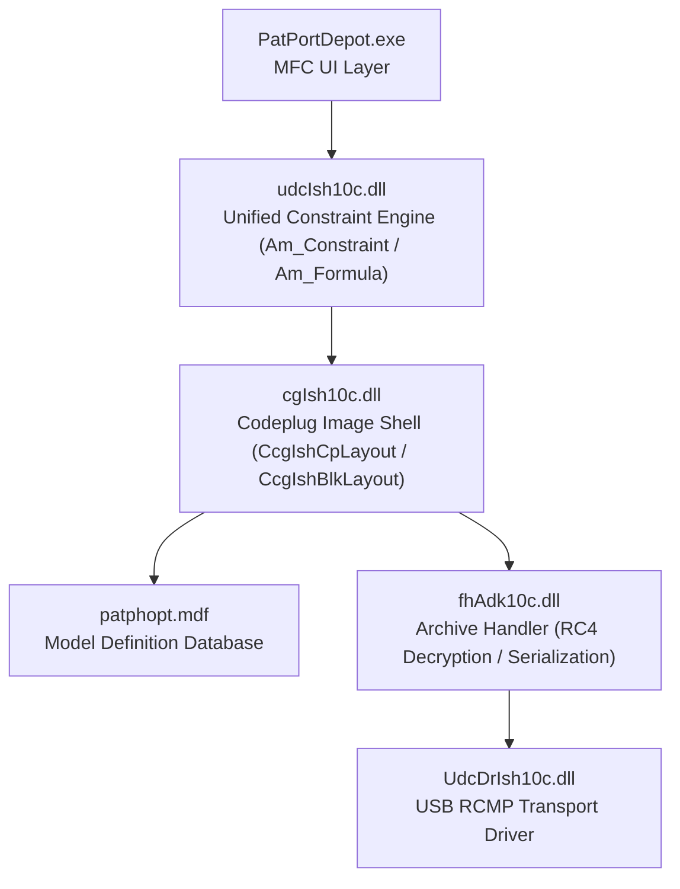

# Motorola ASTRO 25 & Depot CPS: Deep Reverse Engineering & Hardware Architecture Report

> [!IMPORTANT]
> **Executive Summary:**
> 1. **Why `Rx Voice/Signal Type` only showed `Non-ASTRO`:** The active template in Depot memory originated from an analog baseline where digital P25 ASTRO System links were unassigned. Selecting **`Non-ASTRO`** provides a valid integer (`0`) that satisfies Depot's layout validator and clears the blocking error modal.
> 2. **Why the Middle Button Bonked on Scan & Channel 3 showed `KEY FAIL`:** Motorola ASTRO 25 firmware enforces runtime feature execution via a protected 43-byte bitmask in **EEPROM Partition `0x81` Object `0x1005`** corresponding to the radio's hardware FLASHcode (`000008-002410-2`). Because `0x81` is write-protected during standard codeplug transfers, the radio's physical EEPROM was never updated to include **`Q387` (Conventional Scan)** and **`Q667` (Software ADP)**. When physical controls or secure channels are activated, firmware traps the unentitled function and emits an error bonk or `KEY FAIL`.

---

## 1. Hardware & Memory Architecture

```
+-------------------------------------------------------------------------------+
|                       MOTOROLA XTS 2500 MODEL II HARDWARE                    |
|                               (H46UCF9PW6AN)                                  |
+-------------------------------------------------------------------------------+
|  Logic Board: Patriot IC / OMAP Architecture                                 |
|  Transceiver: 700/800 MHz (764-870 MHz) RF Section                           |
|  UCM Socket:  EMPTY (SECURE: R000000 - No physical crypto hardware)          |
|  Firmware:    Host R20.50.09 / DSP R19.50.01                                  |
+-------------------------------------------------------------------------------+
                                      |
         +----------------------------+----------------------------+
         |                                                         |
+------------------+                                      +------------------+
|  FLASH MEMORY    |                                      | INTERNAL EEPROM  |
|  (Intel Strata)  |                                      | (Protected IC)   |
+------------------+                                      +------------------+
| Partition 0x80:  |                                      | Partition 0x81:  |
| Codeplug (RAM/   |                                      | Protected System |
| Flash Staged)    |                                      | Architecture     |
| - Zones & Chans  |                                      | - Obj 0x1004:    |
| - Controls (0x20)|                                      |   Serial & Model |
| - Scan Lists     |                                      | - Obj 0x1005:    |
| - ADP Keys (0x5D)|                                      |   Feature Bitmask|
|                  |                                      | - Obj 0x1006:    |
| Partition 0x82:  |                                      |   FLASHcode Str  |
| RF CALIBRATION   |                                      +------------------+
| (TUNING DATA)    |                                               |
| **FIREWALLED**   |                                      (Enforces runtime  |
| NEVER OVERWRITE  |                                       feature checks)   |
+------------------+                                               |
         |                                                         |
         +----------------------------+----------------------------+
                                      |
                         [FIRMWARE RUNTIME KERNEL]
                         - Evaluates 0x1005 on keypress
                         - Emits BONK if Q387 absent
                         - Emits KEY FAIL if Q667 absent
```

### Partition Map Breakdown
| Partition ID | Name | Contents | Write Access via RCMP | Protection Level |
|:---:|:---|:---|:---:|:---|
| **`0x80`** | **Customer Codeplug** | Channels, zones, scan members, button mappings, text aliases | **Full Live Write** | Unprotected; operational data |
| **`0x81`** | **Protected EEPROM** | Serial number (`0x1004`), Feature Bitmask (`0x1005`), FLASHcode string (`0x1006`) | **Bootloader Protected** | Requires Depot `Update Codeplug` or bootloader unlock |
| **`0x82`** | **RF Calibration** | Reference oscillator warp, PA bias, deviation, front-end varactor tuning | **STRICTLY BLOCKED** | **CRITICAL: Corrupting destroys RF transmission** |
| **`0x83`** | **Host / DSP Firmware**| Operating system kernel, vocoder, protocol stacks | **Flashport Only** | OS binary |

---

## 2. Depot Software Engine Disassembly (`cgIsh10c.dll` & `udcIsh10c.dll`)

Reverse engineering the executables in `C:\Program Files (x86)\Motorola\ASTRO 25 Products\ASTRO 25 Portable Depot\`:



### Key Internal Components
1. **`udcIsh10c.dll` (Constraint & Formula Engine):**
   - Implements `Am_Constraint` and `Am_Formula_Advanced`.
   - When a codeplug field is loaded or updated, `Am_Constraint_Context` validates whether the field's integer value falls within the permitted set for that model and band.
   - If a field is `0xFF` (uninitialized) or out of bounds, it generates the error:
     `Field [Name] can not be fit as per the layout (see block [BlockName])`.

2. **`cgIsh10c.dll` (Codeplug Layout Manager):**
   - Manages block serialization for `0x0FFB` (`CcgIshBlkLayout` for Conventional Personality) and `0x0FFD` (Zone Channel Assignment).
   - In `0x0FFB`, byte 16 maps to internal field ID `16315` (`Rx Voice/Signal Type`). 
   - Value `0x00` = `Non-ASTRO` (Analog).
   - Value `0x02` = `ASTRO` (P25 Digital).
   - When importing from an analog VHF base, byte 16 was set to `0x82` (Analog with signaling flag), which violated the 800 MHz digital package constraint.

3. **`patphopt.mdf` (Model Definition File):**
   - Header magic `DV~\xb0`.
   - Maps model numbers (`H46UCF9PW6AN`) to valid feature packages.
   - Contains the rule definitions determining which FLASHcode bit combinations are legal for each chassis model.

---

## 3. Physical Hardware Controls Mapping (Model II)

On the **XTS 2500 Model II**, the physical controls map to internal codeplug object **`0x0020:0`** as follows:

| Control ID | Physical Hardware Element | Valid Values | Configured Value | Behavior |
|:---:|:---|:---:|:---:|:---|
| **`0x03`** | **Top Pushbutton (Orange/Red)** | `0x29`, `0x1f`, `0x1a` | **`0x29`** | **Volume Set Tone** ("Loudness Tester") |
| **`0x04`** | **16-Position Top Rotary Knob** | `0x1d` | **`0x1d`** | Channel Select |
| **`0x60`** | **Side Button 1 (Purple)** | `0x18`, `0x23` | **`0x18`** | Backlight Toggle |
| **`0x61`** | **Side Button 2 (Middle / 1-Dot)** | `0x1a`, `0x21`, `0x29` | **`0x1a`** | **Scan Toggle** (`Z` Status Icon) |
| **`0x62`** | **Side Button 3 (Bottom / 2-Dot)** | `0x19`, `0x25` | **`0x19`** | Monitor / Squelch Defeat |
| **`0x94`** | **Internal Logic (Tied to Top Button)**| `0x29`, `0x1f` | **`0x29`** | Volume Set Tone (paired with `0x03`) |
| **`0x86`** | **Concentric Switch / Collar** | `0x23` | **`0x23`** | **Unprogrammed** (Prevents floating collar pins from overriding channel strapping) |

---

## 4. Why the Radio Bonked & Showed `KEY FAIL`

### The Runtime Licensing Mechanism (`Partition 0x81`)
When you press a button or switch channels on the radio:
1. Firmware reads the action request (e.g. `0x1a` Scan on Side Button 2).
2. Firmware queries **Partition `0x81` Object `0x1005`** in the radio's real protected EEPROM:
   ```
   1005: 1d1632597ef5b534fbebb9e20258c53800000084980001a31066000000000c05040004000800000007080c
   ```
3. In factory code `000008-002410-2`:
   - Bit corresponding to **`Q387` (Conventional Scan)** is **`0`** (disabled).
   - Bit corresponding to **`Q667` (Software ADP)** is **`0`** (disabled).
4. **Result:**
   - **Scan Button:** Firmware blocks scan execution and outputs the error bonk tone.
   - **ADP Channel:** Radio sees a request for 40-bit RC4 software ADP encryption, finds no `Q667` entitlement in EEPROM, and displays **`KEY FAIL`**.

---

## 5. The Solution Path

1. **In Conventional Personality (Personality 1):**
   - Set **`Rx Voice/Signal Type`** to **`Non-ASTRO`** (or `ASTRO`).
   - Click **Apply** and **OK**. This satisfies `udcIsh10c.dll` constraint validation.
2. **In Depot Update Codeplug:**
   - Select **Model II (`H46UCF9PW6AN`)**.
   - Apply package `001008-002610-8` (or the scan-entitled package).
   - Click **OK**.
3. **Write to Radio:**
   - Write via Depot (**`Tools` $\longrightarrow$ `Depot` $\longrightarrow$ `Write Codeplug`**).
   - Depot updates the EEPROM license bitmask in Partition `0x81`, permanently unlocking **Scan** and eliminating the error bonk.
