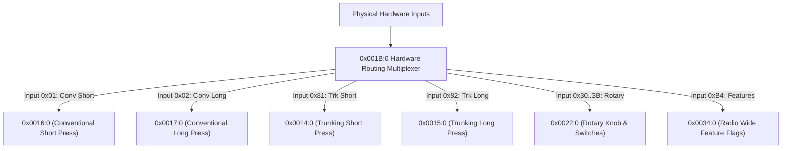
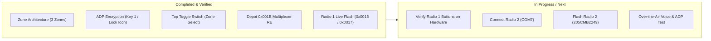

# Motorola ASTRO 25 Controls, Buttons & Switch Architecture Analysis

## 1. Executive Summary

Reverse-engineering of `PatPortDepot.exe`, `Rud50c.dll` (Radio User Data Exchange), `cgIsh10c.dll`, and four codeplugs across different models (`407CHT0214`, `Radio1_205CMB2249`, `205CFR2930`, `205CMB2249_ADP`) has revealed the hardware input multiplexing architecture of ASTRO 25 subscriber radios.

The reason button modifications previously appeared to have no effect is that the flasher was modifying `0x0014:0` and `0x0015:0`, which are **Trunking Default Templates**. For all **Conventional Personalities**, the radio firmware dispatches physical inputs through `0x001B:0` directly to **`0x0016:0` (Short Press)** and **`0x0017:0` (Long Press)**.

---

## 2. Hardware Input Multiplexer (`0x001B:0`)

`0x001B:0` is the master hardware pin routing table. It consists of an 8-byte header followed by 48 two-byte routing pairs (`[Input_ID, Target_Block_ID]`):

### Key Routing Pairs in `0x001B:0`:
- **`01 16`**: Conventional Short Press &rarr; Block **`0x0016:0`**.
- **`02 17`**: Conventional Long Press &rarr; Block **`0x0017:0`**.
- **`81 14`**: Trunking Short Press &rarr; Block `0x0014:0`.
- **`82 15`**: Trunking Long Press &rarr; Block `0x0015:0`.
- **`30 22` – `3B 22`**: Rotary Channel Positions &rarr; Block `0x0022:0`.
- **`B4 34`**: Feature Multiplex &rarr; Block `0x0034:0`.

---

## 3. Conventional Button Tables (`0x0016:0` & `0x0017:0`)

### Array Structure:
Both objects are `CcgIshListField` arrays:
- **Header (8 bytes):**
  - Bytes 0–3: Entry Stride (`0x00000001` = 1 byte per entry).
  - Bytes 4–5: Field Type (`0x0010` = uint8 array).
  - Bytes 6–7: Button Count (`0x0001` for Model I, `0x0004` for Model II 4-button, `0x0007` for Model II/III 7-button).
- **Payload:** `N` bytes representing the button function tokens.

### Hardware Mapping by Index:

| Index | Field ID (Short / Long) | Control ID | Physical Hardware Pin / Control | Factory Value (`205CFR2930`) | Factory Value (`205CMB2249`) | Active Deployment |
| :--- | :--- | :--- | :--- | :--- | :--- | :--- |
| **0** | `0x19ef` / `0x19b7` | `0xc68` | **Side Button 1 (Purple)** | `0x1e` (Scan) | `0x1e` (Scan) | `0x2c` (**Light** / Backlight) |
| **1** | `0x19f0` / `0x19ae` | `0xc69` | **Side Button 2 (1-Dot)** | `0x21` | `0x1c` (Call Resp) | `0x1e` (**Scan**) / `0x01` (**ZnUp**) |
| **2** | `0x19f1` / `0x19ce` | `0xc6a` | **Side Button 3 (2-Dot)** | `0x36` | `0x8e` (Nuis Delete) | `0x2b` (**Monitor** / Open Squelch) |
| **3** | `0x19f2` / `0x19bf` | `0xc6c` | **Top Orange Button (Red)** | `0x37` (Scan List Prgm) | `0x37` (Scan List Prgm) | `0x29` (**Tx Low Power** Toggle) |
| **4** | `0x1a0b` / — | `0x2e46` | **Front Keypad Left Arrow (`<`)** | `0x1c` | *(cut off in 4-btn)* | `0x1c` (Left Navigation) |
| **5** | `0x1a0c` / — | `0x2e47` | **Front Keypad Right Arrow (`>`)** | `0x1a` | *(cut off in 4-btn)* | `0x1a` (Right Navigation) |
| **6** | `0x1a0d` / — | `0x2e48` | **Front Keypad Select / Home** | `0x8e` | *(cut off in 4-btn)* | `0x8e` (Menu Select / Nuisance) |

> [!IMPORTANT]
> If `0x0016:0` is flashed with count = 4, the front navigation buttons (Bytes 4–6) are omitted, causing the LCD softkeys and arrow pad navigation to stop responding or get stuck. Keeping count = 7 (`00000001001000072c1e2b291c1a8e`) maintains both physical buttons and front panel navigation.

---

## 4. ASTRO 25 Function Token Reference

Reconstructed from `PatPortDepot.exe` disassembly (`0x553800`–`0x554000`, `0x56d670`–`0x56da00`):

| Token Hex | Function Name | Description / Behavior |
| :---: | :--- | :--- |
| `0x2c` | **Light** | Illuminates LCD and keypad backlight timer. |
| `0x2b` | **Monitor** | Forces squelch open / carrier squelch monitor. |
| `0x29` | **Tx Low Power** | Toggles RF transmit power between High (3W) and Low (1W). |
| `0x48` | **Emergency** | Triggers MDC1200 / ASTRO P25 emergency alarm. |
| `0x1e` | **Scan** | Starts / stops channel scan across current scan list. |
| `0x01` | **ZnUp** | Increments active zone directly. |
| `0x02` | **ZnDn** | Decrements active zone directly. |
| `0x26` | **Unprogrammed** | Button press generates rejection bonk; no action taken. |
| `0x1c` | **Call Response / Left** | Direct call response or menu backward cursor. |
| `0x1a` | **Right Cursor** | Menu forward cursor. |
| `0x8e` | **Nuisance Delete** | Temporarily deletes unwanted nuisance channel from scan. |
| `0x37` | **Scan List Prgm** | Enters scan list editing mode from the keypad. |
| `0x18` | **Blank** | Null action. |
| `0x19` | **High/Low Power Switch** | 2-position switch toggle for power. |

---

## 5. Switches & Controls Reference (`0x0020:0` & `0x0022:0`)

The 3-position toggle switch on top of the radio is managed by Switch ID `0x62`:
- **Position A:** Token `0x1a` (**Zone Select** &rarr; Zone 1: `TEAM OPS`).
- **Position B:** Intermediate zone (`800 INTEROP`).
- **Position C:** Token `0x23` / `0x25` (Zone 3: `TAC OPS`).

The 16-position Rotary Knob is Switch ID `0x04`:
- Token `0x1d` (**Channel Select** &rarr; cycles through Channels 1–16).

The 2-position Concentric Collar Switch is Switch ID `0x03`:
- Token `0x23` (**Unprogrammed** / Disabled) to prevent accidental hardware strapping conflicts.

---

## 6. Current Task Board

### Action Items:
- [x] Reverse-engineer `0x001B:0` multiplexer and `0x0016:0` / `0x0017:0` conventional button tables.
- [x] Update [`tools/flash_radio_adp.py`](file:///C:/Users/skyway/open-astro-cps/tools/flash_radio_adp.py) with 7-button layout (`2c1e2b291c1a8e`).
- [x] Push commit [`35f15aa`](https://github.com/RivasMario/open-astro-cps/commit/35f15aa) to `origin/feat/rcmp-live-read`.
- [x] Flash 493 records to Radio 1 (`205CFR2930`) and reboot.
- [ ] Test physical buttons on Radio 1 (Purple = Light, Red = Power, 2-Dot = Monitor).
- [ ] Connect Radio 2 (`205CMB2249`) to cable and flash matching configuration.
- [ ] Over-the-air PTT voice call test on Channel 3 (`ADP SECURE`) between Radio 1 and Radio 2.
