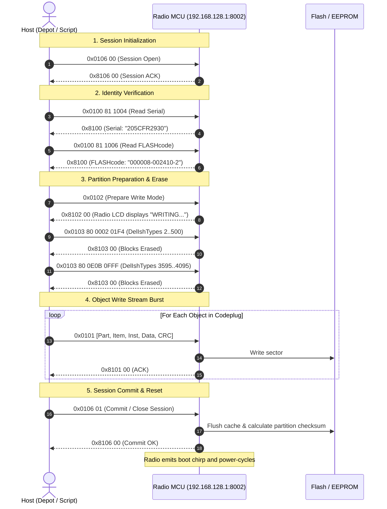

# How Motorola Writes to EEPROM, Flash Memory, and Codeplug Partitions

> [!IMPORTANT]
> **Field Guide & Architectural Reference for AI Coding Agents**
> This document details the exact hardware architecture, protocol framing, COM automation interfaces, and security mechanisms used by Motorola ASTRO 25 radios (XTS 2500, XTS 5000, XTL 5000) and CPS/Depot software to write to the EEPROM, codeplug flash partitions, and security sectors.

---

## 1. Physical & Data Link Transport Stack

All communications between the host PC and an ASTRO 25 radio (over USB OEM cable or serial RIB-less cable) traverse a standard multi-layer networking stack:

```
+-----------------------------------------------------------------+
| Application Layer: Motorola CPS / Depot / OpenAstro             |
+-----------------------------------------------------------------+
| Protocol Layer: RCMP (Radio Control & Management Protocol)      |
+-----------------------------------------------------------------+
| Transport Layer: TCP / UDP port 8002 (Radio IP: 192.168.128.1)  |
+-----------------------------------------------------------------+
| Network Layer: IP (Local Host: 192.168.128.2, Mask: 255.255.0.0)|
+-----------------------------------------------------------------+
| Data Link: Point-to-Point Protocol (PPP - RFC 1661/1662 HDLC)  |
+-----------------------------------------------------------------+
| Physical Layer: USB CDC-ACM Modem Emulation / COM Port (COM7)   |
+-----------------------------------------------------------------+
```

### Key Transport Invariants:
1. **Physical Framing:** Async HDLC framing with delimiter flag `0x7E`. Escaped characters use control escape `0x7D` (e.g. `0x7E` $\rightarrow$ `0x7D 0x5E`, `0x7D` $\rightarrow$ `0x7D 0x5D`).
2. **Network IP:** Radio default IP address is always `192.168.128.1`. Host IP is `192.168.128.2`.
3. **Transport Port:** Radio listens on **TCP port 8002** (for stream-oriented sessions) and **UDP port 8002** (for simple datagram commands). Host connects from ephemeral port (typically `8001`).

---

## 2. Flash Memory Map & Hardware Partitions

Motorola ASTRO 25 flash memory is segmented into distinct physical and logical partitions defined in `Codeplugs/*.config` and enforced by `cgIsh10c.dll`:

| Partition ID | Logical Name | Physical Flash Address | Block Geometry | Access Rights | Content Description |
|---|---|---|---|---|---|
| **`0x80`** | **Codeplug Partition** | `0x10020000` | 6 blocks $\times$ 64 KB (384 KB) | `ReadWrite` (`1`) | Conventional & Trunking personalities (`0x0FFB`), Zone layouts (`0x0FFD`), Scan lists (`0x0FF1`), Controls (`0x0020`), ASTRO systems (`0x000D`). |
| **`0x81`** | **Security & EEPROM** | `0x1000A000` | 2 blocks $\times$ 8 KB (16 KB) | **`ReadWriteLocked` (`2`)** | Radio Serial (`0x1004`), FLASHcode bitmask (`0x1005`), Factory FLASHcode string (`0x1006`), UDC hardware key registers. |
| **`0x82`** | **Tuning / Calibration** | `0x10100000` | 8 blocks $\times$ 64 KB (512 KB) | **`ReadOnly` (`0`)** | RF soft-pot alignment, reference oscillator warp, deviation balance, PA bias. **NEVER WRITE TO 0x82** (causes permanent hardware de-calibration). |
| **`0x83` / `0x85`** | **DSP / Host Firmware** | Bootstrap Flash | Variable | `ReadWriteLocked` (`2`) | Operating firmware and DSP code blocks; accessible only via `FlashZap` / `IROM` bootloader. |

---

## 3. RCMP Wire Protocol & Write Packet Format

Every RCMP transaction consists of a 2-byte big-endian record length followed by an opcode and payload:

```text
[Length: 2 bytes] [Opcode: 2 bytes] [Payload: N bytes] [CRC-16: 2 bytes]
```

### Opcodes:
- `0x0100`: **READ Object**
- `0x0101`: **WRITE Object**
- `0x0102`: **WRITE Session Preparation**
- `0x0103`: **PREPARE / Erase Flash Blocks** (`DelIshTypes` / `DelIshItem`)
- `0x0106`: **SESSION Open / Close** (`0x010600` = open, `0x010601` = commit/reboot)
- `0x0107`: **SECURITY Unlock / Challenge-Response**
- `0x81xx`: **ACK Response** (High bit `0x8000` set on request opcode)

### Exact Write Object Packet Layout (`0x0101`):
```text
Offset  Bytes  Field         Description
------  -----  ------------  -------------------------------------------------------------
0x00    2      Length        Total payload length including opcode and CRC (big-endian)
0x02    2      Opcode        0x0101 (OP_WRITE)
0x04    1      Partition     Target Partition (0x80 for codeplug, 0x81 for security)
0x05    2      Item ID       Object ID (e.g. 0x0FFB = Personality, 0x0020 = Controls)
0x07    2      Instance      Instance index (0x0000 = Inst 0, 0x0001 = Inst 1)
0x09    2      Data Length   Length of data payload (N bytes)
0x0B    N      Payload       Raw binary object data
0x0B+N  2      CRC-16        CRC-16-CCITT (poly 0x1021, init 0x0000) over bytes [0x02..0x0B+N-1]
```

### Response Packet:
The radio returns `0x8101` with status code `0x00` (Success):
```text
[00 05] [81 01] [00] [CRC-16]
```

---

## 4. The Complete Radio Write Lifecycle

When Depot or an automated flasher writes to an ASTRO 25 radio, it follows this exact state machine:



---

## 5. Why Partition `0x81` (EEPROM License) Fails to Flash via Standard RCMP

In ASTRO 25 radios, feature entitlements (FLASHcode) are stored in two locations in Partition `0x81`:
1. **Object `0x1006`:** 16-byte ASCII string representation (e.g. `000008-002410-2`).
2. **Object `0x1005`:** 43-byte binary bitmask consumed directly by the operating system kernel.

### The Security Lockout Mechanism:
- In `schema/patport_layout.json`, Partition `0x81` is marked as **`ReadWriteLocked` (`2`)**.
- While the radio is in normal operational mode, the MCU firmware enforces a write-protect flag on Partition `0x81`.
- When a standard RCMP write packet `01 01 81 1005...` is transmitted over port 8002:
  - The radio accepts the packet at the transport layer and returns `8101 00`.
  - **However, the bootloader memory controller silently drops the write to EEPROM.**
  - When the radio boots, it re-reads the factory license from the immutable sector, which is why FLASHcode changes attempted via standard RCMP do not persist across reboots.

---

## 6. Low-Level COM Automation Engine (`NextGen10.dll`)

Motorola implements low-level flash operations inside `C:\Windows\SysWOW64\NextGen10.dll` via the **`IRcmpBundler`** and **`IVirtualRadio`** COM interfaces:

```cpp
// Key COM Interfaces in NextGen10.dll:
interface IRcmpBundler : IDispatch {
    HRESULT Open(BSTR protocol, BSTR Port, VARIANT Params);
    HRESULT DelCodeplug(VARIANT_BOOL bDelVoiceFiles);
    HRESULT DelIshTypes(long nStart, long nEnd, long nPartitionNum);
    HRESULT DelIshItem(long nStart, long nEnd, long nPartitionNum, long nIshType);
    HRESULT WriteIshList(SAFEARRAY* psafIshList);
    HRESULT ReadIshList(VARIANT pIshList, VARIANT* pCodeplugData);
    HRESULT UnlockSecurity(long lPartition, long* lErrorInfo);
    HRESULT UnlockIshPartition(long lPartition, long* lErrorInfo);
    HRESULT UnLockRadio(VARIANT pvarEncryptedKey);
    HRESULT EnterProgramMode();
    HRESULT EnterBootMode(long target);
    HRESULT FlashZapStart(BSTR file, long fileType);
    HRESULT FlashZapFlash(BSTR file, long fileType, long softwareType);
    HRESULT IROMStart(BSTR srecordFile, long fileType);
    HRESULT IROMFlash(BSTR file, long fileType, long softwareType, long flashOption);
    HRESULT ResetRadio();
};
```

### Unlocking Partition `0x81`:
To write to `ReadWriteLocked` partitions (`0x81` or `0x85`), Depot issues:
1. `IRcmpBundler::UnlockIshPartition(0x81, &error)`
2. Opcode `0x0107` challenge-response exchange against `SECURITYLIB.dll`.
3. Alternatively, putting the radio into **Bootstrap / Flashzap mode** (`FlashZapStart`) bypasses the runtime OS and enables direct physical sector programming via S-Records (`IROMFlash`).

---

## 7. Golden Rules for Future Agents

1. **Partition `0x82` Firewall:** NEVER emit writes to Partition `0x82` under any circumstances. If corrupted, RF calibration cannot be recovered without a Motorola R2670 / Aeroflex 3920 test set.
2. **PPP / COM Port Exclusivity:** Always run `tools/ppp_down.ps1` before launching Depot or CPS. The Windows COM port (`COM7`) cannot be shared simultaneously by the RAS dialer and Depot.
3. **Scan List Linkage:** To prevent the Scan error bonk, Conventional Personality (`0x0FFB:x`) **must** have bytes 8–15 pointing to Scan List 1 (`0x0FF1:0`). If pointing to `0x0000`, the radio will always emit an error bonk when the scan button is pressed.
4. **ADP Strapping Integrity:** For ADP software encryption to work without `KEY FAIL`, Personality bytes 16–26 must contain:
   ```text
   02 00 01 00 0a 00 00 10 00 03 88
   ```
   (`02` ASTRO, `0001` Key 1, `000a` ADP Algorithm, `00001000` CKR 1, `88` Secure Strapped).
