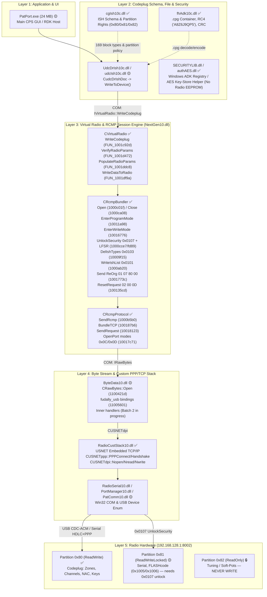
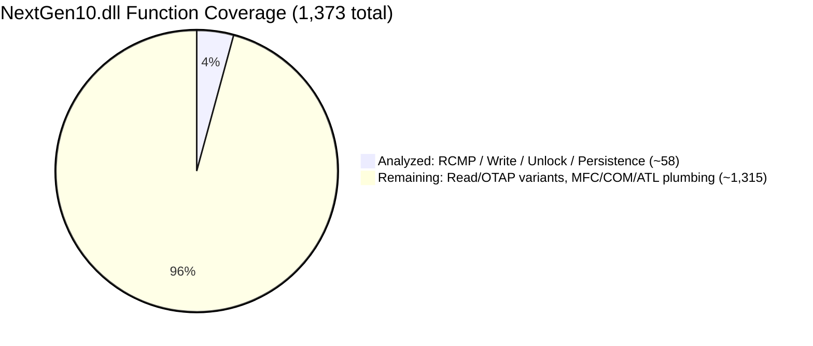

# ASTRO 25 CPS — Logical Architecture & Decompilation Status Map

> Visual status of all DLLs, subsystems, and decompiled/analyzed functions across the original Motorola ASTRO 25 Portable CPS (`R20.01.00`), partitioned by the software's layered design.

---

## 1. End-to-End Software Architecture & Write/EEPROM Path

---

## 2. Logical Partition Status & Function Coverage

| Logical Partition | Binary / Module | Total Non-Thunk Functions | Analyzed / Decompiled | Status | What Is Understood vs Remaining |
|---|---|---|---|---|---|
| **1. UI & App Host** | `PatPort.exe` (24 MB) | Large MFC GUI | Strings + key offsets | 🟡 Partial | Opcode strings, RC4 key literal, zone/channel error strings known; full GUI not needed for CLI/flasher |
| **2. Schema & File Format** | `cgIsh10c.dll` | — | Schema + CRC-16 + access rights | ✅ Done | All 169 block types, partition access rights (`0x80` RW, `0x81` RWLocked, `0x82` RO), field constructors |
| **2. Schema & File Format** | `fhAdk10c.dll` | — | `.cpg` container + RC4 | ✅ Done | `.cpg` header, object directory, 40-bit RC4 (`A8Z6J9QP5`), per-object CRC |
| **2. Schema & File Format** | `UdcDrIsh10c.dll` / `udcIsh10c.dll` | — | Exported symbols + `WriteToDevice` | 🟡 Partial | Packs codeplug image into SAFEARRAY and calls `IVirtualRadio::WriteCodeplug` (`+0x28`) |
| **3. RCMP & Virtual Radio** | `NextGen10.dll` (245 KB) | **1,373** | **~58** core protocol/write/unlock funcs | ✅ Core Done | `SendRcmp`, `UnlockSecurity` (`0x0107` + LFSR `0x51E88D21`), `WriteCodeplug`, `Send ReOrg`, `ResetRequest`, `WriteIshList`, `DelIshTypes`, `OpenPort` (`0x0C`/`0x0D`) |
| **4. Byte & Socket Glue** | `ByteData10.dll` (131 KB) | **415** | **10** (Batch 1 + Batch 2) | 🟡 In Progress | `CRawBytes::Open` (`1100421d`), `fudally_usb` (`11005601`), Batch 2 inner handlers (`110032cf`, `11004c07`, `11004c4b`, etc.) |
| **4. Custom PPP / TCP** | `RadioCustStack10.dll` (122 KB) | **382** | Core USNET PPP + chat | ✅ Done | USNET embedded TCP/IP, `PPPConnect@1000ee10`, `PPPHandshake@1000ef60` (`CLIENT`/`CLIENTSERVER`), async-HDLC framing |
| **4. Serial & Port Enum** | `RadioSerial10.dll`, `PortManager10.dll`, `PatComm10.dll` | Small wrappers | Exports & role | 🟡 Role Known | Win32 `CreateFile`/`SetCommState` and USB/COM port enumeration |
| **5. Security & Legacy Protocols** | `SECURITYLIB.dll`, `authAES.dll`, `RemoteProtocols01.dll`, `EncatenComponent.dll`, `otaprwcdtimer.dll` | — | Batches 4–6 | ✅ Done | `SECURITYLIB.dll` is Windows Registry/XML UI gating (`SOFTWARE\Motorola\ADK\Security`, `SPS.DAT`); `authAES.dll` is AES key-store test/wrapper (`encrypt_function`/`decrypt_function`); zero radio EEPROM/RCMP logic |

---

## 3. `NextGen10.dll` Functional Partitioning (1,373 Non-Thunk Functions)

The ~58 analyzed functions in `NextGen10.dll` cover the **entire RCMP/VirtualRadio write & persistence control plane**; the remaining ~1,315 functions are MFC/ATL boilerplate, COM dispatch stubs, string/variant helpers, and OTAP/read-only variants:

### Analyzed Functions by Logical Role

| Role | Functions (`NextGen10.dll`) | Persistence / Radio Effect |
|---|---|---|
| **Top-Level Write Orchestration** | `CVirtualRadio::WriteCodeplug` (`1001c92d`), `VerifyRadioParams` (`1001d472`), `PopulateRadioParams` (`1001ddc8`), `WriteDataToRadio` (`1001df9a`), `WriteOTAPDataToRadio` (`1001ff23`), `FUN_1001d137`, `FUN_1001f273` | Validates radio params/UUID, prepares codeplug array, drives `CRcmpBundler` write & commit sequence |
| **Session & Mode State** | `Open` (`1000c01f`), `Close` (`1000ca08`), `EnterProgramMode` (`10011a98`), `EnterWriteMode` (`10016776`), `EnterBootMode` (`1000d794`), `EnterTestMode` (`100119d5`), `ResetRequest` (`100135cd`) | Opens RCMP session (`0x0106`), switches radio mode, sends reset (`[02, 00, 0D]`) to finalize/reboot |
| **Security & Partition 0x81** | `UnlockSecurity` (`1000cce7`), `FUN_1000fd89` (LFSR), `FUN_100133df`, `GetRadioUUID` (`10009fe9`), `ReadWriteRadioSerialNumber` (`1000ace8`), `ReadWriteRadioModelNumber` (`1000b08b`) | `0x0107` challenge/response (`0x51E88D21` LFSR) required before `0x81` writes persist across reboot |
| **ISH Erase, Write & ReOrg** | `DelCodeplug` (`10009c7e`), `DelIshItem` (`10009e3f`), `DelIshTypes` (`10009f15`), `WriteIshList` (`1000ab20`), `ReadWriteIshLetToRadio` (`1000beb6`), `Send ReOrg` (`1001773c`), `FUN_100177e1` (CRC-16) | Erases target ISH ranges (`0x0103`), writes ISH objects (`0x0101`), sends `Send ReOrg` (`01 07 80 00`) |
| **RCMP Wire & Port Modes** | `SendRcmp` (`1000b5b0`), `SendCommand` (`1000b8b5`, `1000ba53`), `BundleTCP` (`100187b6`), `SendRequest` (`10018123`), `OpenPort` (`10017c71`), `LoadServer` (`1000b2ad`) | Frames 2-byte BE TCP records (`<= 0x410` chunks) and passes transport modes `0x0C`/`0x0D` to `ByteData10.dll` |

---

## 4. Detailed AI Function Logs

- Batch 1 (20 functions): [HOMELAB_AI_EEPROM_PERSISTENCE_ANALYSIS.md](HOMELAB_AI_EEPROM_PERSISTENCE_ANALYSIS.md)
- Batch 2 (26 inner callees): [HOMELAB_AI_EEPROM_BATCH2.md](HOMELAB_AI_EEPROM_BATCH2.md)
